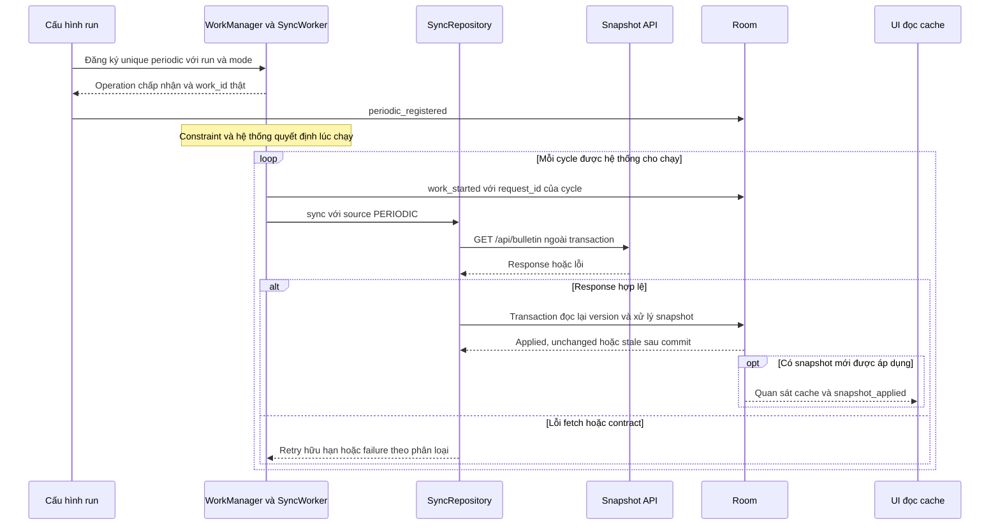
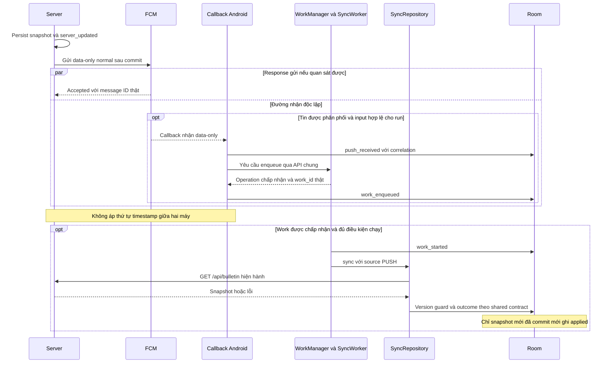

# Tổng hợp cơ chế đồng bộ nền — SEM-19

Tuấn (`mtuan2491`), khởi tạo 03/11, **chốt tổng hợp ngày 06/11/2026 (UTC+7)**. Đã nhận và đối chiếu SEM-11..18, gồm phần silent push SEM-15. Đây là tài liệu cơ chế và phản biện; kết quả thực nghiệm phải dẫn run riêng. [CHECKS](evidence/SEM-19/CHECKS.md) ghi nghiệm thu tài liệu, [INPUT_REVIEW](evidence/SEM-19/INPUT_REVIEW.md) ghi revision nguồn và cách chuẩn hóa chi tiết khác nhau.

## 1. Câu hỏi và phạm vi seminar

Khi app bảng tin không hiển thị, làm sao snapshot mới trên server đi vào cache điện thoại? Cần trả lời riêng: **ai tạo tín hiệu, ai cho phép công việc chạy và khi nào dữ liệu đã commit**.

Theo [SCOPE](SCOPE.md) và [PLAN](PLAN.md), Background Fetch trong đề tài là khái niệm lấy dữ liệu nền, được minh họa bằng periodic WorkManager. Silent Push là tín hiệu FCM data-only để app yêu cầu đồng bộ, không tạo thông báo hiển thị trong demo. Đây là cách ánh xạ của project Android, không phải một API chung cho Android và iOS.

| Mode của run | Trigger tự động được bật | Câu hỏi cần kiểm chứng |
|---|---|---|
| `PERIODIC` | Periodic, không gửi push | Lịch được đăng ký khác gì lần worker chạy thật? |
| `PUSH` | Push, tắt periodic | Sau callback, worker có chạy và cache có đổi trong cửa sổ không? |
| `HYBRID` | Cả periodic và push | Khi cố ý bỏ gửi push, periodic có cập nhật khi đủ điều kiện không? |

`MANUAL` là source kiểm tra/setup, được gắn nhãn và loại khỏi kết quả nền. `source` chỉ nguyên nhân của logical sync, `mode` là cấu hình ca thử; ví dụ `source=PUSH, mode=HYBRID` hoàn toàn hợp lệ. Các quy tắc này thuộc [SHARED_SYNC](mechanisms/SHARED_SYNC.md) và [EVENT_SCHEMA](EVENT_SCHEMA.md).

## 2. Bảng thuật ngữ dùng thống nhất

| Thuật ngữ | Nghĩa trong project | Phân biệt cần giữ |
|---|---|---|
| Trigger | Tín hiệu yêu cầu công việc | Có tín hiệu chưa chứng minh worker chạy. |
| Scheduler / WorkManager | Lưu và điều phối yêu cầu công việc theo điều kiện hệ thống | Đăng ký lịch chưa phải thực thi. |
| Worker / sync core | Công việc lấy snapshot và xử lý cache | Worker bắt đầu chưa phải dữ liệu đã lưu. |
| Snapshot / cache | Trạng thái bản tin toàn bộ trên server / bản lưu cục bộ trong Room | UI đọc cache; cache có thể cũ hơn server. |
| `version` / `version_hint` | Version thật của snapshot / gợi ý đi kèm push | Hint không có quyền thay dữ liệu cache. |
| Idempotence | Lặp lại tác động logic không tạo dữ liệu trùng hoặc làm sai trạng thái | Không đồng nghĩa mọi trigger chỉ tạo đúng một HTTP request. |
| Coalesce | Gom các yêu cầu thích hợp | Phải giữ tín hiệu mới đến khi worker đang kết thúc. |
| Retry / backoff | Thử lại lỗi tạm thời / khoảng chờ giữa các lần thử | Không retry lỗi vĩnh viễn vô hạn. |
| `run_id` / `request_id` | Lượt thí nghiệm / một yêu cầu sync logic | Một run có thể có nhiều request. |
| `work_id` | ID WorkManager thật | Periodic có thể giữ ID qua nhiều cycle; mỗi cycle có request ID riêng. |
| `signal_ids` / `message_id` | ID tín hiệu ứng dụng / ID do FCM cấp | Không tự đặt FCM ID hoặc ép hai nguồn có cùng chuỗi ID. |
| UTC / monotonic | Đồng hồ tường / thời gian trôi qua nội bộ thiết bị | Không trừ hai clock khác máy hoặc qua reboot tùy tiện. |

Nguồn định nghĩa và bất biến của project: [SHARED_SYNC](mechanisms/SHARED_SYNC.md), [API](API.md), [EVENT_SCHEMA](EVENT_SCHEMA.md). Đây là quy tắc thiết kế, không phải xác nhận code đã tuân thủ mọi mục.

## 3. Luồng periodic: từ lịch đến cache

Sơ đồ mô tả **luồng mục tiêu**, không phải trace của run đã đo. Phần periodic được tổng hợp từ [SEM-17](mechanisms/PERIODIC_FETCH.md) và [SEM-14](mechanisms/SHARED_SYNC.md).

WorkManager cho phép interval tối thiểu 15 phút; thời điểm thực thi còn phụ thuộc constraint và tối ưu của hệ thống. Constraint `CONNECTED` chỉ là điều kiện lập lịch, không xác nhận server/API truy cập được. Đăng ký unique work giúp kiểm soát một lịch logic; cần chờ operation và kiểm WorkInfo thật khi ghi nhận đăng ký. Nguồn: [Define work requests](https://developer.android.com/develop/background-work/background-tasks/persistent/getting-started/define-work), [Managing work](https://developer.android.com/develop/background-work/background-tasks/persistent/how-to/manage-work).

Trong project, tên event chuẩn là `periodic_registered`; mốc này phải tách khỏi `work_started` và `snapshot_applied`. Không dùng force-run, test driver hoặc MANUAL để tạo bằng chứng periodic tự nhiên. Cách vận hành và quan sát nằm ở [PERIODIC](PERIODIC.md); E01/E03/E04 nằm ở [protocol](../experiments/PROTOCOL.md).

## 4. Luồng push: từ server đến cache

Sơ đồ là **luồng hợp lệ có nhận callback**, tổng hợp từ [SEM-15](mechanisms/SILENT_PUSH.md), [SEM-18](mechanisms/SERVER_FCM.md), SEM-14 và contract SEM-26. Đã đối chiếu payload, callback, lifecycle và event; các chi tiết blueprint được chuẩn hóa tại [INPUT_REVIEW](evidence/SEM-19/INPUT_REVIEW.md). Các nhánh gửi lỗi, chưa biết kết quả hoặc input bị từ chối không được trình bày như sync thành công.

Với baseline `AndroidConfig` v1, notification, data-only và mixed có đường xử lý khác nhau khi app ở nền. Bảng mô tả routing khi message đã được phân phối theo điều kiện nền tảng, không bảo đảm phân phối sau force-stop hay khi cấu hình sai.

| Payload v1 | Foreground | Background | Phù hợp demo |
|---|---|---|---|
| Notification | Callback; app xử lý hiển thị | Thông báo vào system tray | Không dùng cho silent sync. |
| Data-only | `onMessageReceived` | `onMessageReceived` khi được phân phối | Baseline, callback offload sang worker. |
| Notification + data | Callback nhận hai phần | Notification ở tray, data trong launcher intent khi người dùng tương tác | Không dùng để chứng minh sync nền không cần mở UI. |

Nguồn: [SEM-15, bảng payload](mechanisms/SILENT_PUSH.md), [Firebase receive messages](https://firebase.google.com/docs/cloud-messaging/android/receive-messages). Callback có cửa sổ ngắn; không coi các mốc 50/100ms trong ví dụ là SLA của Android. Chuyển tác vụ kéo dài cho WorkManager, không chạy GET/transaction dài tùy ý trong callback.

Normal priority có thể bị trì hoãn trong Doze. Project giữ normal priority cho tín hiệu đồng bộ và không dùng high priority để che độ trễ; đó là baseline thử nghiệm theo [SCOPE](SCOPE.md), phù hợp [hướng dẫn priority](https://firebase.google.com/docs/cloud-messaging/android-message-priority). Không suy sự bảo đảm giao tin từ một lần demo thành công. Sơ đồ chỉ mở rộng nhánh input hợp lệ; callback sai run/payload phải được xử lý theo contract, không mặc định enqueue.

Theo EVENT_SCHEMA, callback có run/config xác định nhưng trigger không hợp mode ghi receipt rồi `trigger_rejected`. Input không xác định được run/config ghi diagnostic local ngoài dataset; không tự gán run hiện hành hoặc fallback mode PUSH. Trong run hợp lệ, `source=PUSH`, mode là PUSH hoặc HYBRID đã capture; `version_hint` là gợi ý và data payload không phải snapshot đã commit.

Server persist thành công và gửi push là hai thao tác khác nhau. Nếu gửi lỗi hoặc cố ý bỏ gửi, snapshot vẫn tồn tại cho GET. FCM trả message ID chỉ xác nhận chấp nhận để phân phối, chưa chứng minh app nhận. TTL giới hạn thời gian giữ tin, không đặt deadline hoàn tất worker. Nguồn: [SEM-18](mechanisms/SERVER_FCM.md), [Message lifespan](https://firebase.google.com/docs/cloud-messaging/customize-messages/setting-message-lifespan).

Các nhóm nguyên nhân từ SEM-15 được dùng để đặt câu hỏi, không phải lỗi đã quan sát trên thiết bị nhóm:

| Nhóm | Evidence cần kiểm | Không tự kết luận |
|---|---|---|
| Lỗi config/IAM/token hoặc provider từ chối | Sender result và mã lỗi an toàn | Có accepted nếu chưa gọi/nhận response thật. |
| Offline, đường mạng hoặc Google Play services | Kiểm kết nối server và FCM riêng; manifest cấu hình | ADB reverse tới server đồng nghĩa có Internet/receipt. |
| Doze, standby hoặc stopped state | Trạng thái OS và mốc người dùng mở lại nếu force-stop | Màn hình tắt là Doze, hoặc hybrid vượt stopped. |
| Tin pending, TTL/collapse hoặc giới hạn phân phối | Payload/config và event của run | Timeout đủ chứng minh tin bị mất hoặc TTL đã hết. |
| Chính sách OEM | Hồ sơ OS/cấu hình và run thật | OPPO đã có hành vi cụ thể khi hồ sơ còn Not run. |
| App đã nhận nhưng input/work/cache chưa thành công | Receipt, rejection/enqueue/start/fetch/commit theo correlation | Mọi cache cũ đều do FCM không giao tin. |

## 5. Ranh giới bằng chứng và đồng bộ dùng chung

Tên event lấy từ schema `2.0.0`; bảng là **quy tắc đọc log**, chưa xác nhận mọi event đã được instrument đúng trong một build.

| Event | Bằng chứng tối thiểu | Chưa chứng minh |
|---|---|---|
| `server_updated` | Snapshot/version và event đã commit theo API | Đã gửi push hoặc app nhận dữ liệu. |
| `push_send_accepted` | Response thành công của lần gửi FCM thật | Delivered, worker start hoặc cache đổi. |
| `push_send_unknown` | Có send attempt nhưng chưa biết response | Rejected hoặc delivered. |
| `push_received` | Callback thực sự nhận message | Enqueue thành công. |
| `periodic_registered` / `work_enqueued` | Đăng ký lịch / enqueue one-time được chấp nhận | Worker bắt đầu. |
| `work_started` | Worker thực sự bắt đầu | GET thành công hoặc snapshot mới. |
| `snapshot_fetch_completed` | Kết quả HTTP tương ứng `network_call_id` | Transaction cache đã commit. |
| `snapshot_applied` | Cache/version và event commit cùng transaction | Mọi push đều được xử lý riêng. |
| `snapshot_unchanged` / `snapshot_stale` | Version bằng / thấp hơn cache theo contract | Có lần áp dụng dữ liệu mới. |
| `sync_retrying` / `sync_failed` | Lỗi được phân loại, còn lượt thử / phải dừng | Đã áp dụng dữ liệu. |

Theo [SHARED_SYNC](mechanisms/SHARED_SYNC.md) và [API](API.md), GET ở ngoài transaction; sau GET phải đọc lại cached version trong transaction để response cũ không ghi đè một commit mới hơn. Áp dụng version lớn hơn; equal giữ items; thấp hơn giữ cache và ghi stale. Snapshot rỗng vẫn có metadata version riêng. Đây là bất biến của demo, không phải cơ chế Room tự suy ra; [Room Transaction](https://developer.android.com/reference/androidx/room/Transaction) cung cấp ranh giới transaction.

Correlation theo [EVENT_SCHEMA](EVENT_SCHEMA.md): `run_id + device_alias + signal_id` nối tín hiệu hai phía; `request_id` nối logical sync và retry; mỗi GET có `network_call_id`. Giữ FCM ID thật hoặc null, không nối chỉ bằng version/timestamp. UI mở lại chỉ đọc Room, không tự GET để làm đẹp kết quả nền.

`KEEP`/`REPLACE` hoặc version guard riêng lẻ không phải chứng cứ rằng một cập nhật mới luôn được giữ qua race/process death. REPLACE hủy work cũ theo [Managing work](https://developer.android.com/develop/background-work/background-tasks/persistent/how-to/manage-work). Tại base đã đọc, [SyncWorkEnqueuer](../android/app/src/main/java/com/thanhtris/seminarie307/sync/SyncWorkEnqueuer.kt) dùng one-time `enqueue` cho MANUAL/PUSH; SEM-19 không gọi blueprint unique policy của nguồn khác là hành vi đã tích hợp. Yêu cầu giữ tín hiệu mới phải truy về chiến lược triển khai và E05-C/test logic thật.

Android ghi `elapsed_realtime_ms` để tính khoảng thời gian trong cùng device và cùng `boot_session_id` khác null. UTC liên server/điện thoại phải kiểm clock offset trước khi tính latency; thiếu event hoặc thiếu clock không được gán duration bằng 0. Cơ sở: [SystemClock](https://developer.android.com/reference/android/os/SystemClock), [quy tắc đo của protocol](../experiments/PROTOCOL.md).

## 6. Lifecycle và giới hạn cần giải thích

Bảng này tóm lược [ma trận SEM-16](../experiments/PROTOCOL.md), không phải kết quả chạy các trạng thái trên máy thật.

| Tình huống | Phân biệt cần giữ | Bằng chứng/giới hạn của demo |
|---|---|---|
| Foreground | UI đang hiển thị | Dùng control/setup; MANUAL không tính là đồng bộ nền. |
| Background bằng Home | App không hiển thị, process có thể còn | E01/E02 theo dõi trigger và cache trước mở lại. |
| Process death | PID biến mất khác package stopped | Ghi cách tạo trạng thái; `am kill` là mô phỏng, không đại diện mọi lần OS thu hồi process. |
| Vuốt recent | Xóa task khỏi Recents | Kiểm task/PID/stopped thực tế; không mặc định thành force-stop trên mọi OEM. |
| Force-stop | Package bị stopped | Không coi hybrid là cách vượt stopped; tách mốc người dùng mở lại và phục hồi sau đó. |
| Tắt màn hình | Một điều kiện của thiết bị | Chưa đủ gọi là Doze; cần đọc idle state. |
| Doze đã xác nhận | Có giới hạn nền của hệ thống | E03 tách trước/trong/sau idle; không hứa periodic hoặc normal push chạy tức thời. |

Nguồn nền tảng: [Processes and app lifecycle](https://developer.android.com/guide/components/activities/process-lifecycle), [Doze and App Standby](https://developer.android.com/training/monitoring-device-state/doze-standby). Điều kiện FCM Android cần mở lại sau force-quit trong Settings được ghi ở [Firebase receive messages](https://firebase.google.com/docs/cloud-messaging/flutter/receive-messages); chỉ tham khảo điều kiện nền tảng, không dùng callback Flutter cho Kotlin.

## 7. Phiên bản và cấu hình được dùng làm cơ sở

Thông tin được đối chiếu lại tại base tiếp nhận `a26d270` chứa main `319cc67`, ngày 06/11/2026; không phải kiểm build/thiết bị trong SEM-19. [INPUT_REVIEW](evidence/SEM-19/INPUT_REVIEW.md) lưu các revision nguồn.

| Phần | Cơ sở hiện có | Giới hạn |
|---|---|---|
| Android | [app build](../android/app/build.gradle.kts): package `com.thanhtris.seminarie307`, minSdk 24, compile/target 37; [version catalog](../android/gradle/libs.versions.toml): WorkManager 2.12.0, Room 2.8.5, Firebase BoM 35.1.0 | Không dùng version trong một CHECKS cũ để khẳng định cấu hình APK đang chạy. |
| FCM | [SEM-15](mechanisms/SILENT_PUSH.md): HTTP v1, `AndroidConfig` v1, data-only, normal | Đã đối chiếu routing và giới hạn; không trộn callback AndroidConfigV2 hoặc xem normal là cam kết tức thời. |
| HTTP / event | [API](API.md) và [EVENT_SCHEMA](EVENT_SCHEMA.md) khai báo `2.0.0` | Đặc tả không tự chứng nhận client/server tuân thủ; giữ [delta SEM-26](evidence/SEM-26/CHECKS.md). |
| Emulator của Vinh | [DEVICES](environment/DEVICES.md): Android 17 / runtime API 37, có Google Play services; probe server/mạng đã ghi | Kiểm môi trường không phải run push/periodic hoặc kết quả thiết bị của SEM-19. |
| OPPO Find X9 | Hồ sơ SEM-12 ghi chưa có máy để kiểm | Android/API/ColorOS và hành vi OEM chưa xác nhận. |
| Firebase/server | [SEM-13](environment/SERVER_FIREBASE.md) ghi môi trường host và blocker quyền/config tại lần kiểm | Không suy quyền gửi hay receipt từ transport probe; setup/run sau phải ghi trạng thái mới. |
| API/server đã bàn giao sau hồ sơ môi trường | [SETUP](SETUP.md), [M1 SEM-28](evidence/SEM-28/M1.md), [API](API.md) | Có mã app/server và hồ sơ manual; đây không phải bằng chứng periodic/push tự nhiên hoặc một run mới của SEM-19. |
| TTL/collapse | [SEM-16](../experiments/PROTOCOL.md): baseline TTL 24 giờ, không đặt collapse key | Là cấu hình protocol cần đối chiếu candidate, không phải payload đã gửi trong SEM-19. |

## 8. Giả thuyết và evidence còn cần

| Luận điểm cần kiểm | Case / đầu ra liên quan | Trạng thái trong SEM-19 |
|---|---|---|
| Lịch đăng ký khác thời điểm worker chạy | E01/E03, SEM-29/41/42 | Cơ sở tài liệu; chưa đo trong task này. |
| Nhận push khác hoàn tất sync | E02/E04, SEM-34/41/42 | Cơ chế đã đối chiếu SEM-15/18; kết quả runtime cần run thật. |
| Duplicate/stale/race không làm sai cache | E05, SEM-38/39/36 | Bất biến thiết kế; không lấy sơ đồ làm test Pass. |
| Periodic có thể bổ sung cơ hội cập nhật khi bỏ gửi push | E06, SEM-40/36/41 | Giả thuyết hybrid; skip có chủ ý không chứng minh FCM mất tin. |
| OEM/idle ảnh hưởng quan sát trên cấu hình thử | SEM-12/16/42 | Chờ máy và run thật; không suy rộng mọi Android. |

Bộ tổng hợp đã nhận đủ nguồn để bàn giao phần cơ chế cho SEM-50. Câu hỏi và đáp án ở [QUESTIONS](QUESTIONS.md) đã đối chiếu cùng contract. Số liệu, latency, tỷ lệ thành công và kết luận runtime phải bổ sung từ run có provenance; không tự tạo trong SEM-19. Hybrid bổ sung cơ hội cập nhật khi được phép, không được gọi là tối ưu nhất hoặc vượt chính sách nền chỉ từ thiết kế này.
