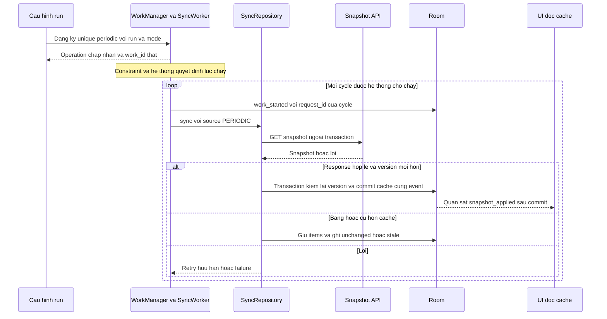
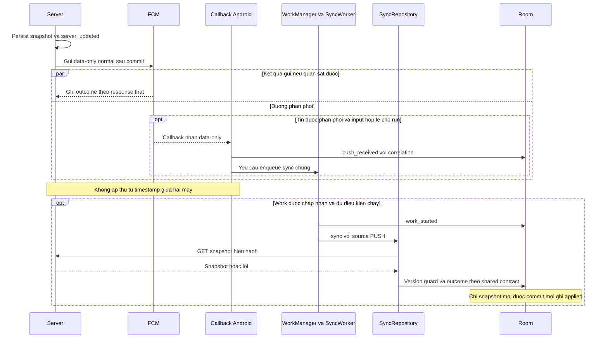

# Tổng hợp cơ chế đồng bộ nền — SEM-19

Tuấn (`mtuan2491`), ngày **03/11/2026 (UTC+7)**. **Bản làm trước phần độc lập**, phục vụ tổng hợp và phản biện; chưa phải bàn giao cuối SEM-19 hoặc kết quả thực nghiệm. [CHECKS và phần còn chờ](evidence/SEM-19/CHECKS.md) ghi phạm vi kiểm chứng.

## 1. Câu hỏi và phạm vi seminar

Khi app bảng tin không hiển thị, làm sao snapshot mới trên server đi vào cache điện thoại? Cần trả lời riêng: **ai tạo tín hiệu, ai cho phép công việc chạy và khi nào dữ liệu đã commit**.

Theo [SCOPE](SCOPE.md) và [PLAN](PLAN.md), Background Fetch trong đề tài là khái niệm lấy dữ liệu nền, được minh họa bằng periodic WorkManager. Silent Push là tín hiệu FCM data-only để app yêu cầu đồng bộ, không tạo thông báo hiển thị trong demo. Đây là cách ánh xạ của project Android, không phải một API chung cho Android và iOS.

| Mode của run | Trigger tự động được bật | Câu hỏi cần kiểm chứng |
|---|---|---|
| `PERIODIC` | Periodic, không gửi push | Lịch được đăng ký khác gì lần worker chạy thật? |
| `PUSH` | Push, tắt periodic | Sau callback, worker có chạy và cache có đổi trong cửa sổ không? |
| `HYBRID` | Cả periodic và push | Khi cố ý bỏ gửi push, periodic có cập nhật khi đủ điều kiện không? |

`MANUAL` là source kiểm tra/setup, được gắn nhãn và loại khỏi kết quả nền. `source` chỉ nguyên nhân của logical sync, `mode` là cấu hình ca thử; ví dụ `source=PUSH, mode=HYBRID` hoàn toàn hợp lệ. Các quy tắc này thuộc [SHARED_SYNC](mechanisms/SHARED_SYNC.md) và [EVENT_SCHEMA](EVENT_SCHEMA.md).

## 2. Bảng thuật ngữ dùng thống nhất

| Thuật ngữ | Nghĩa trong project | Phân biệt cần giữ |
|---|---|---|
| Trigger | Tín hiệu yêu cầu công việc | Có tín hiệu chưa chứng minh worker chạy. |
| Scheduler / WorkManager | Lưu và điều phối yêu cầu công việc theo điều kiện hệ thống | Đăng ký lịch chưa phải thực thi. |
| Worker / sync core | Công việc lấy snapshot và xử lý cache | Worker bắt đầu chưa phải dữ liệu đã lưu. |
| Snapshot / cache | Trạng thái bản tin toàn bộ trên server / bản lưu cục bộ trong Room | UI đọc cache; cache có thể cũ hơn server. |
| `version` / `version_hint` | Version thật của snapshot / gợi ý đi kèm push | Hint không có quyền thay dữ liệu cache. |
| Idempotence | Lặp lại tác động logic không tạo dữ liệu trùng hoặc làm sai trạng thái | Không đồng nghĩa mọi trigger chỉ tạo đúng một HTTP request. |
| Coalesce | Gom các yêu cầu thích hợp | Phải giữ tín hiệu mới đến khi worker đang kết thúc. |
| Retry / backoff | Thử lại lỗi tạm thời / khoảng chờ giữa các lần thử | Không retry lỗi vĩnh viễn vô hạn. |
| `run_id` / `request_id` | Lượt thí nghiệm / một yêu cầu sync logic | Một run có thể có nhiều request. |
| `work_id` | ID WorkManager thật | Periodic có thể giữ ID qua nhiều cycle; mỗi cycle có request ID riêng. |
| `signal_ids` / `message_id` | ID tín hiệu ứng dụng / ID do FCM cấp | Không tự đặt FCM ID hoặc ép hai nguồn có cùng chuỗi ID. |
| UTC / monotonic | Đồng hồ tường / thời gian trôi qua nội bộ thiết bị | Không trừ hai clock khác máy hoặc qua reboot tùy tiện. |

Nguồn định nghĩa và bất biến của project: [SHARED_SYNC](mechanisms/SHARED_SYNC.md), [API](API.md), [EVENT_SCHEMA](EVENT_SCHEMA.md). Đây là quy tắc thiết kế, không phải xác nhận code đã tuân thủ mọi mục.

## 3. Luồng periodic: từ lịch đến cache

Sơ đồ mô tả **luồng mục tiêu**, không phải trace của run đã đo. Phần periodic được tổng hợp từ [SEM-17](mechanisms/PERIODIC_FETCH.md) và [SEM-14](mechanisms/SHARED_SYNC.md).

WorkManager cho phép interval tối thiểu 15 phút; thời điểm thực thi còn phụ thuộc constraint và tối ưu của hệ thống. Constraint `CONNECTED` chỉ là điều kiện lập lịch, không xác nhận server/API truy cập được. Đăng ký unique work giúp kiểm soát một lịch logic; cần chờ operation và kiểm WorkInfo thật khi ghi nhận đăng ký. Nguồn: [Define work requests](https://developer.android.com/develop/background-work/background-tasks/persistent/getting-started/define-work), [Managing work](https://developer.android.com/develop/background-work/background-tasks/persistent/how-to/manage-work).

Trong project, tên event chuẩn là `periodic_registered`; mốc này phải tách khỏi `work_started` và `snapshot_applied`. Không dùng force-run, test driver hoặc MANUAL để tạo bằng chứng periodic tự nhiên. Cách vận hành và quan sát nằm ở [PERIODIC](PERIODIC.md); E01/E03/E04 nằm ở [protocol](../experiments/PROTOCOL.md).

## 4. Luồng push: từ server đến cache

Sơ đồ dưới là **khung logic từ SEM-14, SEM-18 và contract SEM-26**, chưa thay tài liệu silent push do SEM-15 sở hữu. Khi nhận SEM-15, cần đối chiếu lại loại payload, callback, lifecycle và giới hạn trong mục này; không yêu cầu Trang cùng sửa file tổng hợp.

Với baseline `AndroidConfig` v1, notification, data-only và mixed có đường xử lý khác nhau khi app ở nền. Data-only đi qua `onMessageReceived`; callback có cửa sổ ngắn nên công việc kéo dài được bàn giao cho WorkManager. Demo không coi một thông báo bị tắt tiếng là data-only. Nguồn: [Receive messages in Android apps](https://firebase.google.com/docs/cloud-messaging/android/receive-messages).

Normal priority có thể bị trì hoãn trong Doze. Project giữ normal priority cho tín hiệu đồng bộ và không dùng high priority để che độ trễ; đó là baseline thử nghiệm theo [SCOPE](SCOPE.md), phù hợp [hướng dẫn priority](https://firebase.google.com/docs/cloud-messaging/android-message-priority). Không suy sự bảo đảm giao tin từ một lần demo thành công. Sơ đồ chỉ mở rộng nhánh input hợp lệ; callback sai run/payload phải được xử lý theo contract, không mặc định enqueue.

Server persist thành công và gửi push là hai thao tác khác nhau. Nếu gửi lỗi hoặc cố ý bỏ gửi, snapshot vẫn tồn tại cho GET. FCM trả message ID chỉ xác nhận chấp nhận để phân phối, chưa chứng minh app nhận. TTL giới hạn thời gian giữ tin, không đặt deadline hoàn tất worker. Nguồn: [SEM-18](mechanisms/SERVER_FCM.md), [Message lifespan](https://firebase.google.com/docs/cloud-messaging/customize-messages/setting-message-lifespan).

## 5. Ranh giới bằng chứng và đồng bộ dùng chung

Tên event lấy từ schema `2.0.0`; bảng là **quy tắc đọc log**, chưa xác nhận mọi event đã được instrument đúng trong một build.

| Event | Bằng chứng tối thiểu | Chưa chứng minh |
|---|---|---|
| `server_updated` | Snapshot/version và event đã commit theo API | Đã gửi push hoặc app nhận dữ liệu. |
| `push_send_accepted` | Response thành công của lần gửi FCM thật | Delivered, worker start hoặc cache đổi. |
| `push_send_unknown` | Có send attempt nhưng chưa biết response | Rejected hoặc delivered. |
| `push_received` | Callback thực sự nhận message | Enqueue thành công. |
| `periodic_registered` / `work_enqueued` | Đăng ký lịch / enqueue one-time được chấp nhận | Worker bắt đầu. |
| `work_started` | Worker thực sự bắt đầu | GET thành công hoặc snapshot mới. |
| `snapshot_fetch_completed` | Kết quả HTTP tương ứng `network_call_id` | Transaction cache đã commit. |
| `snapshot_applied` | Cache/version và event commit cùng transaction | Mọi push đều được xử lý riêng. |
| `snapshot_unchanged` / `snapshot_stale` | Version bằng / thấp hơn cache theo contract | Có lần áp dụng dữ liệu mới. |
| `sync_retrying` / `sync_failed` | Lỗi được phân loại, còn lượt thử / phải dừng | Đã áp dụng dữ liệu. |

Theo [SHARED_SYNC](mechanisms/SHARED_SYNC.md) và [API](API.md), GET ở ngoài transaction; sau GET phải đọc lại cached version trong transaction để response cũ không ghi đè một commit mới hơn. Áp dụng version lớn hơn; equal giữ items; thấp hơn giữ cache và ghi stale. Snapshot rỗng vẫn có metadata version riêng. Đây là bất biến của demo, không phải cơ chế Room tự suy ra; [Room Transaction](https://developer.android.com/reference/androidx/room/Transaction) cung cấp ranh giới transaction.

Correlation theo [EVENT_SCHEMA](EVENT_SCHEMA.md): `run_id + device_alias + signal_id` nối tín hiệu hai phía; `request_id` nối logical sync và retry; mỗi GET có `network_call_id`. Giữ FCM ID thật hoặc null, không nối chỉ bằng version/timestamp. UI mở lại chỉ đọc Room, không tự GET để làm đẹp kết quả nền.

Android ghi `elapsed_realtime_ms` để tính khoảng thời gian trong cùng device và cùng `boot_session_id` khác null. UTC liên server/điện thoại phải kiểm clock offset trước khi tính latency; thiếu event hoặc thiếu clock không được gán duration bằng 0. Cơ sở: [SystemClock](https://developer.android.com/reference/android/os/SystemClock), [quy tắc đo của protocol](../experiments/PROTOCOL.md).

## 6. Lifecycle và giới hạn cần giải thích

Bảng này tóm lược [ma trận SEM-16](../experiments/PROTOCOL.md), không phải kết quả chạy các trạng thái trên máy thật.

| Tình huống | Phân biệt cần giữ | Bằng chứng/giới hạn của demo |
|---|---|---|
| Foreground | UI đang hiển thị | Dùng control/setup; MANUAL không tính là đồng bộ nền. |
| Background bằng Home | App không hiển thị, process có thể còn | E01/E02 theo dõi trigger và cache trước mở lại. |
| Process death | PID biến mất khác package stopped | Ghi cách tạo trạng thái; `am kill` là mô phỏng, không đại diện mọi lần OS thu hồi process. |
| Vuốt recent | Xóa task khỏi Recents | Kiểm task/PID/stopped thực tế; không mặc định thành force-stop trên mọi OEM. |
| Force-stop | Package bị stopped | Không coi hybrid là cách vượt stopped; tách mốc người dùng mở lại và phục hồi sau đó. |
| Tắt màn hình | Một điều kiện của thiết bị | Chưa đủ gọi là Doze; cần đọc idle state. |
| Doze đã xác nhận | Có giới hạn nền của hệ thống | E03 tách trước/trong/sau idle; không hứa periodic hoặc normal push chạy tức thời. |

Nguồn nền tảng: [Processes and app lifecycle](https://developer.android.com/guide/components/activities/process-lifecycle), [Doze and App Standby](https://developer.android.com/training/monitoring-device-state/doze-standby). Điều kiện FCM Android cần mở lại sau force-quit trong Settings được ghi ở [Firebase receive messages](https://firebase.google.com/docs/cloud-messaging/flutter/receive-messages); chỉ tham khảo điều kiện nền tảng, không dùng callback Flutter cho Kotlin.

## 7. Phiên bản và cấu hình được dùng làm cơ sở

Đây là thông tin đọc từ artifact tại base `5e1c643550e35aee5f08cd74002be038ee3d4b9e`, không phải kiểm build/thiết bị trong SEM-19.

| Phần | Cơ sở hiện có | Giới hạn |
|---|---|---|
| Android | [app build](../android/app/build.gradle.kts): package `com.thanhtris.seminarie307`, minSdk 24, compile/target 37; [version catalog](../android/gradle/libs.versions.toml): WorkManager 2.12.0, Room 2.8.5, Firebase BoM 35.1.0 | Không dùng version trong một CHECKS cũ để khẳng định cấu hình APK đang chạy. |
| FCM | HTTP v1, `AndroidConfig` v1, data-only, normal | Giữ phạm vi baseline; không trộn callback AndroidConfigV2. SEM-15 cần bàn giao để đối chiếu cuối. |
| HTTP / event | [API](API.md) và [EVENT_SCHEMA](EVENT_SCHEMA.md) khai báo `2.0.0` | Đặc tả không tự chứng nhận client/server tuân thủ; giữ [delta SEM-26](evidence/SEM-26/CHECKS.md). |
| Emulator của Vinh | [DEVICES](environment/DEVICES.md): Android 17 / runtime API 37, có Google Play services; probe server/mạng đã ghi | Kiểm môi trường không phải run push/periodic hoặc kết quả thiết bị của SEM-19. |
| OPPO Find X9 | Hồ sơ SEM-12 ghi chưa có máy để kiểm | Android/API/ColorOS và hành vi OEM chưa xác nhận. |
| Firebase/server | [SEM-13](environment/SERVER_FIREBASE.md) ghi môi trường host và blocker quyền/config tại lần kiểm | Không suy quyền gửi hay receipt từ transport probe; setup/run sau phải ghi trạng thái mới. |
| TTL/collapse | [SEM-16](../experiments/PROTOCOL.md): baseline TTL 24 giờ, không đặt collapse key | Là cấu hình protocol cần đối chiếu candidate, không phải payload đã gửi trong SEM-19. |

## 8. Giả thuyết và evidence còn cần

| Luận điểm cần kiểm | Case / đầu ra liên quan | Trạng thái trong SEM-19 |
|---|---|---|
| Lịch đăng ký khác thời điểm worker chạy | E01/E03, SEM-29/41/42 | Cơ sở tài liệu; chưa đo trong task này. |
| Nhận push khác hoàn tất sync | E02/E04, SEM-34/41/42 | Khung cơ chế; chờ SEM-15 và evidence runtime. |
| Duplicate/stale/race không làm sai cache | E05, SEM-38/39/36 | Bất biến thiết kế; không lấy sơ đồ làm test Pass. |
| Periodic có thể bổ sung cơ hội cập nhật khi bỏ gửi push | E06, SEM-40/36/41 | Giả thuyết hybrid; skip có chủ ý không chứng minh FCM mất tin. |
| OEM/idle ảnh hưởng quan sát trên cấu hình thử | SEM-12/16/42 | Chờ máy và run thật; không suy rộng mọi Android. |

Bản này có thể dùng ngay để chuẩn bị phần mở bài, thuật ngữ và phản biện. Trước bàn giao cuối cho SEM-50: nhận SEM-15 cùng CHECKS, đối chiếu lại mục push và câu hỏi liên quan, ghi delta nếu có. Số liệu, latency, tỷ lệ thành công và kết luận runtime chỉ bổ sung từ run có provenance; không tự tạo trong SEM-19.
