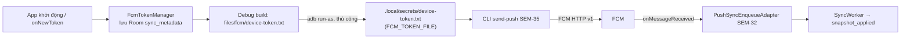

# PUSH — Token FCM, gửi silent push và đọc kết quả

Tài liệu vận hành cho luồng **silent push** (data-only, normal priority) của app Android `com.thanhtris.seminarie307` và CLI sender SEM-35. Bàn giao của [SEM-33](../tasks/backlog/SEM-33.md); kiểm chứng ở [CHECKS SEM-33](evidence/SEM-33/CHECKS.md).

> [!IMPORTANT]
> Chưa có Firebase project, credential và token thật được xác nhận trong repo ([SEM-13](environment/SERVER_FIREBASE.md), blocker B1). Mọi lệnh dưới đây là quy trình chạy khi đã có cấu hình thật; chưa chạy ở máy nào thì CHECKS ghi **Not run**. Không đưa token, `google-services.json` hay service-account key vào Git, log, chat hoặc evidence public.

## 1. Tổng quan luồng



Không có API đăng ký token trên server snapshot: ánh xạ thiết bị ↔ token là **file local do người chạy cung cấp** cho sender. Khi token đổi, phải lấy lại token vào `FCM_TOKEN_FILE` (mục 4).

## 2. Vòng đời token trong app

Code: [`FcmTokenManager.kt`](../android/app/src/main/java/com/thanhtris/seminarie307/fcm/FcmTokenManager.kt), được gọi từ [`SeminarApp`](../android/app/src/main/java/com/thanhtris/seminarie307/SeminarApp.kt) (khởi động) và [`BulletinFirebaseMessagingService.onNewToken`](../android/app/src/main/java/com/thanhtris/seminarie307/fcm/BulletinFirebaseMessagingService.kt).

| Tình huống | Hành vi | `fcmTokenStatus` |
|---|---|---|
| Có `google-services.json`, lấy token thành công | Lưu token vào Room `sync_metadata`, ghi fingerprint, thời điểm UTC, nguồn (`STARTUP`/`ON_NEW_TOKEN`) | `READY` |
| Token mới khác token đã lưu | Thay token, lưu `fcmTokenPreviousFingerprint`, tăng `fcmTokenRefreshCount` | `READY` |
| Token giống token đã lưu | Không đổi gì ngoài `fcmTokenSource` | `READY` |
| Thiếu `google-services.json` (Firebase không khởi tạo được) | Không crash, không dùng token hardcode | `FIREBASE_NOT_CONFIGURED` |
| `FirebaseMessaging.token` thất bại | Giữ token cũ (nếu có) nhưng đánh dấu không còn chắc chắn hiện hành | `FETCH_FAILED` |
| Token rỗng, có khoảng trắng hoặc dài hơn 8192 ký tự | Từ chối, không lưu | `INVALID_TOKEN` |

Quy tắc an toàn:

- **Không bao giờ log token thô.** Logcat chỉ có `fingerprint` (16 ký tự hex đầu của SHA-256 UTF-8 của token) với tag `FcmTokenManager`. Code cũ ghi token ra Logcat (tag `FCM_TOKEN`, `BulletinFCM`) đã bị loại bỏ.
- Room không chứa token trong export/timeline; token chỉ nằm ở bảng `sync_metadata` nội bộ. `allowBackup=false` và rule backup loại toàn bộ dữ liệu app.
- Mọi lỗi chỉ lưu mã trạng thái an toàn, không lưu exception message.

## 3. Cấu hình Firebase local tối thiểu

1. Người quản lý Firebase xác nhận project và đăng ký Android app với package `com.thanhtris.seminarie307` ([hướng dẫn SEM-13](environment/SERVER_FIREBASE.md)).
2. Nhận `google-services.json` qua kênh riêng và đặt tại `android/app/google-services.json` (đã gitignore). Gradle chỉ áp dụng plugin `com.google.gms.google-services` khi file này tồn tại; thiếu file thì build bình thường và app báo `FIREBASE_NOT_CONFIGURED`.
3. Build debug: `cd android && ./gradlew :app:installDebug` (Windows: `gradlew.bat`). Thiết bị/emulator cần Google Play services và Internet tới FCM.
4. Mở app một lần để app lấy token. Kiểm trạng thái ở mục 4.

## 4. Lấy token cho sender (không qua Logcat)

Chỉ **debug build** ghi token vào `files/fcm/device-token.txt` trong bộ nhớ riêng của app; release build không ghi và xóa file nếu còn. Copy bằng `run-as` vào file git-ignored:

```sh
# macOS/Linux
mkdir -p .local/secrets
adb exec-out run-as com.thanhtris.seminarie307 cat files/fcm/device-token.txt > .local/secrets/device-token.txt
```

```powershell
# Windows: dùng cmd để redirect byte thô (PowerShell '>' ghi UTF-16 và sẽ làm hỏng token)
New-Item -ItemType Directory -Force .local\secrets | Out-Null
cmd /c "adb exec-out run-as com.thanhtris.seminarie307 cat files/fcm/device-token.txt > .local\secrets\device-token.txt"
```

Kiểm file khớp token app mà không in token: so fingerprint (16 ký tự đầu của SHA-256) với dòng log `FCM token stored: ... fingerprint=<...>`:

```powershell
(Get-FileHash -Algorithm SHA256 .local\secrets\device-token.txt).Hash.Substring(0,16).ToLower()
adb logcat -d -s FcmTokenManager
```

Giới hạn: `run-as` chỉ dùng được với app debuggable. Token đổi khi gỡ/cài lại app, xóa dữ liệu app (`adb shell pm clear com.thanhtris.seminarie307`), khôi phục sang thiết bị khác hoặc Firebase tự xoay vòng (`onNewToken`). Sau mỗi lần như vậy phải lặp lại bước copy; token cũ khiến sender nhận lỗi `messaging/registration-token-not-registered` (`push_send_rejected`).

## 5. Chạy sender

Chi tiết đầy đủ ở [FCM_SENDER.md](setup/FCM_SENDER.md). Tóm tắt:

```sh
export FIREBASE_PROJECT_ID="<project-id-that>"
export GOOGLE_APPLICATION_CREDENTIALS="$PWD/../.local/secrets/fcm-service-account.json"
export FCM_TOKEN_FILE="$PWD/../.local/secrets/device-token.txt"
cd server && npm ci && npm run build
npm run send-push -- --validate-only --run run-e02-01 --mode PUSH --device emulator-01 --update-id update-e02-01 --signal-id signal-e02-01 --version 1
```

Điều kiện gửi: server SEM-27 đã commit update cùng `run_id`, `mode`, `device_alias`, `update_id`, `version` (sender tự kiểm trước khi gọi SDK).

## 6. Payload (đã loại token), TTL và callback

Payload gửi qua Admin SDK ([`fcm_sender.js`](../server/src/fcm_sender.js)):

```json
{
  "data": {
    "run_id": "run-e02-01",
    "mode": "PUSH",
    "source": "PUSH",
    "version_hint": "1",
    "signal_id": "signal-e02-01"
  },
  "android": { "priority": "normal", "ttl": 86400000 }
}
```

- Token chỉ là trường `token` của message đi tới FCM; **không** nằm trong `data`, log, manifest hay event.
- Không có `notification`. Mọi giá trị `data` là string.
- TTL mặc định **86400000 ms (24 giờ)** theo [protocol](../experiments/PROTOCOL.md) (Admin SDK tính ms; HTTP v1 thô dùng `"86400s"`). Chỉ đổi bằng `--ttl-ms` khi protocol run cho phép và ghi TTL thực vào manifest.
- Phía Android, [`PushSyncEnqueueAdapter`](../android/app/src/main/java/com/thanhtris/seminarie307/fcm/PushSyncEnqueueAdapter.kt) từ chối payload có `notification`, thiếu/sai `run_id`, ghi `push_received`, kiểm mode (PERIODIC → `trigger_rejected`/`MODE_DISABLED`) rồi enqueue `SyncWorker`; callback không gọi mạng.

## 7. Phân biệt accepted / received / applied

| Mức | Event | Nguồn | Chứng minh | **Chưa** chứng minh |
|---|---|---|---|---|
| Accepted | `push_send_accepted` (kèm `message_id` thật) | SERVER | SDK/FCM nhận message để chuyển tiếp | Thiết bị online, app nhận callback, cache đổi |
| Received | `push_received` | ANDROID | `onMessageReceived` đã chạy | WorkManager enqueue thành công, snapshot đã tải |
| Applied | `snapshot_applied` | ANDROID | Room transaction commit version mới | — (chu trình hoàn tất) |

Trạng thái khác: `push_send_rejected` (token hết hạn/sai sender), `push_send_unknown` (lỗi SDK/network không đủ cơ sở kết luận), `push_send_failed_local` (thiếu cấu hình/không chứng minh được commit). Thiếu `push_received` sau `push_send_accepted` **không** tự suy ra lỗi FCM hay lỗi app; xem mục 8. Không dùng accepted để báo đã đồng bộ.

## 8. Giới hạn nhận khi app ở nền

Silent push là best-effort, không cam kết độ trễ hay giao hàng ([SILENT_PUSH.md §5–6](mechanisms/SILENT_PUSH.md)):

- **Force stop** chặn nhận cho tới khi người dùng mở lại app.
- **Doze/App Standby** có thể hoãn normal priority; không dùng high priority để lách.
- **OEM** (ví dụ ColorOS trên OPPO) có thể chặn khởi chạy nền dù FCM đã accepted.
- **TTL** hết hạn khi thiết bị offline quá lâu; FCM giữ tối đa 100 message pending mỗi token.
- **Token cũ/hết hạn** → `registration-token-not-registered`; cần lấy lại token (mục 4).
- Không có `google-services.json` hoặc Google Play services → app không lấy được token, không nhận được push.

## 9. Xử lý lỗi nhanh

| Triệu chứng | Kiểm | Hướng xử lý |
|---|---|---|
| `fcmTokenStatus=FIREBASE_NOT_CONFIGURED` | Có `android/app/google-services.json` đúng package? Build lại sau khi thêm | Thêm file, build lại; nếu chưa có thì ghi blocker, không tạo token giả |
| `FETCH_FAILED` | Internet/Play services trên thiết bị | Kiểm mạng tới FCM ([DEVICES.md](environment/DEVICES.md)), mở lại app |
| `.local/secrets/device-token.txt` rỗng/không đọc được | App debug đã mở ít nhất một lần? `run-as` báo not debuggable? | Dùng debug build; trên Windows redirect bằng `cmd /c` |
| `push_send_rejected` | Fingerprint file ≠ fingerprint log app | Lấy lại token (mục 4) |
| `push_send_failed_local` | `FIREBASE_PROJECT_ID`, credential, token file, server commit | Sửa cấu hình/chạy lại; không retry khi `push_send_unknown` trước khi xem bằng chứng |
