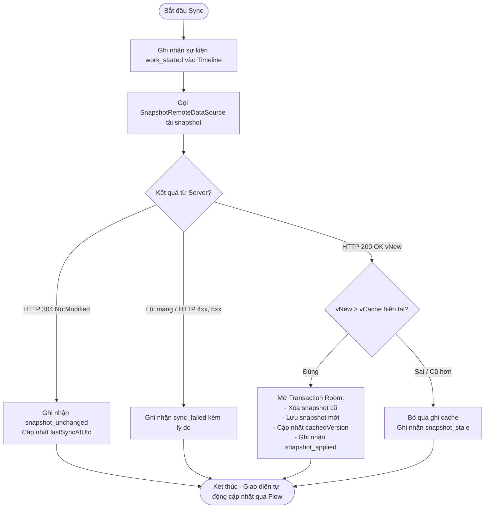

# Kiến trúc Sync Core và Room Database (Android) — SEM-25

Tài liệu này đặc tả thành phần lưu trữ cục bộ (Room Database) và lõi đồng bộ dữ liệu (`SyncRepository`, `SyncWorker`, `RealBulletinUiGateway`) trên ứng dụng Android thuộc đề tài Seminar IE307.

- **Phiên bản:** `1.0.0`
- **Kiến trúc áp dụng:** Repository Pattern + Gateway Pattern + WorkManager UDF.

---

## 1. Cơ sở dữ liệu Room (`AppDatabase`)

Cơ sở dữ liệu cục bộ được xây dựng với Room persistence library, bao gồm 3 bảng chính:

### 1.1. Bảng bản tin (`bulletin_items`)
Lưu trữ danh sách bản tin nhận được từ máy chủ sau khi đã được xác thực version guard.
- `id` (String, Primary Key): Định danh bản tin.
- `title` (String): Tiêu đề bản tin.
- `body` (String): Nội dung chi tiết.
- `version` (Long): Phiên bản của bản tin.

### 1.2. Bảng sự kiện (`timeline_events`)
Lưu trữ toàn bộ dòng thời gian diễn biến đồng bộ trên máy để hiển thị sang tab Timeline và xuất dữ liệu thực nghiệm:
- `eventId` (String, Primary Key): Mã sự kiện (UUID).
- `source` (String): `MANUAL`, `PERIODIC`, `PUSH`.
- `eventType` (String): `work_enqueued`, `work_started`, `snapshot_applied`, `snapshot_unchanged`, `snapshot_stale`, `sync_failed`.
- `occurredAtEpochMillis` (Long) & `occurredAtUtc` (String).
- `runId` (String).
- `version` (Long, nullable): Phiên bản liên quan.
- `outcome` (String) & `reason` (String).
- `requestId`, `workId`, `messageId` (Correlation IDs).

### 1.3. Bảng siêu dữ liệu (`sync_metadata`)
Lưu các giá trị cấu hình và trạng thái đồng bộ dạng Key-Value:
- `cachedVersion`: Phiên bản cache hiện tại.
- `lastSyncAtUtc`: Thời điểm hoàn thành đồng bộ gần nhất.
- `mode`: Chế độ đồng bộ đang hoạt động (`PERIODIC`, `PUSH`, `HYBRID`).

---

## 2. Luồng xử lý Version Guard trong `SyncRepository`

`SyncRepository` là trung tâm thực thi đồng bộ dùng chung cho cả 3 trigger (`MANUAL`, `PERIODIC`, `PUSH`):

---

## 3. Khởi tạo và Tích hợp Gateway (`RealBulletinUiGateway`)

- `RealBulletinUiGateway` kết nối Room DAOs với Compose UI:
  - Lắng nghe luồng dữ liệu phản ứng (`Flow`) từ `bulletinDao` và `timelineDao`. Khi Room commit dữ liệu mới, UI tự động vẽ lại mà không cần polling.
  - Cung cấp hàm `enqueueManual(context)`: tạo `OneTimeWorkRequest` giao cho Android `WorkManager`, ghi nhận sự kiện `work_enqueued` và trả về `ManualEnqueueResult.Accepted`.
