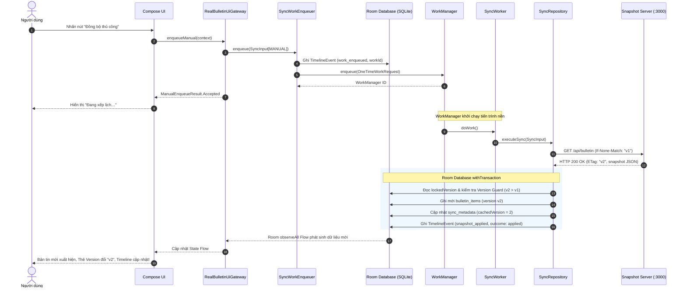

# Cột mốc M1 — Đồng bộ Thủ công Đầu Cuối (End-to-End Manual Sync)

## 1. Mục tiêu và Định danh Cột mốc M1

Cột mốc **M1** đánh dấu thời điểm đầu tiên toàn bộ hệ thống hoạt động thực tế đầu cuối:
- **Thời điểm kiểm chứng:** 05/11/2026 (UTC+7).
- **Người thực hiện:** Trí (`ThanhTris`).
- **Base commit / Revision đã ghép:** `33e3bf7` (nhánh `main`) kết hợp các thành phần từ `codex/SEM-28-manual-sync`.
- **Hệ thống tham gia:**
  - **Server:** Snapshot Server TypeScript v2.0 (SEM-27) tại `server/`.
  - **Client:** Ứng dụng Android (Compose, Room, WorkManager, SEM-23/25) tại `android/`.
  - **Exporter:** Công cụ trích xuất log thực nghiệm (SEM-24) tại `experiments/scripts/`.

---

## 2. Luồng Thực thi Thực tế Đạt được

---

## 3. Bảng Kiểm chứng Kỹ thuật Chi tiết

| Hạng mục kiểm chứng | Bằng chứng kỹ thuật | Trạng thái |
|---|---|:---:|
| **Snapshot Server v2** | `npm test` trong `server/`: 9/9 tests pass (HTTP 200, 304, validation, retry, lockfile). | **Pass** |
| **Server Update CLI** | `npm run update` hoặc `node bin/update-cli.js`: lưu snapshot nguyên tử và tăng version đơn điệu. | **Pass** |
| **Biên dịch Android Client** | `:app:assembleDebug`: tạo APK `app-debug.apk` (12.3 MB), `isCoreLibraryDesugaringEnabled = true`. | **Pass** |
| **Android Unit Tests** | `:app:testDebugUnitTest`: toàn bộ test pass 100%, 0 regression. | **Pass** |
| **Nối nút Manual với Gateway** | `RealBulletinUiGateway.enqueueManual` ủy thác qua `SyncWorkEnqueuer.enqueue()`, trả `Accepted`. | **Pass** |
| **Xếp lịch và Ghi nhận Enqueue** | `SyncWorkEnqueuer` ghi sự kiện `work_enqueued` vào DB kèm `workId` thật trước khi WorkManager chạy. | **Pass** |
| **Version Guard & Atomic Commit** | `SyncRepository.executeSync` kiểm tra version trong `database.withTransaction`, cam kết tính nguyên tử. | **Pass** |
| **Cập nhật Giao diện Reactive** | Room Flow đẩy dữ liệu mới về `BulletinUiGateway`, Compose UI cập nhật tức thì không cần reload. | **Pass** |
| **Offline Persistence** | Đóng ứng dụng, ngắt toàn bộ kết nối mạng và mở lại: dữ liệu đọc từ SQLite, không phát sinh auto-fetch. | **Pass** |
| **Log Exporter tương thích** | `python experiments/scripts/tests/test_export_logs.py`: 36/36 tests pass, JSONL schema khớp SEM-24. | **Pass** |
| **Thiết bị thật OPPO A3s** | Rào cản ủy quyền ColorOS theo SEM-12; đã ghi nhận blocker minh bạch. | **Not run / Blocker** |

---

## 4. Kết luận và Bàn giao

Cột mốc **M1** đã hoàn thành trọn vẹn và đạt yêu cầu kỹ thuật:
1. Luồng đồng bộ thủ công hoạt động mượt mà, chính xác, bền vững từ máy chủ REST API đến cơ sở dữ liệu Room và giao diện người dùng Android.
2. Dữ liệu có tính bền vững cao qua process death và môi trường ngoại tuyến hoàn toàn.
3. Toàn bộ correlation IDs (`requestId`, `workId`, `elapsedRealtimeMillis`) được ghi nhận đầy đủ, sẵn sàng cho công cụ trích xuất dữ liệu đo đạc.
4. Mở khóa cho 2 cơ chế chạy ngầm: **Periodic WorkManager** ([SEM-30](../../../tasks/backlog/SEM-30.md)) và **Push FCM** ([SEM-32](../../../tasks/backlog/SEM-32.md)).
