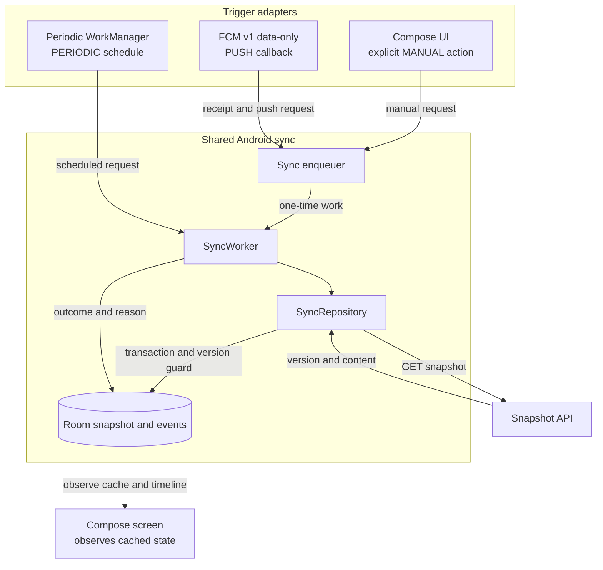
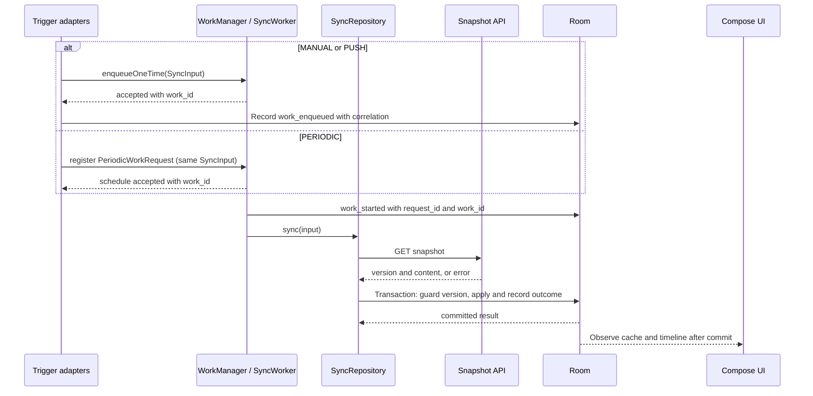

# Shared sync flow and contract

Status: design contract for SEM-14. This document describes the target behavior; it does not claim the Android app, server, or device flow has been implemented or run.

## Purpose and decisions

Periodic WorkManager, an FCM data-only callback, and an explicit manual action request the same synchronization behavior. They carry their origin into one `SyncWorker` and one `SyncRepository`; only the scheduling adapter differs. The worker fetches the current server snapshot, applies it to Room under a version guard, and records an outcome for the local timeline. The UI observes Room and never fetches from the server when opened.

This contract follows [the project scope](../SCOPE.md), [the Android build baseline](../environment/ANDROID_BUILD.md), and [the experiment protocol](../EXPERIMENT_PROTOCOL.md). SEM-14 fixes the logical input and flow. SEM-26 defines the wire format and event schema; SEM-25 maps this contract to the actual Kotlin API.

## Component flow



## End-to-end sequence



The GET stays outside the Room transaction. Inside the transaction, read the latest cached version again before applying the response; a concurrent newer commit must not be overwritten by an older response. Insert `snapshot_applied` in the same transaction as the cache update so the UI can observe it only after commit. Record unchanged, stale, and failure outcomes without claiming the snapshot was applied. The transaction boundary follows [Room's transaction contract](https://developer.android.com/reference/androidx/room/Transaction).

## Shared input and output

| Field | Contract |
|---|---|
| `source` | Required enum: `MANUAL`, `PERIODIC`, or `PUSH`; identifies what triggered this logical sync. |
| `mode` | Required enum: `PERIODIC`, `PUSH`, or `HYBRID`; captures the experiment mode when the request is accepted. |
| `run_id` | Required non-empty run identifier. Keep it unchanged from trigger through worker and events. Reject missing or malformed input; never substitute the currently active run. |
| `version_hint` | Optional non-negative `Long`. Reject a negative value. It is advisory metadata; only the version returned by the server can update cached data. |
| `request_id` | Identifier for one logical sync request. Create one for each one-time request and each periodic cycle; keep it across retries of that request. |
| `work_id` | WorkManager-generated identifier attached when the work starts. A periodic request can reuse its work ID across cycles. |
| `message_id` | FCM identifier when supplied by FCM; otherwise `null`. Never invent one. |

`source` and `mode` answer different questions. Manual sync remains `source=MANUAL` in all modes and is diagnostic work, excluded from background-result counts. `request_id` identifies an execution cycle; `work_id` identifies the WorkManager request. A new periodic cycle therefore gets a new `request_id` even if its `work_id` is unchanged.

| Operation | Input | Result |
|---|---|---|
| Enqueue one-time work | `SyncInput` for MANUAL or PUSH | `EnqueueReceipt`: accepted/rejected, reason if rejected, `request_id`, and WorkManager `work_id` once assigned. Acceptance means queued, not started or applied. |
| Register periodic work | `SyncInput` with `source=PERIODIC` plus schedule configuration owned by SEM-30 | Registration result and periodic `work_id`; each cycle invokes the same worker/core with its own `request_id`. |
| Run sync core | Valid `SyncInput` plus runtime `work_id` when available | `SyncOutcome`: `APPLIED`, `UNCHANGED`, `STALE`, `RETRY`, or `FAILURE`, with a reason and server/cache version when known. |
| Observe UI state | Room cache and local timeline query | Current cached snapshot/version, mode, latest sync state, and events filtered by `run_id`; observing does not enqueue work. |

Illustrative Kotlin pseudocode (SEM-25 chooses the concrete package, serialization, and method signatures):

```kotlin
enum class SyncSource { MANUAL, PERIODIC, PUSH }
enum class SyncMode { PERIODIC, PUSH, HYBRID }
enum class SyncOutcome { APPLIED, UNCHANGED, STALE, RETRY, FAILURE }

data class Correlation(
    val requestId: String?,
    val workId: String?,
    val messageId: String?,
)

data class SyncInput(
    val source: SyncSource,
    val mode: SyncMode,
    val runId: String,
    val versionHint: Long?,
    val correlation: Correlation,
)

data class EnqueueReceipt(
    val accepted: Boolean,
    val reason: String?,
    val correlation: Correlation,
)

interface SyncEnqueuer {
    fun enqueueOnce(input: SyncInput): EnqueueReceipt
    fun registerPeriodic(input: SyncInput, schedule: PeriodicSchedule): EnqueueReceipt
}

interface SyncRepository {
    suspend fun sync(input: SyncInput): SyncOutcome
    fun observeCachedSnapshot(): Flow<CachedSnapshot?>
    fun observeTimeline(runId: String): Flow<List<SyncEvent>>
}
```

`PeriodicSchedule`, `CachedSnapshot`, and `SyncEvent` above name conceptual values, not finalized source declarations. SEM-25 defines the core API; SEM-26 defines canonical event fields and the HTTP payload.

## Modes, version guard, and failure behavior

| Captured mode | Periodic trigger | Push trigger | Manual trigger |
|---|---:|---:|---:|
| `PERIODIC` | Enabled | Disabled | Allowed and labeled MANUAL |
| `PUSH` | Disabled | Enabled | Allowed and labeled MANUAL |
| `HYBRID` | Enabled | Enabled | Allowed and labeled MANUAL |

Reject an automated trigger that is disabled for the captured mode and record its reason. Keep the captured `mode` and `run_id` immutable; never relabel queued work when the active experiment changes. A mode/run transition stops accepting the old run's triggers and drains its work before the next run starts. If it cannot drain, mark the affected run as contaminated rather than attributing old work to the new run.

After GET, compare the response version against the current Room version inside the transaction:

- Greater version: atomically replace the cached snapshot and make `snapshot_applied` visible after commit.
- Equal version: leave snapshot rows untouched and record `snapshot_unchanged`.
- Lower version: leave cache untouched and record a stale response; version must never move backward.
- Network/transient failure: return `RETRY` with reason; permanent contract/data failure returns `FAILURE`. SEM-26 defines error details and SEM-39 implements retry limits.

If a new request arrives while a worker is active, preserve that signal so a later sync can fetch the newest server snapshot. SEM-38/39 choose the concrete coalescing and concurrency strategy; `KEEP` alone is not asserted to satisfy this requirement. A push `version_hint` can explain why a request arrived but cannot replace the GET or authorize a cache write.

The FCM callback parses the v1 data-only message, records receipt and correlation, and enqueues the shared worker. It does not perform the network sync itself. This matches Firebase's guidance for long-running message work; callback receipt, FCM accepted, worker start, and snapshot application remain distinct events ([receive messages](https://firebase.google.com/docs/cloud-messaging/android/receive-messages)).

## Ownership and handoff

| Task | Owns |
|---|---|
| [SEM-23](../../tasks/backlog/SEM-23.md) | Compose UI/config and adapter that observes Room cache; opening the screen performs no GET. |
| [SEM-25](../../tasks/backlog/SEM-25.md) | Enqueuer, shared worker/repository, Room transaction and actual Kotlin core API. |
| [SEM-30](../../tasks/backlog/SEM-30.md) | Periodic registration, unique schedule controls, and schedule configuration. |
| [SEM-32](../../tasks/backlog/SEM-32.md) / [SEM-38](../../tasks/backlog/SEM-38.md) | FCM callback, push input parsing/correlation and message-side policy. |
| [SEM-26](../../tasks/backlog/SEM-26.md) / [SEM-27](../../tasks/backlog/SEM-27.md) | HTTP endpoint/payload/error contract, canonical event schema and server behavior. |
| [SEM-36](../../tasks/backlog/SEM-36.md) / [SEM-39](../../tasks/backlog/SEM-39.md) | Mode transition, integrated behavior, coalescing/race protection and retry robustness. |

SEM-14 hands this logical contract to [SEM-19](../../tasks/backlog/SEM-19.md), [SEM-26](../../tasks/backlog/SEM-26.md) and [SEM-46](../../tasks/backlog/SEM-46.md). SEM-23, SEM-25, SEM-30 and SEM-32 reference it when implementing their parts. Any API or event-schema detail added later must remain consistent with the distinctions and invariants above.

## References

- [WorkManager work requests](https://developer.android.com/develop/background-work/background-tasks/persistent/getting-started/define-work)
- [WorkManager unique work](https://developer.android.com/develop/background-work/background-tasks/persistent/how-to/manage-work)
- [Room `Transaction`](https://developer.android.com/reference/androidx/room/Transaction)
- [Firebase: receive messages in Android apps](https://firebase.google.com/docs/cloud-messaging/android/receive-messages)
- [Project experiment protocol](../EXPERIMENT_PROTOCOL.md)
