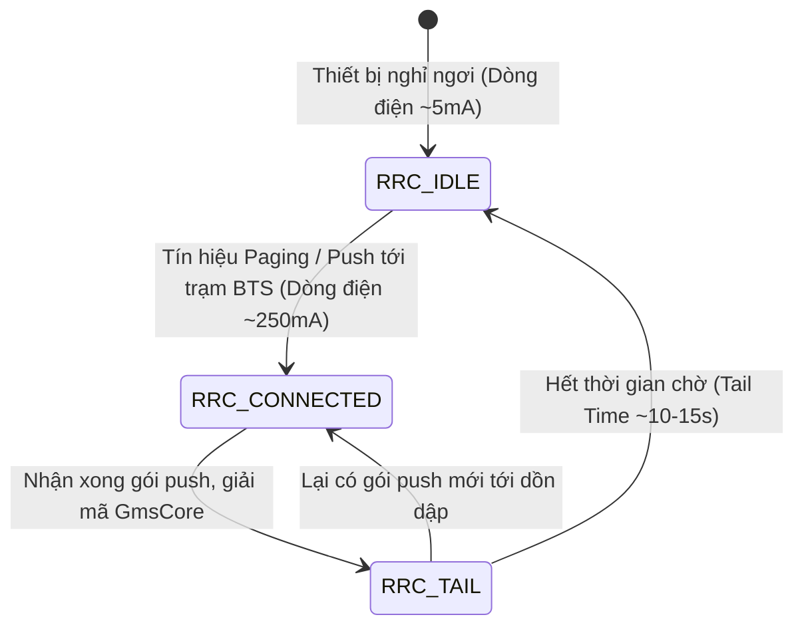
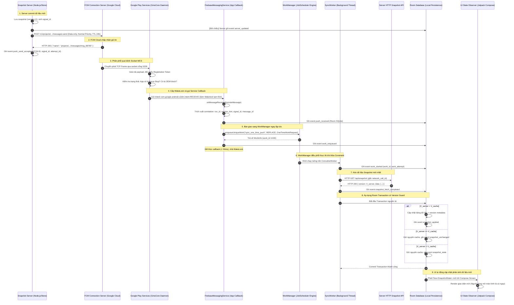
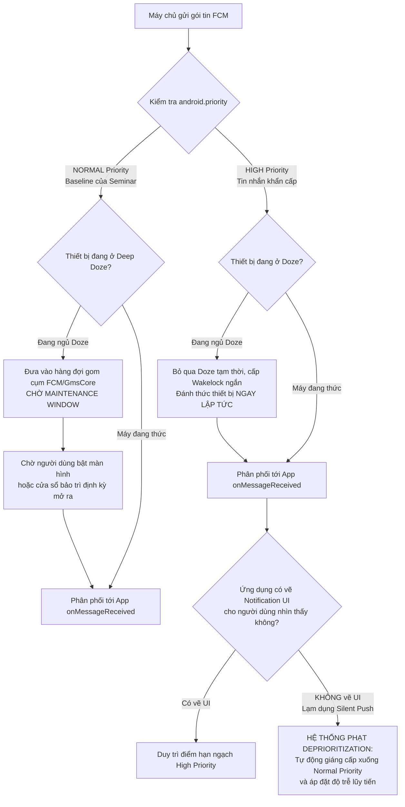
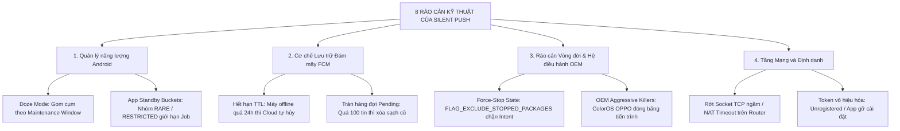

# Cơ chế Silent Push và Giới hạn FCM trên Android — Nghiên cứu chuyên sâu SEM-15

- **Tác giả:** Trang (`rosy179`).
- **Nhiệm vụ:** SEM-15 — Giải thích cơ chế silent push và giới hạn FCM.
- **Thuộc đề tài:** Seminar IE307 (Chủ đề 12: *Xử lý việc tìm nạp nền và thông báo đẩy im lặng, minh họa trên Android*).
- **Trạng thái:** Tài liệu đặc tả cơ chế kỹ thuật và nghiên cứu chuyên sâu (In-depth Technical Research & Mechanism Specification).
- **Đối chiếu nguồn:** 05/11/2026 (UTC+7).
- **Phạm vi kỹ thuật chuẩn:**
  - Giao thức: **Firebase Cloud Messaging (FCM) HTTP v1 API** (`POST https://fcm.googleapis.com/v1/projects/{project_id}/messages:send`).
  - Loại payload: **Data-only message** (không chứa `notification` object ở cấp root hoặc trong `android.notification`).
  - Mức ưu tiên: `android.priority = "NORMAL"` (tuân thủ quản lý năng lượng tự nhiên của Android, không dùng High Priority để lách Doze).
  - Vòng đời tin nhắn (TTL): `ttl = "86400s"` (24 giờ) theo chuẩn kịch bản thực nghiệm [PROTOCOL 1.0.0](../../experiments/PROTOCOL.md).
  - Môi trường Android: SDK 37 (compileSdk 37, targetSdk 37, minSdk 24), thư viện AndroidX WorkManager `2.12.0`, Firebase Android BOM `35.1.0` (`firebase-messaging`), Room `2.8.5` theo [libs.versions.toml](../../android/gradle/libs.versions.toml).
  - Đối chiếu thiết bị: Android Emulator (API 37 Google APIs) và OPPO Find X9 (ColorOS) theo [Hồ sơ SEM-12](../../docs/environment/DEVICES.md).

> [!NOTE]
> Tài liệu này được biên soạn với mức độ chi tiết học thuật và kỹ thuật cao, đóng vai trò là kim chỉ nam cho các thành viên trong nhóm triển khai code Android (SEM-32, SEM-38), backend sender (SEM-35), thiết kế bộ câu hỏi phản biện (SEM-19), đối chiếu bài báo nghiên cứu (SEM-22), chạy thử nghiệm thực tế (SEM-34, SEM-42) và chuẩn bị kịch bản thuyết trình demo (SEM-47).

---

## Mục lục chi tiết

1. [Bản chất cốt lõi: "Data-only" vs "Notification bị tắt tiếng"](#1-bản-chất-cốt-lõi-data-only-vs-notification-bị-tắt-tiếng)
2. [Kiến trúc hạ tầng: GmsCore, MCS Socket và RRC State Machine](#2-kiến-trúc-hạ-tầng-gmscore-mcs-socket-và-rrc-state-machine)
3. [Luồng xử lý đầu cuối (End-to-End Flow): Từ Server tới Room Cache](#3-luồng-xử-lý-đầu-cuối-end-to-end-flow-từ-server-tới-room-cache)
4. [Giới hạn thực thi nền trong Callback và Bàn giao sang WorkManager](#4-giới-hạn-thực-thi-nền-trong-callback-và-bàn-giao-sang-workmanager)
5. [Cơ chế Message Priority: Normal vs High và Hệ thống phạt Deprioritization](#5-cơ-chế-message-priority-normal-vs-high-và-hệ-thống-phạt-deprioritization)
6. [Hệ thống 8 nguyên nhân gây Trì hoãn hoặc Mất tín hiệu Push](#6-hệ-thống-8-nguyên-nhân-gây-trì-hoãn-hoặc-mất-tín-hiệu-push)
7. [Ranh giới nhận thức sự kiện: Bằng chứng quan sát vs Suy diễn](#7-ranh-giới-nhận-thức-sự-kiện-bằng-chứng-quan-sát-vs-suy-diễn)
8. [Hướng dẫn triển khai chi tiết cho các thành viên (Code Blueprints)](#8-hướng-dẫn-triển-khai-chi-tiết-cho-các-thành-viên-code-blueprints)
9. [Bộ 10 câu hỏi phản biện chuyên sâu và Lời giải (Defense Q&A)](#9-bộ-10-câu-hỏi-phản-biện-chuyên-sâu-và-lời-giải-defense-qa)
10. [Thư viện Nguồn tham chiếu kỹ thuật và Dẫn chứng học thuật](#10-thư-viện-nguồn-tham-chiếu-kỹ-thuật-và-dẫn-chứng-học-thuật)
11. [Phụ lục: Early Access Program (EAP) và Các API thế hệ mới](#phụ-lục-early-access-program-eap-và-các-api-thế-hệ-mới)

---

## 1. Bản chất cốt lõi: "Data-only" vs "Notification bị tắt tiếng"

Trong lập trình Android, có một sự nhầm lẫn tai hại giữa **Thông báo đẩy im lặng (Silent Push / Background Data Message)** và **Thông báo giao diện bị tắt tiếng (Muted / Silent UI Notification)**. Hai khái niệm này nằm ở hai tầng kiến trúc hoàn toàn khác nhau của hệ điều hành Android.

```mermaid
flowchart TD
    subgraph FCM[Đám mây FCM]
        P_DATA[Payload Data-Only<br/>Chỉ có trường data: {...}]
        P_NOTIF[Payload Notification<br/>Có trường notification: {...}]
    end

    subgraph OS_Layer[Hạ tầng Android & Google Play Services]
        GMS{GmsCore phân giải gói tin}
        NOTIF_MGR[Android NotificationManager<br/>System Tray / Notification Shade]
        FCM_SVC[FirebaseMessagingService<br/>onMessageReceived]
    end

    subgraph App_Action[Hành vi phía Ứng dụng]
        UI_RENDER[Hiển thị Icon / Banner / Màn hình khóa<br/>Người dùng NHÌN THẤY thông báo]
        SILENT_TASK[Đánh thức ngầm, Enqueue WorkManager<br/>Người dùng HOÀN TOÀN KHÔNG BIẾT]
        CACHE[(Cập nhật Room Database)]
    end

    P_DATA --> GMS
    P_NOTIF --> GMS

    GMS -->|Data-only: Foreground hoặc Background| FCM_SVC
    FCM_SVC --> SILENT_TASK
    SILENT_TASK --> CACHE

    GMS -->|Có notification: App ở Background| NOTIF_MGR
    NOTIF_MGR -->|Vẽ giao diện dù tắt tiếng / rung| UI_RENDER
    GMS -->|Có notification: App ở Foreground| FCM_SVC
```

### 1.1. Phân biệt theo cấp độ kiến trúc hệ điều hành

1. **Thông báo bị tắt tiếng (Muted / Silent UI Notification):**
   - **Tầng quản lý:** Thuộc tầng Giao diện Người dùng (`android.app.NotificationManager`).
   - **Đặc điểm:** Ứng dụng tạo một đối tượng `Notification` và gửi qua một `NotificationChannel` có mức độ ưu tiên thấp (`IMPORTANCE_LOW` hoặc `IMPORTANCE_MIN`). Kênh này cấu hình âm thanh bằng rỗng (`setSound(null, null)`), tắt rung (`enableVibration(false)`), tắt đèn LED và không bật heads-up pop-up.
   - **Hành vi quan sát:** Mặc dù không phát ra tiếng chuông hay rung, thông báo **vẫn xuất hiện trực quan** trên khay hệ thống (System Tray), thanh trạng thái (Status Bar), trung tâm thông báo (Notification Shade) hoặc màn hình khóa. Người dùng nhìn thấy icon và nội dung văn bản.
   - **Mục đích:** Thông báo không làm gián đoạn (non-intrusive notification) nhằm chuyển tải thông tin thụ động tới con người (ví dụ: cập nhật thời tiết, trạng thái download).

2. **Thông báo đẩy im lặng (Silent Push / Data-only Message):**
   - **Tầng quản lý:** Thuộc tầng IPC ngầm (`BroadcastReceiver` nội bộ của Google Play Services chuyển sang tiến trình nền của ứng dụng).
   - **Đặc điểm:** Gói tin JSON gửi từ server qua FCM **hoàn toàn không có khóa `notification`**. Gói tin chỉ chứa khóa `data` với các cặp `key: value` kỹ thuật (ví dụ: `run_id`, `version_hint`, `signal_id`).
   - **Hành vi quan sát:** **Hoàn toàn không có bất kỳ thành phần UI nào xuất hiện**. Không icon, không banner, không rung, không chuông. Người dùng đang cầm máy hoàn toàn không nhận biết thiết bị vừa nhận một gói tin.
   - **Mục đích:** Đóng vai trò là một "tín hiệu đánh thức ngầm" (Background Wake-up Ping / Cache Warming / Invalidation Signal). Ứng dụng nhận tín hiệu, đánh thức tiến trình ngầm trong tích tắc, lập lịch tải dữ liệu mới từ máy chủ về bộ nhớ đệm Room, sẵn sàng để khi người dùng tự tay mở app thì dữ liệu mới đã hiển thị ngay lập tức (zero-latency UI).

### 1.2. Bảng đối chiếu toàn diện 3 dạng payload FCM HTTP v1

| Tiêu chí kỹ thuật | 1. Notification Payload | 2. Data-only Payload (Silent Push) | 3. Mixed Payload (Notification + Data) |
|---|---|---|---|
| **Cấu trúc JSON HTTP v1** | `message: { notification: { title, body } }` | `message: { data: { key1: val1, ... } }` | `message: { notification: {...}, data: {...} }` |
| **Khi app ở Foreground (Đang mở)** | Gọi `onMessageReceived(RemoteMessage)`. App tự quyết định có vẽ notification không. | Gọi `onMessageReceived(RemoteMessage)`. App đọc dữ liệu qua `getData()`. | Gọi `onMessageReceived(RemoteMessage)`. Cả notification và data đều nằm trong RemoteMessage. |
| **Khi app ở Background hoặc Bị tắt (Killed)** | **GmsCore tự động vẽ Notification lên System Tray**. Mã nguồn Java/Kotlin của app **KHÔNG** được thực thi. | **GmsCore gửi Broadcast đánh thức `FirebaseMessagingService` và gọi `onMessageReceived`**. Hoàn toàn không vẽ UI. | **GmsCore tự động vẽ Notification lên System Tray**. Callback `onMessageReceived` **BỊ TRIỆT TIÊU HOÀN TOÀN**. |
| **Cách ứng dụng nhận dữ liệu `data` khi ở Background** | Không hỗ trợ dữ liệu tùy biến ngầm. | Nhận trực tiếp trong `RemoteMessage.getData()` tại hàm `onMessageReceived`. | Dữ liệu `data` bị nhét vào `Intent.getExtras()` của Activity, **chỉ đọc được khi người dùng click vào notification**. |
| **Rủi ro đối với đồng bộ ngầm** | Không thể đồng bộ ngầm vì không có mã lệnh nào được chạy. | Phải tuân thủ giới hạn thực thi nền; cần bàn giao sang WorkManager ngay. | **Nguy cơ mất đồng bộ cực cao:** Nếu người dùng vuốt bỏ (dismiss) thông báo hoặc không bao giờ bấm vào, mã lệnh đồng bộ sẽ **vĩnh viễn không chạy**. |
| **Đánh giá phù hợp với Seminar IE307** | **Không hợp lệ.** | **Chuẩn mực kỹ thuật duy nhất được chấp nhận.** | **Không hợp lệ** (phá vỡ tính chất "silent" và "tự động"). |

> [!CRITICAL]
> **Kết luận cho kiến trúc Seminar:** Để đạt được cơ chế Silent Push đúng nghĩa, backend của Tâm (SEM-35) **tuyệt đối chỉ được gửi `data` payload**. Bất kỳ sự xuất hiện nào của trường `notification` sẽ khiến hệ thống Android kích hoạt cơ chế hiển thị giao diện mặc định của GmsCore, tước quyền chạy ngầm của ứng dụng và làm hỏng toàn bộ kịch bản đo kiểm đồng bộ nền tự động.

---

## 2. Kiến trúc hạ tầng: GmsCore, MCS Socket và RRC State Machine

Để hiểu tại sao FCM Silent Push có thể đánh thức một thiết bị Android từ xa mà không cần ứng dụng duy trì một background service liên tục, chúng ta phải đi sâu vào hạ tầng kết nối của Google Play Services và modem vô tuyến.

### 2.1. Kết nối dài hạn MCS (Mobile Connection Server)

Google Play Services (`com.google.android.gms` - viết tắt là **GmsCore**) là một tiến trình hệ thống đặc quyền chạy ngầm liên tục trên các thiết bị Android có chứng chỉ Google Mobile Services.
1. **Multiplexed Socket:** GmsCore duy trì đúng **duy nhất một kết nối TCP/TLS dài hạn** (persistent socket) tới cụm máy chủ FCM Connection Server (còn gọi là MCS - Mobile Connection Server) trên cổng **TCP 5228** (với các cổng dự phòng 5229, 5230 hoặc HTTPS 443).
2. **Cơ chế Multiplexing (Dồn kênh):** Mọi ứng dụng cài đặt trên thiết bị (Gmail, Zalo, app Seminar...) đều dùng chung đúng một kênh socket này. Ứng dụng không cần và không được phép tự mở socket riêng chạy ngầm, giúp tiết kiệm RAM và pin cho thiết bị.
3. **Heartbeat Alarms:** Để duy trì socket qua các router mạng và tường lửa NAT (vốn có xu hướng ngắt kết nối không hoạt động sau vài phút), GmsCore sử dụng `AlarmManager` để định kỳ đánh thức CPU phát gói tin Heartbeat (khoảng 15 phút trên Wi-Fi và 28 phút trên Cellular).

### 2.2. Trạng thái Modem Vô tuyến (Radio Resource Control - RRC)

Khi một tín hiệu push truyền từ trạm phát sóng di động (Cell Tower) xuống thiết bị:
- **`RRC_IDLE`:** Modem ở trạng thái nghỉ, tiêu thụ dòng điện cực thấp (< 5–10 mA).
- **Chuyển trạng thái `RRC_CONNECTED`:** Khi nhận tín hiệu Paging Channel từ trạm BTS, modem chuyển lên trạng thái công suất cao (100–300 mA) để thu nhận các gói tin TCP.
- **Tail Energy (Năng lượng đuôi):** Sau khi nhận xong gói tin push, modem không về `IDLE` ngay mà phải chờ một khoảng thời gian trễ (Tail Time, thường 10–15 giây ở trạng thái trung gian `RRC_DCH/FACH`).
- **Ý nghĩa nghiên cứu:** Việc gửi push dồn dập với tần suất cao sẽ khiến modem bị "kẹp" liên tục ở trạng thái công suất cao, gây sụt pin nghiêm trọng (battery drain). Đây là lý do kiến trúc di động hiện đại yêu cầu gom cụm (batching) và kiểm soát chặt chẽ tần suất gửi.



---

## 3. Luồng xử lý đầu cuối (End-to-End Flow): Từ Server tới Room Cache

Dưới đây là sơ đồ tuần tự chi tiết 10 bước thể hiện chính xác cách một bản tin cập nhật di chuyển từ Backend qua FCM, GmsCore, vào ứng dụng Android, xử lý qua WorkManager và lưu bền vững vào Room Cache:



---

## 4. Giới hạn thực thi nền trong Callback và Bàn giao sang WorkManager

### 4.1. Cơ chế WakeLock và Giới hạn thời gian sống (Lifetime) của Service

Khi GmsCore kích hoạt `FirebaseMessagingService`, quy trình quản lý tài nguyên của hệ điều hành diễn ra như sau:
1. **Wakelock ngầm của GmsCore:** GmsCore giữ một `PARTIAL_WAKE_LOCK` để đảm bảo CPU không ngủ trong khi Intent `com.google.android.c2dm.intent.RECEIVE` được chuyển phát tới tiến trình của ứng dụng.
2. **EnhancedIntentService của Firebase SDK:** Firebase Messaging SDK tiếp nhận Intent, khởi tạo một Worker Thread nội bộ và chuyển tiếp tới phương thức `onMessageReceived(RemoteMessage message)`.
3. **Cửa sổ thực thi khắt khe (Execution Window):**
   - Theo quy định từ Android 8.0 (API 26) về [Background Execution Limits](https://developer.android.com/about/versions/oreo/background), các Service chạy nền không được phép tồn tại lâu dài.
   - Wakelock của Firebase SDK chỉ được bảo đảm duy trì tối đa khoảng **10 đến 20 giây**.
   - Nếu mã nguồn trong `onMessageReceived` thực hiện các thao tác kéo dài (như gọi Retrofit/OkHttp tải file, thực hiện giải mã nén dữ liệu phức tạp, hoặc truy vấn DB lớn):
     - **Nguy cơ 1: CPU Fall Asleep.** Wakelock bị hệ điều hành thu hồi cưỡng bức sau khi hết hạn timeout. CPU lập tức chuyển về trạng thái Deep Sleep; luồng HTTP của bạn bị treo giữa chừng, gói tin TCP bị drop, kết nối socket bị ngắt (SocketTimeoutException).
     - **Nguy cơ 2: ANR (Application Not Responding).** Nếu vô tình chạy tác vụ nặng trên Main Thread thay vì Worker Thread.
     - **Nguy cơ 3: Process Termination (Kill).** Khi ứng dụng ở nền, hệ điều hành xếp `ProcessRecord.curAdj` vào nhóm `CACHED_APP`. Nếu hệ thống cần RAM, ActivityManagerService (AMS) sẽ lập tức gửi tín hiệu `SIGKILL` tiêu diệt tiến trình. Mọi thao tác ghi dữ liệu dang dở bị phá hủy hoàn toàn.

### 4.2. Quy tắc thiết kế bất biến: "Chỉ Nhận và Bàn Giao" (Ingest & Offload)

Để đảm bảo tính bền vững 100% trong mọi điều kiện tải, hàm `onMessageReceived` phải tuân thủ nguyên tắc:
$$\text{Thời gian thực thi trong callback} \le 100\text{ ms}$$

Bên trong `onMessageReceived`, lập trình viên **CHỈ ĐƯỢC PHÉP**:
1. Đọc và kiểm tra tính hợp lệ của `RemoteMessage.getData()`.
2. Trích xuất các trường correlation: `run_id`, `version_hint`, `signal_id`, `message_id`.
3. Ghi trực tiếp một bản ghi log nhẹ vào Room: `push_received`.
4. Khởi tạo một `OneTimeWorkRequest` và đẩy vào `WorkManager`.
5. Thoát hàm ngay lập tức để hệ thống giải phóng wakelock.

WorkManager sẽ chịu trách nhiệm:
- Lưu trữ yêu cầu vào cơ sở dữ liệu SQLite nội bộ của hệ điều hành Android.
- Đảm bảo công việc **sống sót qua việc process bị kill** hoặc máy khởi động lại.
- Tự động kiểm tra ràng buộc mạng (`NetworkType.CONNECTED`) trước khi chạy `SyncWorker`.

---

## 5. Cơ chế Message Priority: Normal vs High và Hệ thống phạt Deprioritization

FCM HTTP v1 cho phép cấu hình trường `android.priority` với hai giá trị duy nhất: `NORMAL` và `HIGH`. Sự khác biệt giữa hai mức này quyết định trực tiếp hành vi đánh thức thiết bị trong chế độ tiết kiệm năng lượng Doze Mode.



### 5.1. Cơ chế hoạt động của Normal Priority (Baseline của Đề tài)
- **Thiết kế vì người dùng:** Tôn trọng tối đa thời lượng pin. Khi thiết bị nằm yên không sạc, Android đưa hệ thống vào Deep Doze (tắt truy cập mạng của app, dừng alarms/jobs).
- **Hành vi hoãn chuyển phát (Deferred Delivery):** FCM Connection Server hoặc GmsCore sẽ không cố gắng đánh thức CPU. Gói tin được giữ lại và gom cụm cùng các tác vụ nền khác, chỉ chuyển phát đồng loạt khi thiết bị bước vào một "Cửa sổ bảo trì" (Maintenance Window) hoặc khi người dùng cầm máy lên mở khóa màn hình.
- **Tại sao chọn Normal cho Seminar IE307?**
  1. Phản ánh đúng hành vi tự nhiên của hệ sinh thái Android.
  2. Đo đạc được chính xác sự đánh đổi (trade-off) giữa **Độ tươi dữ liệu (Data Freshness)** và **Tiết kiệm năng lượng (Battery Conservation)** theo đúng mục tiêu môn học.
  3. Tránh việc gian lận kết quả đo bằng cách ép hệ thống chạy thời gian thực giả tạo.

### 5.2. Chính sách Hạn ngạch (Quota) và Cơ chế phạt (Deprioritization) của High Priority
Nhiều lập trình viên thường mắc sai lầm cấu hình `android.priority = "HIGH"` cho silent push để ép gói tin đến ngay lập tức. Tuy nhiên, Google Play Services áp dụng thuật toán kiểm soát cực kỳ nghiêm ngặt:
1. **Hạn ngạch tin nhắn ưu tiên cao (High-priority Message Quota):** Mỗi ứng dụng được cấp một "hồ chứa hạn ngạch" (quota bucket). Mỗi lần nhận một gói high-priority, điểm số bị trừ. Điểm số chỉ được hồi phục dần theo thời gian.
2. **Yêu cầu bắt buộc về Giao diện người dùng (User-Visible Notification Requirement):**
   - Tài liệu chính thức của Google về [FCM Message Priority](https://firebase.google.com/docs/cloud-messaging/android-message-priority) nêu rõ: *High priority chỉ được thiết kế cho các sự kiện khẩn cấp mà người dùng cần biết ngay lập tức (cuộc gọi thoại incoming call, tin nhắn chat mới).*
   - Nếu một ứng dụng nhận tin nhắn high priority nhưng sau đó **không gọi `NotificationManager.notify()` để hiển thị thông báo trực quan**, hệ điều hành Android và GmsCore sẽ ghi nhận hành vi lạm dụng.
3. **Hình phạt Deprioritization:**
   - Khi phát hiện lạm dụng hoặc cạn kiệt quota pool, Google Play Services sẽ **tự động giáng cấp (downgrade) toàn bộ các tin nhắn high-priority tiếp theo xuống thành `NORMAL` priority**.
   - Gói tin sẽ bị trì hoãn như normal priority mà server gửi hoàn toàn không nhận được cảnh báo lỗi. Do đó, việc dùng High Priority cho silent push là một giải pháp hoàn toàn bế tắc trong thực tế.

---

## 6. Hệ thống 8 nguyên nhân gây Trì hoãn hoặc Mất tín hiệu Push

Một luận điểm mang tính nguyên tắc sống còn khi bảo vệ seminar: **FCM Silent Push là kênh truyền Best-Effort (Nỗ lực tối đa), KHÔNG PHẢI là kênh truyền bảo đảm 100% hay tức thì (Guaranteed Real-time Delivery).**

Dưới đây là phân tích chi tiết 8 kịch bản kỹ thuật dẫn tới việc push bị trì hoãn hoặc biến mất hoàn toàn:



### 6.1. Chi tiết 8 rào cản kỹ thuật

#### 1. Doze Mode và App Standby Buckets
- **Doze Mode (Android 6.0+):** Khi thiết bị không sạc và đứng yên, hệ thống tắt mạng của ứng dụng. Normal priority push bị hoãn. Chu kỳ bảo trì Doze giãn nở theo cấp số nhân: 15 phút, 30 phút, 1 giờ, 2 giờ... khiến thời gian trễ của push có thể lên tới hàng giờ.
- **App Standby Buckets (Android 9.0+):** Hệ thống phân loại app thành các nhóm: `ACTIVE`, `WORKING_SET`, `FREQUENT`, `RARE`, `RESTRICTED`. Nếu app Seminar ít được mở, hệ thống xếp vào `RARE` hoặc `RESTRICTED`, áp đặt giới hạn WorkManager chỉ được phép chạy job một vài lần mỗi ngày.

#### 2. Vòng đời tin nhắn (FCM Message Lifespan - TTL Expiry)
- Khi thiết bị ngoại tuyến (tắt nguồn, mất sóng, bật Airplane Mode), FCM lưu trữ tin nhắn trên đám mây.
- Trường `android.ttl` xác định thời gian sống. Theo [EXPERIMENT_PROTOCOL](../../experiments/PROTOCOL.md), dự án khóa TTL ở mức **24 giờ (`86400s`)**.
- Nếu thiết bị offline quá 24 giờ, máy chủ FCM sẽ **tự động xóa vĩnh viễn gói tin khỏi hàng đợi lưu trữ**. Khi thiết bị online trở lại, gói tin đã bốc hơi và không có bất kỳ callback nào được gọi.

#### 3. Tràn hàng đợi tin nhắn chờ (Queue Overflow: > 100 Pending Messages)
- Theo đặc tả hạ tầng của Google, FCM chỉ lưu trữ tối đa **100 tin nhắn đang chờ (pending messages)** cho một registration token cụ thể.
- Nếu server phát liên tục vượt quá 100 tin trong lúc thiết bị offline, FCM sẽ **xóa sạch toàn bộ 100 gói tin cũ** và chỉ lưu tin nhắn mới nhất kèm cờ `deleted_messages`. Toàn bộ các phiên bản trung gian bị mất hoàn toàn.

#### 4. Trạng thái Buộc Dừng Ứng dụng (Application Stopped State / Force-Stop)
- Khi người dùng vào Cài đặt hệ thống (Settings) -> Quản lý ứng dụng -> chọn "Buộc dừng" (Force Stop), Android gán cờ `stopped=true` cho package.
- Kể từ Android 3.1, hệ điều hành áp dụng cờ bảo mật `Intent.FLAG_EXCLUDE_STOPPED_PACKAGES` cho mọi broadcast ngầm.
- Tiến trình GmsCore **không bao giờ và không được phép gắn cờ `FLAG_INCLUDE_STOPPED_PACKAGES`** khi phát tán broadcast FCM.
- **Hệ quả:** Mọi Intent `com.google.android.c2dm.intent.RECEIVE` đều bị PackageManager chặn đứng ngay tại tầng kernel của Android. Không một dòng code nào của app được chạy cho đến khi chính người dùng bấm vào icon ứng dụng để mở lại (`stopped=false`).

#### 5. Trình diệt ứng dụng độc quyền của nhà sản xuất OEM (OEM Battery Killers)
- Đây là bài toán kinh điển trong phát triển Android, được ghi nhận chi tiết tại [hồ sơ thiết bị SEM-12](../../docs/environment/DEVICES.md) cho chiếc **OPPO Find X9 chạy ColorOS**.
- Các nhà sản xuất (OPPO, Xiaomi, Huawei, Samsung) tích hợp các daemon quản lý pin tùy biến (như ColorOS Battery Manager, Auto-launch Protection):
  - Chặn quyền tự khởi chạy ngầm (Disable Auto-Start / Secondary Launch).
  - Tự động diệt sạch các tiến trình con sau khi màn hình tắt 5–10 phút (Process Freeze).
  - Can thiệp vào `BroadcastQueue`, chủ động loại bỏ Intent của GmsCore hướng tới các ứng dụng bên thứ ba không nằm trong "danh sách trắng" (Whitelist) của hãng.
- **Kết luận:** Dù server báo `push_send_accepted` và GmsCore trên OPPO đã nhận gói tin, ColorOS vẫn thẳng tay chặn không cho app thức dậy.

#### 6. Đứt Socket ngầm và Timeout NAT (Silent Socket Drop / NAT Timeout)
- Kết nối giữa GmsCore và Google MCS chạy trên TCP socket dài hạn.
- Trên mạng di động 4G/5G hoặc Wi-Fi công cộng, các router NAT thường có bảng ánh xạ cổng (NAT translation table) bị timeout sau 3–5 phút không có gói tin.
- Khi NAT table bị xóa âm thầm, đường truyền TCP bị đứt ở tầng mạng nhưng cả GmsCore và Google Server đều không biết (Half-open socket).
- Tín hiệu push gửi xuống sẽ bị mất trên đường truyền. Thiết bị chỉ phát hiện ra socket bị đứt khi chu kỳ Heartbeat Alarm tiếp theo kích hoạt (có thể mất tới 15–28 phút) và thiết lập lại socket mới.

#### 7. Giới hạn tần suất phân phối (FCM Device Throttling / Rate Limits)
- Google áp đặt hạn ngạch tối đa không quá **240 tin nhắn / phút** và **5000 tin nhắn / giờ** cho một thiết bị cụ thể để ngăn chặn nguy cơ tấn công DoS hoặc vắt kiệt pin thiết bị.
- Nếu trong quá trình test, nhóm gửi liên tục các bản tin test vượt ngưỡng, FCM sẽ tạm hoãn chuyển phát hoặc từ chối gói tin.

#### 8. Vô hiệu hóa Token Đăng ký (Token Refresh & Invalidation)
- FCM Registration Token không cố định mãi mãi. Token bị vô hiệu hóa khi:
  - Ứng dụng bị gỡ cài đặt (Uninstall) rồi cài lại.
  - Người dùng bấm "Xóa dữ liệu" (Clear Data) trong App Info.
  - Ứng dụng được khôi phục trên một thiết bị mới từ bản sao lưu.
  - Cơ chế tự động xoay vòng định kỳ của Firebase SDK (`onNewToken`).
- Nếu server vẫn sử dụng token cũ chưa cập nhật, FCM API sẽ trả về lỗi `UNREGISTERED` (`messaging/registration-token-not-registered`). Tin nhắn không bao giờ được chuyển phát.

---

## 7. Ranh giới nhận thức sự kiện: Bằng chứng quan sát vs Suy diễn

Trong nghiên cứu khoa học và đối chuẩn log theo [EVENT_SCHEMA 2.0.0](../../docs/EVENT_SCHEMA.md), sự trung thực về dữ liệu là yếu tố sống còn. Tuyệt đối không được suy đoán rằng sự kiện sau đã xảy ra chỉ vì sự kiện trước đã thành công.

Dưới đây là ma trận phân định ranh giới nhận thức kỹ thuật:

| Mã sự kiện (`event_type`) | Nguồn ghi | Bằng chứng CHO PHÉP ghi nhận | Điều TUYỆT ĐỐI CHƯA ĐƯỢC suy diễn |
|---|---|---|---|
| `server_updated` | SERVER | Cơ sở dữ liệu server đã commit xong version mới | Chưa biết server có gửi push hay chưa; chưa biết FCM có nhận được không |
| `push_send_accepted` | SERVER | FCM API trả về HTTP 200 và chuỗi `projects/.../messages/{id}` | **Chưa biết thiết bị có online không; chưa biết app có nhận được không; chưa biết cache có thay đổi không** |
| `push_send_rejected` | SERVER | FCM API trả về mã lỗi cụ thể (ví dụ `UNREGISTERED`, quota exceeded) | Gói tin đã bị từ chối ngay tại cửa ngõ Google Cloud |
| `push_received` | ANDROID | Hàm `onMessageReceived` của app đã được GmsCore gọi thành công | **Chưa biết WorkManager có chấp nhận enqueue không; chưa biết snapshot đã được tải hay lưu DB chưa** |
| `work_enqueued` | ANDROID | WorkManager API trả về kết quả tiếp nhận `OneTimeWorkRequest` có `work_id` | **Chưa biết khi nào worker sẽ chạy** (còn phụ thuộc scheduler hệ điều hành, pin, mạng) |
| `work_started` | ANDROID | Luồng nền `SyncWorker` đã bắt đầu thực thi code | Chưa biết cuộc gọi mạng HTTP GET snapshot có thành công hay không |
| `snapshot_fetch_completed` | ANDROID | Cuộc gọi HTTP GET snapshot lên server đã nhận được HTTP response | Chưa biết Room Database có commit thành công phiên bản mới hay không |
| `snapshot_applied` | ANDROID | Room Transaction đã commit thành công dữ liệu mới và metadata version | **Đã hoàn tất chu trình:** Dữ liệu mới đã nằm bền vững trong Room và sẵn sàng cho UI đọc |
| `snapshot_unchanged` | ANDROID | Dữ liệu trả về có version bằng với version trong cache hiện tại | Giữ nguyên cache; không có dữ liệu mới hơn |
| `snapshot_stale` | ANDROID | Dữ liệu trả về có version thấp hơn version trong cache hiện tại | Vi phạm Version Guard; chặn đứng không cho phép rollback cache |

---

## 8. Hướng dẫn triển khai chi tiết cho các thành viên (Code Blueprints)

Phần này cung cấp các đoạn mã khung chuẩn mực, thiết kế riêng cho các thành viên phụ trách các task kế thừa.

### 8.1. Dành cho Trang — SEM-32: Triển khai `FirebaseMessagingService` trên Android

File: `android/app/src/main/java/com/thanhtris/seminarie307/service/AppFirebaseMessagingService.kt`

```kotlin
package com.thanhtris.seminarie307.service

import android.util.Log
import androidx.work.BackoffPolicy
import androidx.work.Constraints
import androidx.work.ExistingWorkPolicy
import androidx.work.NetworkType
import androidx.work.OneTimeWorkRequestBuilder
import androidx.work.WorkManager
import androidx.work.workDataOf
import com.google.firebase.messaging.FirebaseMessagingService
import com.google.firebase.messaging.RemoteMessage
import com.thanhtris.seminarie307.data.SyncRepository
import com.thanhtris.seminarie307.worker.SyncWorker
import kotlinx.coroutines.CoroutineScope
import kotlinx.coroutines.Dispatchers
import kotlinx.coroutines.launch
import java.util.concurrent.TimeUnit

class AppFirebaseMessagingService : FirebaseMessagingService() {

    companion object {
        private const val TAG = "FCM_SILENT_PUSH"
        const val UNIQUE_PUSH_WORK_NAME = "sync_one_time_push_work"
    }

    override fun onNewToken(token: String) {
        super.onNewToken(token)
        Log.d(TAG, "FCM Token refreshed: $token")
        // Bàn giao cho SEM-33: Quản lý vòng đời token và đăng ký với server
    }

    override fun onMessageReceived(remoteMessage: RemoteMessage) {
        super.onMessageReceived(remoteMessage)

        // 1. Kiểm tra tuyệt đối: Chỉ chấp nhận Data-only payload
        if (remoteMessage.notification != null) {
            Log.w(TAG, "CẢNH BÁO: Nhận payload chứa notification! Vi phạm chuẩn Silent Push.")
            // Không xử lý ngầm nếu có notification để tránh sai lệch kịch bản đo
            return
        }

        val data = remoteMessage.data
        if (data.isEmpty()) {
            Log.w(TAG, "Bỏ qua: Payload data rỗng.")
            return
        }

        // 2. Trích xuất các trường correlation theo EVENT_SCHEMA 2.0.0
        val runId = data["run_id"]
        val mode = data["mode"] ?: "PUSH"
        val source = data["source"] ?: "PUSH"
        val versionHint = data["version_hint"]?.toLongOrNull()
        val signalId = data["signal_id"]
        val fcmMessageId = remoteMessage.messageId

        Log.i(TAG, "Đã nhận Push Callback: runId=$runId, hint=$versionHint, signalId=$signalId")

        // 3. Ghi event push_received vào Room cục bộ qua Coroutine nhẹ
        CoroutineScope(Dispatchers.IO).launch {
            try {
                SyncRepository.getInstance(applicationContext).recordPushReceivedEvent(
                    runId = runId,
                    mode = mode,
                    versionHint = versionHint,
                    signalId = signalId,
                    messageId = fcmMessageId
                )
            } catch (e: Exception) {
                Log.e(TAG, "Lỗi ghi event push_received", e)
            }
        }

        // 4. Bàn giao NGAY LẬP TỨC cho WorkManager (Không chạy network GET ở đây!)
        val syncInputData = workDataOf(
            "KEY_RUN_ID" to runId,
            "KEY_MODE" to mode,
            "KEY_SOURCE" to "PUSH",
            "KEY_VERSION_HINT" to (versionHint ?: -1L),
            "KEY_SIGNAL_ID" to signalId,
            "KEY_MESSAGE_ID" to fcmMessageId
        )

        val constraints = Constraints.Builder()
            .setRequiredNetworkType(NetworkType.CONNECTED)
            .build()

        val pushWorkRequest = OneTimeWorkRequestBuilder<SyncWorker>()
            .setConstraints(constraints)
            .setInputData(syncInputData)
            .setBackoffCriteria(BackoffPolicy.EXPONENTIAL, 10, TimeUnit.SECONDS)
            .addTag("TAG_PUSH_SYNC")
            .build()

        // Sử dụng APPEND_OR_REPLACE hoặc REPLACE để xử lý tín hiệu dồn dập
        WorkManager.getInstance(applicationContext).enqueueUniqueWork(
            UNIQUE_PUSH_WORK_NAME,
            ExistingWorkPolicy.REPLACE,
            pushWorkRequest
        )

        Log.d(TAG, "Đã enqueue OneTimeWorkRequest: workId=${pushWorkRequest.id}")
        // Thoát hàm ngay lập tức để bảo vệ tài nguyên hệ thống
    }
}
```

### 8.2. Dành cho Tâm — SEM-18 / SEM-35: Chuẩn hóa Sender Payload (Node.js Admin SDK vs HTTP v1 REST)

Khi xây dựng công cụ CLI phát tín hiệu push từ backend, Tâm cần lưu ý sự sai khác tinh vi về cú pháp giữa **Node.js Firebase Admin SDK** và **HTTP v1 REST API**:

| Thuộc tính cấu hình | Firebase Admin SDK (Node.js / TypeScript) | FCM HTTP v1 REST JSON thô |
|---|---|---|
| **Priority** | `android: { priority: "normal" }` *(Chữ thường)* | `"android": { "priority": "NORMAL" }` *(Chữ HOA)* |
| **TTL (Time to Live)** | `android: { ttl: 86400000 }` *(Số nguyên Mili-giây)* | `"android": { "ttl": "86400s" }` *(Chuỗi có hậu tố 's')* |
| **Data Values** | Bắt buộc tất cả values là `string` | Bắt buộc tất cả values là `string` |
| **Notification Key** | **Tuyệt đối không khai báo** | **Tuyệt đối không khai báo** |

**Đoạn mã Node.js Admin SDK chuẩn cho SEM-35:**
```typescript
import * as admin from 'firebase-admin';

export async function sendSilentPushSignal(
  registrationToken: string,
  runId: string,
  targetVersion: number,
  signalId: string
): Promise<string> {
  const message: admin.messaging.Message = {
    token: registrationToken,
    data: {
      run_id: runId,
      mode: 'PUSH',
      source: 'PUSH',
      version_hint: String(targetVersion), // Phải ép kiểu string
      signal_id: signalId
    },
    android: {
      priority: 'normal', // Node.js Admin SDK dùng chữ thường
      ttl: 86400000       // 24 giờ biểu diễn bằng mili-giây (Protocol 1.0.0)
    }
  };

  try {
    // Trả về chuỗi ID dạng: projects/{project_id}/messages/{message_id}
    const response = await admin.messaging().send(message);
    return response;
  } catch (error) {
    throw error;
  }
}
```

---

## 9. Bộ 10 câu hỏi phản biện chuyên sâu và Lời giải (Defense Q&A)

Dành cho Tuấn (SEM-19) đưa vào tài liệu `docs/QUESTIONS.md` và chuẩn bị kịch bản bảo vệ trước Hội đồng giảng viên:

#### Q1: Tại sao nhóm không dùng `HIGH` priority để đảm bảo thông báo đẩy đến tức thì trong mọi hoàn cảnh?
> **Đáp:** Mặc dù `HIGH` priority có thể đánh thức thiết bị trong Doze, nhưng Google áp đặt chính sách hạn ngạch nghiêm ngặt. Nếu ứng dụng liên tục nhận tin nhắn high priority mà không hiển thị thông báo trực quan (user-facing notification) cho người dùng, Google Play Services sẽ kích hoạt cơ chế phạt (deprioritization), tự động giáng cấp xuống normal priority mà không báo trước. Việc chọn `NORMAL` priority phản ánh đúng chuẩn mực thiết kế bền vững cho tác vụ đồng bộ ngầm và giúp quan sát trung thực hành vi tiết kiệm pin của Android.

#### Q2: Tại sao không gửi luôn toàn bộ dữ liệu snapshot trong trường `data` của push mà phải gửi tín hiệu rồi mới HTTP GET?
> **Đáp:** FCM data payload bị giới hạn cứng ở mức **4 KB**. Trong khi đó, snapshot thực tế có thể phình to theo thời gian. Hơn nữa, việc gửi dữ liệu trực tiếp trong push không giải quyết được bài toán race condition (nếu các gói push đến lộn xộn thứ tự, gói cũ có thể đè gói mới). Gửi một tín hiệu nhẹ (`version_hint`) đóng vai trò thông báo, sau đó để Worker gọi GET có Version Guard sẽ đảm bảo client luôn lấy được bản ghi mới nhất từ máy chủ một cách an toàn.

#### Q3: Tại sao không thực hiện gọi API và ghi cơ sở dữ liệu trực tiếp trong hàm `onMessageReceived`?
> **Đáp:** Service chạy ngầm trên Android bị giới hạn thời gian thực thi (Background Execution Limits). Wakelock do Firebase SDK cấp chỉ duy trì an toàn dưới 10–20 giây. Nếu thực hiện cuộc gọi mạng kéo dài gặp lúc sóng yếu hoặc DB bị khóa, hệ thống sẽ thu hồi wakelock đẩy CPU vào giấc ngủ (gây timeout kết nối) hoặc ActivityManagerService sẽ gửi `SIGKILL` tiêu diệt tiến trình. Việc bàn giao ngay cho WorkManager giúp tác vụ được hệ điều hành bảo kê thực thi bền vững.

#### Q4: Nếu thiết bị đang ở trạng thái Buộc Dừng (Force-Stop), FCM có đánh thức được app không?
> **Đáp:** Hoàn toàn không. Kể từ Android 3.1, khi app bị Force Stop, hệ điều hành đánh dấu `FLAG_EXCLUDE_STOPPED_PACKAGES`. GmsCore không thể vượt qua rào cản này để phát broadcast vào app. Ứng dụng sẽ hoàn toàn "chết" cho tới khi người dùng tự tay nhấp vào biểu tượng ứng dụng trên màn hình chính để mở lại.

#### Q5: Sự khác biệt bản chất giữa `FCM message_id` và `signal_id` do nhóm tự định nghĩa là gì?
> **Đáp:** `message_id` là định danh do hạ tầng của Google tự sinh sau khi tiếp nhận gói tin, server gửi không kiểm soát được giá trị này trước khi gọi API. Ngược lại, `signal_id` là mã định danh logic do server của nhóm sinh ra ngay khi quyết định phát tín hiệu cập nhật. Nó cho phép gắn kết xuyên suốt từ lúc chuẩn bị gửi, qua các lần thử lại (retries), cho tới khi callback trên Android tiếp nhận, độc lập với việc FCM có sinh lại `message_id` hay không.

#### Q6: Tại sao trên điện thoại OPPO Find X9 (ColorOS), push thường xuyên không nhận được khi tắt màn hình?
> **Đáp:** Các bản ROM tùy biến sâu như ColorOS của OPPO có các tiến trình quản lý pin độc quyền cực kỳ hung hãn. ColorOS chủ động chặn quyền tự khởi chạy ngầm (Auto-launch) của các ứng dụng bên thứ ba và đóng băng tiến trình chỉ sau vài phút tắt màn hình. Khi GmsCore nhận được push, intent broadcast chuyển tiếp cho app bị ColorOS triệt tiêu ngay tại tầng framework của hãng.

#### Q7: Nếu mạng bị chập chờn đúng lúc app nhận được push thì WorkManager xử lý ra sao?
> **Đáp:** WorkManager được cấu hình với ràng buộc `NetworkType.CONNECTED`. Nếu khi callback gọi xong mà mạng bị rớt ngay, WorkManager sẽ giữ yêu cầu ở trạng thái `ENQUEUED` trong SQLite cục bộ. Khi thiết bị có mạng trở lại, hệ điều hành sẽ tự động kích hoạt `SyncWorker` mà không làm mất công việc.

#### Q8: Điều gì xảy ra nếu server gửi 2 tín hiệu push liên tiếp (Version 10 rồi đến Version 11) nhưng do mạng nên Version 11 đến trước, Version 10 đến sau?
> **Đáp:** Nhờ kiến trúc Version Guard trong Room Transaction do nhóm thiết kế tại [SHARED_SYNC.md](SHARED_SYNC.md): Khi tín hiệu Version 11 đến trước, worker kéo snapshot Version 11 và commit vào cache (`cached_version = 11`). Khi tín hiệu Version 10 đến sau, worker kiểm tra thấy `V_server (10) < V_cache (11)` nên lập tức từ chối ghi đè, giữ nguyên cache và ghi log sự kiện `snapshot_stale`. Dữ liệu mới không bao giờ bị ghi lùi.

#### Q9: Tại sao nhóm không sử dụng Foreground Service để giữ app sống liên tục và cập nhật tức thì?
> **Đáp:** Kể từ Android 14 (API 34), Google siết chặt việc sử dụng Foreground Service, bắt buộc phải khai báo rõ ràng `foregroundServiceType` và phải hiển thị một thông báo dai dẳng (persistent notification) trên thanh trạng thái mà người dùng không thể vuốt tắt. Điều này vi phạm nghiêm ngặt yêu cầu "im lặng" (silent) của đề tài và sẽ bị Google Play Store từ chối phê duyệt nếu phát hành thực tế.

#### Q10: Tại sao mô hình HYBRID (kết hợp Periodic WorkManager và FCM Push) lại là giải pháp tối ưu nhất trong thực tế?
> **Đáp:** Vì cả hai cơ chế đơn lẻ đều có khuyết điểm chí mạng: Push có thể bị rớt do Doze, TTL hết hạn, hoặc bị OEM kill; trong khi Periodic thì có độ trễ lớn (tối thiểu 15 phút một chu kỳ). Khi kết hợp thành HYBRID, Push đóng vai trò là "kênh phản ứng nhanh" khi điều kiện lý tưởng, còn Periodic đóng vai trò là "lưới an toàn vét dữ liệu", đảm bảo nếu push bị rơi rụng thì trong vòng chu kỳ tiếp theo, dữ liệu vẫn được đồng bộ trọn vẹn.

---

## 10. Thư viện Nguồn tham chiếu kỹ thuật và Dẫn chứng học thuật

### 10.1. Tài liệu Kỹ thuật Chính thức từ Google & Android

1. **[FCM Architecture Overview]** Google Firebase. *Firebase Cloud Messaging Architecture Overview*.
   URL: https://firebase.google.com/docs/cloud-messaging/fcm-architecture
   *(Dẫn chứng mô hình 3 tầng kết nối: App Server, FCM Connection Server và Client App qua GmsCore socket).*

2. **[FCM HTTP v1 REST Reference]** Google Firebase. *Firebase Cloud Messaging HTTP v1 API Reference*.
   URL: https://firebase.google.com/docs/reference/fcm/rest/v1/projects.messages
   *(Dẫn chứng định dạng cấu trúc payload, phân định `notification` và `data`, trường `android.priority` và `android.ttl`).*

3. **[FCM Message Priority & Deprioritization]** Google Firebase. *FCM Message Priority on Android*.
   URL: https://firebase.google.com/docs/cloud-messaging/android-message-priority
   *(Dẫn chứng cơ chế hoãn tin của Normal priority trong Doze và quy định giáng cấp khi gửi High priority không kèm UI notification).*

4. **[FCM Message Lifespan & Throttling]** Google Firebase. *Setting Message Lifespan and Limits*.
   URL: https://firebase.google.com/docs/cloud-messaging/customize-messages/setting-message-lifespan
   *(Dẫn chứng thời gian sống mặc định 4 tuần, cấu hình TTL, và giới hạn tối đa 100 pending messages).*

5. **[Android Receive Messages]** Google Firebase. *Receive Messages in an Android App*.
   URL: https://firebase.google.com/docs/cloud-messaging/android/receive-messages
   *(Dẫn chứng vòng đời `FirebaseMessagingService`, sự khác biệt khi nhận push ở foreground/background, và giới hạn thời gian thực thi trong callback).*

6. **[Android Optimize for Doze & App Standby]** Google Android Developers. *Optimize for Doze and App Standby*.
   URL: https://developer.android.com/training/monitoring-device-state/doze-standby
   *(Dẫn chứng chu kỳ bảo trì Doze Mode, hạn chế truy cập mạng và các lệnh ADB kiểm thử deviceidle).*

7. **[Android Background Execution Limits]** Google Android Developers. *Background Execution Limits in Android 8.0 Oreo*.
   URL: https://developer.android.com/about/versions/oreo/background
   *(Dẫn chứng lệnh cấm background service chạy ngầm vô thời hạn và yêu cầu chuyển đổi sang WorkManager).*

8. **[Android WorkManager Architecture]** Google Android Developers. *Persistent Work with WorkManager*.
   URL: https://developer.android.com/topic/libraries/architecture/workmanager
   *(Dẫn chứng bảo đảm thực thi bền vững qua SQLite, xử lý tái khởi động và quản lý ràng buộc mạng).*

9. **[AOSP Intent Security Flags]** Android Open Source Project. *Intent.FLAG_EXCLUDE_STOPPED_PACKAGES Specification*.
   URL: https://developer.android.com/reference/android/content/Intent#FLAG_EXCLUDE_STOPPED_PACKAGES
   *(Dẫn chứng cơ chế chặn đứng mọi broadcast ngầm khi ứng dụng ở trạng thái Force Stop).*

---

## Phụ lục: Early Access Program (EAP) và Các API thế hệ mới

> [!NOTE]
> Phần phụ lục này phục vụ mục đích mở rộng tầm nhìn công nghệ và trả lời các câu hỏi nâng cao từ Hội đồng. Toàn bộ nội dung tại đây **không nằm trong baseline v1** của sản phẩm demo.

Google đang thử nghiệm các giải pháp mới để giải quyết bài toán đồng bộ nền trong bối cảnh các chính sách tiết kiệm pin ngày càng khắt khe:

1. **FCM v2 API Preview và `AndroidConfigV2`:**
   - Cung cấp định dạng API gửi tin mới với các trường phân loại mục đích thông điệp (Message Purpose) chi tiết hơn, giúp Android Framework phân bổ mức độ ưu tiên chính xác hơn.
   - Chi tiết: [Firebase Cloud Messaging v2 Send API](https://firebase.google.com/docs/cloud-messaging/send/v2-api).

2. **FCM BackgroundSync API (EAP):**
   - Một cơ chế thử nghiệm cho phép nhà phát triển yêu cầu hệ điều hành tự động lập lịch một phiên đồng bộ hóa ngầm mà không cần ứng dụng tự khởi chạy service tạm thời trong `onMessageReceived`.
   - Cơ chế này tích hợp trực tiếp với `JobScheduler` của Google Play Services, giảm thiểu rủi ro bị hệ thống kill tiến trình khi đang chạy callback.

**Lý do đề tài không áp dụng EAP vào code demo:**
- Chương trình EAP yêu cầu đăng ký tài khoản doanh nghiệp đặc biệt với Google Cloud và phụ thuộc vào bản build SDK riêng biệt chưa phát hành công khai.
- Khả năng tương thích trên các thiết bị OEM bên thứ ba (đặc biệt là ColorOS trên OPPO) chưa được kiểm chứng, tiềm ẩn nguy cơ gây lỗi crash không thể kiểm soát.
- Đề tài giữ vững phương châm học thuật: **Sử dụng nền tảng chuẩn mực ổn định nhất (FCM HTTP v1 Standard + AndroidX WorkManager)** để quan sát chính xác và minh bạch các giới hạn tự nhiên của hệ điều hành.
