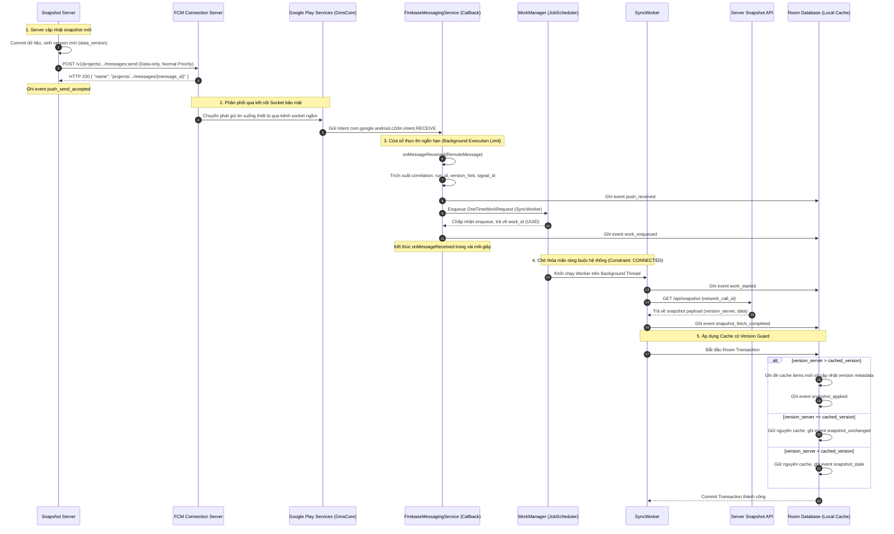
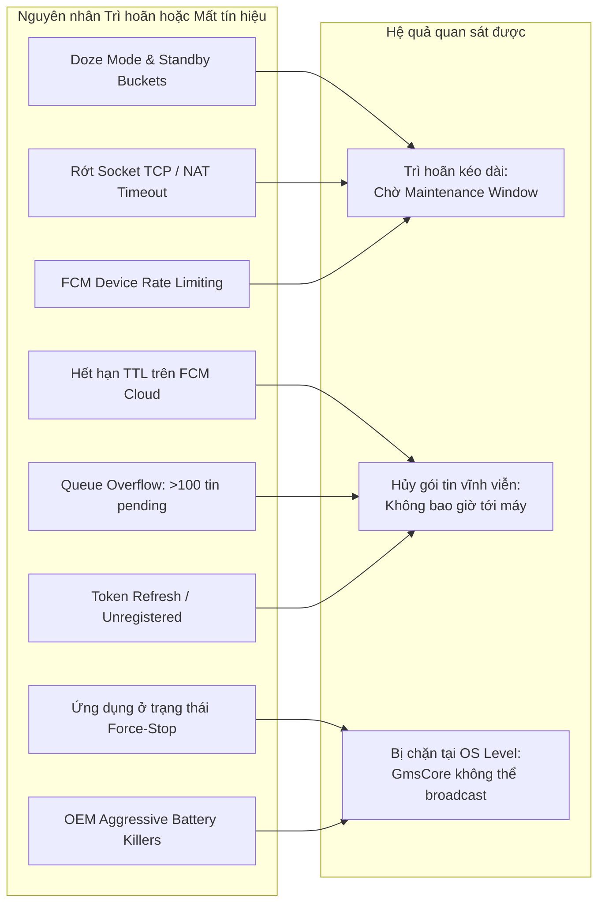

# Cơ chế Silent Push và giới hạn FCM trên Android — SEM-15

Trang (`rosy179`), rà soát và đối chiếu tài liệu ngày **05/11/2026**.

Tài liệu này là đặc tả cơ chế kỹ thuật và hợp đồng thiết kế cho thông báo đẩy im lặng (Silent Push / Background Data Message) qua Firebase Cloud Messaging (FCM) trên nền tảng Android. Đây là tài liệu phân tích cơ chế, **không phải báo cáo log thực nghiệm hoặc xác nhận đã gửi push thành công trên thiết bị thực**. Các ca đo thực nghiệm trên thiết bị thật và emulator thuộc sở hữu của các task pilot và main runs (SEM-34, SEM-41, SEM-42).

Phạm vi kỹ thuật bám sát [Kế hoạch tổng thể](../PLAN.md), [Phạm vi sản phẩm](../SCOPE.md), [Hợp đồng đồng bộ chung SHARED_SYNC](SHARED_SYNC.md), [Server FCM SEM-18](SERVER_FCM.md) và [Quy chuẩn thực nghiệm](../EXPERIMENT_PROTOCOL.md). Baseline của đề tài được khóa tại:
- **Giao thức:** FCM HTTP v1 API (`https://fcm.googleapis.com/v1/projects/{project_id}/messages:send`).
- **Loại thông điệp:** Dữ liệu thuần túy (**Data-only**), không chứa khóa `notification` ở root hoặc `android.notification`.
- **Mức ưu tiên:** `android.priority = "NORMAL"` (tuân thủ tối ưu hóa năng lượng tự nhiên của Android, không dùng High Priority để lách Doze).
- **Client Android:** Android SDK 37 (compileSdk 37, targetSdk 37, minSdk 24), thư viện AndroidX WorkManager `2.12.0`, Firebase BOM `35.1.0` (`firebase-messaging`), Room `2.8.5` theo [libs.versions.toml](../../android/gradle/libs.versions.toml).
- **Phụ lục riêng:** Các tính năng thử nghiệm trong Early Access Program (EAP) như FCM v2 API Preview hay BackgroundSync được tách riêng ở [Phụ lục](#phụ-lục-early-access-program-eap-và-các-api-thế-hệ-mới), không trộn lẫn vào baseline v1.

---

## 1. Khái niệm bản chất: "Data-only" không đồng nghĩa "Notification bị tắt tiếng"

Một trong những ngộ nhận phổ biến nhất trong phát triển ứng dụng di động là đồng nhất **thông báo dữ liệu ngầm (Silent Push / Data-only message)** với **thông báo giao diện người dùng bị tắt tiếng (Muted / Silent UI Notification)**. Hai khái niệm này hoàn toàn khác nhau về mục đích, kiến trúc hệ điều hành và đường dẫn xử lý mã lệnh:

```mermaid
flowchart TD
    subgraph FCMCloud[FCM Cloud Messaging]
        MSG_DATA[Payload Data-only<br/>chỉ có data: {...}]
        MSG_NOTIF[Payload Notification<br/>có notification: {...}]
    end

    subgraph AndroidFramework[Android Framework & GmsCore]
        GMS_ROUTER{GmsCore nhận tín hiệu}
        SYS_TRAY[System Notification Tray<br/>Trình quản lý thông báo hệ thống]
        APP_CALLBACK[FirebaseMessagingService<br/>onMessageReceived]
    end

    subgraph AppProcess[Tiến trình Ứng dụng]
        WORK_MGR[WorkManager / SyncWorker<br/>Tìm nạp snapshot ngầm]
        CACHE[(Room Database Cache)]
        UI_DISPLAY[Giao diện hiển thị<br/>Người dùng nhìn thấy UI]
    end

    MSG_DATA --> GMS_ROUTER
    MSG_NOTIF --> GMS_ROUTER

    GMS_ROUTER -->|Data-only: App Foreground hoặc Background| APP_CALLBACK
    APP_CALLBACK -->|Enqueue ngầm| WORK_MGR
    WORK_MGR -->|Ghi cache| CACHE

    GMS_ROUTER -->|Có notification: App Background| SYS_TRAY
    SYS_TRAY -->|Hiển thị banner/icon thanh trạng thái<br/>Dù tắt chuông/rung vẫn chiếm diện tích UI| UI_DISPLAY
    GMS_ROUTER -->|Có notification: App Foreground| APP_CALLBACK
```

### 1.1. Phân biệt về mặt kiến trúc hệ điều hành

1. **Thông báo bị tắt tiếng (Muted / Silent UI Notification):**
   - Là một thông báo hướng tới người dùng (**User-facing Notification**) do hệ thống hiển thị trên thanh trạng thái (Status Bar), trung tâm thông báo (Notification Shade) hoặc màn hình khóa.
   - Thuộc tính "im lặng" (silent) ở đây chỉ mang ý nghĩa mức độ làm phiền (**Interruption Level**): `NotificationChannel` được cấu hình với độ quan trọng thấp (`IMPORTANCE_LOW` hoặc `IMPORTANCE_MIN`), âm thanh bị vô hiệu hóa (`setSound(null, null)`), không kích hoạt motor rung (`enableVibration(false)`) và không hiển thị pop-up dạng heads-up.
   - **Bản chất:** Nó *vẫn tạo ra thành phần hiển thị giao diện người dùng*, vẫn chiếm dụng không gian thông báo của hệ điều hành và do Android Notification Manager quản lý hiển thị.

2. **Thông báo đẩy im lặng (Silent Push / Data-only Message):**
   - Là một gói tin dữ liệu kỹ thuật truyền qua kênh FCM mà **hoàn toàn không chứa bất kỳ chỉ thị hiển thị UI nào**.
   - Mục đích duy nhất là đóng vai trò một "tín hiệu đánh thức ngầm" (Background wake-up signal / ping) để ứng dụng cập nhật bộ nhớ đệm (Cache Warming), vô hiệu hóa dữ liệu cũ (Cache Invalidation), hoặc chuẩn bị trước nội dung trước khi người dùng chủ động mở màn hình.
   - **Bản chất:** Người dùng hoàn toàn không hay biết gói tin này đã đến thiết bị. Thanh trạng thái không có icon, không có pop-up, không có âm thanh. Tiến trình ứng dụng tiếp nhận dữ liệu ngầm, kích hoạt bộ lập lịch của hệ điều hành, cập nhật cơ sở dữ liệu Room và tự động kết thúc.

### 1.2. Phân tích ba loại payload trong FCM HTTP v1

FCM phân loại thông điệp dựa trên sự có mặt của hai đối tượng cấp cao: `notification` và `data`. Bảng dưới đây đối chiếu hành vi thực tế trên Android:

| Tiêu chí phân định | Notification Payload (`notification`) | Data-only Payload (`data`) | Mixed Payload (`notification` + `data`) |
|---|---|---|---|
| **Cấu trúc JSON** | Chứa `message.notification` (`title`, `body`...) | Chỉ chứa `message.data` (các cặp key-value dạng chuỗi) | Chứa cả `message.notification` và `message.data` |
| **Khi app ở Foreground** | SDK gọi `onMessageReceived(RemoteMessage)` | SDK gọi `onMessageReceived(RemoteMessage)` | SDK gọi `onMessageReceived(RemoteMessage)` |
| **Khi app ở Background / Chết** | **Hệ điều hành / GmsCore tự động hiển thị lên System Tray**, mã nguồn app không được chạy | **SDK đánh thức service và gọi `onMessageReceived`**, hoàn toàn không có thông báo hiển thị | **Hệ điều hành / GmsCore tự động hiển thị lên System Tray**. Callback `onMessageReceived` **KHÔNG** được gọi |
| **Vị trí lấy dữ liệu khi app ở Background** | Không mang payload ứng dụng tùy biến | Đọc trực tiếp từ `RemoteMessage.getData()` trong `onMessageReceived` | Dữ liệu `data` bị nhét vào `Intent.getExtras()` của Activity khi người dùng bấm vào notification |
| **Rủi ro đối với đồng bộ ngầm** | Không thể dùng để chạy code cập nhật cache nền | Tuân thủ giới hạn thực thi nền của Android; cần bàn giao sang WorkManager | **Nguy cơ mất dữ liệu cao:** Nếu người dùng vuốt xóa thông báo (dismiss) hoặc không bao giờ bấm vào, code đồng bộ sẽ không bao giờ được kích hoạt |
| **Phù hợp với Silent Push?** | **Không** | **Đúng chuẩn duy nhất** | **Không** (Vi phạm tính im lặng và phá vỡ tính tự động) |

> [!IMPORTANT]
> **Nguyên tắc cốt lõi của đề tài:** Để thực hiện "Silent Push" đúng nghĩa trên Android, hệ thống server **bắt buộc phải gửi Data-only message**. Nếu gửi Mixed payload, khi app ở nền, Google Play Services sẽ tự động vẽ một notification lên màn hình và triệt tiêu callback ngầm, biến tác vụ ngầm thành một thông báo làm phiền người dùng.

---

## 2. Luồng xử lý đầu cuối: Server → FCM → Callback → WorkManager → Cache

Quy trình dữ liệu di chuyển từ máy chủ qua đám mây của Google tới bộ nhớ đệm cục bộ Room trên thiết bị Android được mô hình hóa qua chuỗi sự kiện và ranh giới trách nhiệm sau:



### 2.1. Chi tiết các giai đoạn thực thi và giới hạn nền

#### Giai đoạn 1: Server phát tín hiệu push
- Máy chủ commit phiên bản mới vào kho lưu trữ bền vững trước khi gửi push.
- Tạo một `signal_id` logic của ứng dụng và chuẩn bị payload FCM HTTP v1.
- Gửi HTTP POST tới FCM API với OAuth2 Access Token.
- Khi FCM phản hồi HTTP 200 chứa chuỗi tài nguyên `projects/{project}/messages/{message_id}`, server ghi nhận `push_send_accepted`. Lưu ý: Sự kiện này **chỉ chứng nhận FCM đã nhận gói tin vào hàng đợi của Google**, không bảo đảm máy khách đã nhận.

#### Giai đoạn 2: FCM phân phối tới Google Play Services
- FCM Connection Server tìm kiếm socket TCP kết nối tới thiết bị (cổng 5228/5229/5230).
- Nếu thiết bị đang ở trạng thái ngủ sâu (Doze), FCM xử lý mức ưu tiên: do là `NORMAL` priority, gói tin được đưa vào hàng đợi gom cụm (batch queue) chờ maintenance window (chi tiết ở mục 3).
- Khi phân phối xuống thiết bị, tiến trình `com.google.android.gms` (GmsCore) tiếp nhận gói tin và kiểm tra chữ ký/quyền gói tin mục tiêu.

#### Giai đoạn 3: Callback trong ứng dụng và giới hạn thực thi nền (Background Execution Limits)
- GmsCore kích hoạt `FirebaseMessagingService` của ứng dụng thông qua broadcast receiver nội bộ.
- Hàm `onMessageReceived(RemoteMessage message)` được gọi trên một luồng Worker do Firebase SDK quản lý.
- **Giới hạn thực thi nền nghiêm ngặt (Android 8.0+ / API 26+):**
  - Callback service chạy ngầm được hệ điều hành cấp phát một wakelock tạm thời với thời gian sống rất ngắn (thường dưới 20 giây; trên thực tế hệ điều hành có thể bắt đầu thu hồi tài nguyên sau 10–15 giây nếu phát hiện tải nặng).
  - Nếu ứng dụng cố tình thực hiện một tác vụ mạng kéo dài (HTTP GET), tải tệp tin lớn, hoặc thực hiện xử lý dữ liệu nặng ngay trong `onMessageReceived`, hệ thống sẽ coi đây là hành vi lạm dụng nền. Ứng dụng có nguy cơ cao bị:
    1. **ANR (Application Not Responding)** nếu chiếm dụng luồng.
    2. **Process Termination (Kill):** Hệ điều hành giải phóng wakelock và lập tức đẩy tiến trình vào trạng thái Cached Process hoặc buộc dừng (Killed) khi thiết bị cần giải phóng RAM. Khi đó, yêu cầu HTTP bị ngắt nửa chừng, dữ liệu cache bị hỏng hoặc trạng thái rơi vào bất định.
- **Quy tắc thiết kế bắt buộc:**
  1. `onMessageReceived` **chỉ được phép thực hiện các thao tác nhẹ**: đọc `message.getData()`, phân giải các trường correlation (`run_id`, `version_hint`, `signal_id`), ghi log nhận tin `push_received`.
  2. Bàn giao ngay lập tức cho `WorkManager` bằng cách gọi `WorkManager.getInstance(context).enqueueUniqueWork(...)` hoặc `enqueue(...)`.
  3. Ghi nhận log `work_enqueued` và thoát callback ngay lập tức (dưới 50–100ms).

#### Giai đoạn 4: WorkManager thực thi tác vụ bền vững
- WorkManager lưu yêu cầu công việc vào cơ sở dữ liệu SQLite cục bộ của hệ điều hành, đảm bảo công việc không bị mất ngay cả khi tiến trình bị kill hoặc máy khởi động lại.
- Tác vụ được kích hoạt khi hệ điều hành phân bổ hạn ngạch và điều kiện mạng thỏa mãn (`NetworkType.CONNECTED`).
- Khi chạy, `SyncWorker` ghi nhận `work_started`, thực hiện cuộc gọi HTTP GET tới Snapshot API để kéo toàn bộ dữ liệu mới nhất. Điều này bảo đảm nếu có nhiều push dồn dập, worker chỉ cần kéo một snapshot mới nhất tại thời điểm chạy.

#### Giai đoạn 5: Áp dụng vào Room Cache theo Hợp đồng Đồng bộ chung
- Cuộc gọi HTTP GET snapshot được thực hiện hoàn toàn **bên ngoài** Room Transaction để tránh khóa database trong thời gian chờ mạng.
- Sau khi có payload, mở một Room Transaction nguyên tử:
  1. Đọc lại `cached_version` hiện tại trong DB.
  2. Nếu `server_version > cached_version`: cập nhật bảng dữ liệu, cập nhật bảng metadata và ghi bản ghi log `snapshot_applied`.
  3. Nếu `server_version == cached_version`: ghi nhận `snapshot_unchanged`.
  4. Nếu `server_version < cached_version`: giữ nguyên cache, ghi nhận `snapshot_stale`.
- Cam kết: Bản ghi log `snapshot_applied` và bản ghi cache được commit trong cùng một transaction; UI quan sát Flow từ Room chỉ thấy dữ liệu mới sau khi transaction đã hoàn tất bền vững.

---

## 3. Phân biệt Message Priority: Normal Priority vs High Priority

Trong FCM HTTP v1, trường `android.priority` xác định cách thức hạ tầng Google Play Services và hệ điều hành Android đối xử với gói tin khi thiết bị đang ở các trạng thái nguồn khác nhau:

| Tiêu chí | Normal Priority (`android.priority = "NORMAL"`) | High Priority (`android.priority = "HIGH"`) |
|---|---|---|
| **Mục đích thiết kế** | Đồng bộ dữ liệu ngầm, nạp sẵn bộ nhớ đệm, tin tức không khẩn cấp, tác vụ bảo trì | Cuộc gọi VoIP, tin nhắn trò chuyện trực tiếp (chat), cảnh báo an ninh thời gian thực |
| **Hành vi khi thiết bị ở Doze Mode** | **Bị giữ lại (Deferred / Batched).** Gói tin không đánh thức thiết bị mà nằm chờ trên máy chủ FCM hoặc GmsCore cho tới cửa sổ bảo trì (Maintenance Window) tiếp theo | **Cố gắng đánh thức thiết bị ngay lập tức.** Bỏ qua Doze mode tạm thời, cấp wakelock ngắn để ứng dụng xử lý |
| **Tác động tới pin** | Tối ưu hóa tối đa; giúp thiết bị duy trì trạng thái ngủ sâu (Deep Sleep) theo thiết kế tiết kiệm năng lượng của Android | Tiêu hao năng lượng cao nếu gửi thường xuyên do liên tục ngắt chu kỳ tiết kiệm pin |
| **Chính sách hạn ngạch của Google (Quota & Throttling)** | **Không bị giới hạn hạn ngạch khắt khe.** Cho phép gửi đều đặn phục vụ đồng bộ nền | **Bị áp đặt hạn ngạch nghiêm ngặt.** Google Play Services áp dụng cơ chế tính điểm (High-priority quota pool) |
| **Hình phạt khi vi phạm chính sách** | Không bị phạt | Nếu gửi High-priority data message mà **không hiển thị thông báo giao diện (user-visible notification)**, hệ thống sẽ tự động hạ cấp xuống Normal priority (Deprioritization) và áp đặt delay lũy tiến |
| **Quyết định trong dự án Seminar IE307** | **Được chọn làm BASELINE CHUẨN.** Phản ánh đúng hành vi tự nhiên của hệ thống, minh họa chính xác sự đánh đổi giữa độ tươi dữ liệu và tiết kiệm pin | **Không sử dụng.** Tuyệt đối không dùng để làm cho kết quả demo có vẻ "nhanh hơn" một cách giả tạo |

### Cơ chế hạ cấp (Deprioritization) của High Priority
Tài liệu chính thức của Google về [FCM message priority](https://firebase.google.com/docs/cloud-messaging/android-message-priority) quy định rõ:
- High priority dành riêng cho các trường hợp người dùng cần được thông báo ngay lập tức.
- Nếu ứng dụng nhận tin nhắn high priority nhưng không phát sinh một thông báo hiển thị cho người dùng (user-facing notification) trong một khoảng thời gian nhất định, ứng dụng sẽ bị đưa vào danh sách theo dõi.
- Khi cạn kiệt "hạn ngạch tin nhắn ưu tiên cao" (quota pool), mọi tin nhắn gửi tới sau đó sẽ bị hệ thống tự động giáng cấp xuống hành vi tương đương `NORMAL` priority. Do đó, việc lạm dụng High Priority cho Silent Push là giải pháp không bền vững và vi phạm chuẩn phát triển Android.

---

## 4. Các trường hợp trì hoãn và không nhận được tin: Vì sao không thể hứa push tức thì?

Một nguyên tắc sống còn khi làm việc với hệ thống phân tán và mạng di động: **Thông báo đẩy (Push Notification) là một kênh truyền "nỗ lực tối đa" (Best-effort delivery), không phải là một kênh truyền thời gian thực bảo đảm (Guaranteed Real-time RPC).**

Hệ thống **tuyệt đối không được hứa hẹn rằng push sẽ đến tức thì**. Bảng dưới đây liệt kê các trường hợp thiết bị bị trì hoãn (Delay) hoặc hoàn toàn không nhận được tin (Drop/Undelivered):



### 4.1. Chi tiết 8 kịch bản gây trễ hoặc mất push

1. **Doze Mode và App Standby Buckets:**
   - Khi thiết bị không cắm sạc, tắt màn hình và để yên trong một khoảng thời gian, Android kích hoạt Doze Mode (gồm Light Doze và Deep Doze).
   - Trong Deep Doze, hệ thống tắt quyền truy cập mạng của các ứng dụng thông thường, tạm hoãn các Job/Alarms và chỉ mở ra các cửa sổ bảo trì ngắn định kỳ (Maintenance Windows: chu kỳ giãn dần từ vài phút lên đến hàng giờ).
   - Tin nhắn `NORMAL` priority sẽ bị giữ lại tại hạ tầng FCM hoặc GmsCore, hoàn toàn không đánh thức máy cho tới khi cửa sổ bảo trì kế tiếp mở ra hoặc người dùng bật sáng màn hình.
   - Thêm vào đó, nếu ứng dụng ít được sử dụng, hệ thống xếp vào App Standby Bucket `RARE` hoặc `RESTRICTED`, áp đặt giới hạn công việc WorkManager chỉ được chạy vài lần một ngày.

2. **Hết hạn vòng đời tin nhắn (Message TTL Expiry):**
   - Khi thiết bị ngoại tuyến (tắt máy, mất sóng, bật chế độ máy bay), FCM lưu trữ tin nhắn trên đám mây.
   - Mỗi tin nhắn mang một thời gian sống (TTL - Time to Live). Mặc định là 4 tuần, nhưng trong kịch bản kiểm thử có thể cấu hình ngắn hơn (ví dụ 600 giây).
   - Nếu thiết bị offline vượt quá thời gian TTL, máy chủ FCM sẽ **tự động xóa vĩnh viễn gói tin khỏi hàng đợi**. Khi máy online trở lại, không có bất kỳ callback nào được kích hoạt.

3. **Tràn hàng đợi tin nhắn chờ (Pending Message Queue Overflow):**
   - Theo đặc tả của Google, FCM lưu trữ tối đa **100 tin nhắn đang chờ (pending)** cho một registration token cụ thể.
   - Nếu một server liên tục phát tin nhắn data-only tới một thiết bị offline vượt quá ngưỡng 100 tin, FCM sẽ **xóa sạch toàn bộ 100 tin cũ** và chỉ gửi một thông báo đặc biệt `deleted_messages` khi thiết bị kết nối lại. Khi đó, toàn bộ các bản cập nhật trung gian bị hủy bỏ.

4. **Trạng thái Dừng Buộc Giao diện (Application Stopped State / Force-Stop):**
   - Nếu người dùng vào mục Cài đặt (Settings) -> Quản lý ứng dụng -> chọn "Buộc dừng" (Force Stop), Android đưa gói cài đặt vào trạng thái đặc biệt: `FLAG_EXCLUDE_STOPPED_PACKAGES`.
   - Trong trạng thái này, Android Framework chủ động **chặn đứng tất cả các Broadcast Intent** hướng tới ứng dụng, bao gồm cả broadcast `com.google.android.c2dm.intent.RECEIVE` từ Google Play Services.
   - FCM hoàn toàn bất lực trong việc đánh thức một ứng dụng đang bị Force-Stop cho đến khi người dùng tự tay chạm vào icon để khởi chạy lại ứng dụng.

5. **Trình diệt ứng dụng ngầm tùy biến của các nhà sản xuất OEM (OEM Aggressive Battery Management):**
   - Các dòng máy chạy ROM tùy biến sâu như ColorOS (OPPO), MIUI/HyperOS (Xiaomi), OneUI (Samsung) tích hợp các trình quản lý pin nghiêm ngặt vượt qua tiêu chuẩn của Android thuần (AOSP).
   - Tiêu biểu trên **OPPO Find X9 (ColorOS)**: Trình quản lý pin có các cơ chế:
     - Chặn tự động khởi chạy (Disable Auto-launch / Secondary launch).
     - Đóng băng ứng dụng chạy ngầm (Background Freeze / Sleep).
     - Tự động diệt tiến trình nền sau vài phút tắt màn hình.
   - Dù GmsCore có nhận được push, intent chuyển giao cho app vẫn bị hệ điều hành ColorOS nuốt chửng, dẫn tới hiện tượng "server báo accepted nhưng máy khách không hề rung chuyển".

6. **Đứt kết nối ngầm (Silent Socket Drop / NAT Timeout):**
   - Kết nối giữa Google Play Services và FCM dựa trên một TCP socket đường dài.
   - Trên các mạng Wi-Fi công cộng hoặc mạng 4G/5G của nhà mạng, các bộ định tuyến NAT thường có thời gian timeout ngắn (NAT keep-alive timeout). Nếu socket bị ngắt âm thầm từ phía router mà thiết bị chưa kịp gửi gói ping Heartbeat, thiết bị sẽ không biết mình đã mất kết nối.
   - Trong khoảng thời gian này, push gửi từ server sẽ bị trôi dạt và chỉ được phát hiện khi thiết bị thực hiện chu kỳ heartbeat định kỳ tiếp theo (có thể mất 15–28 phút).

7. **Giới hạn tốc độ phân phối (FCM Device Throttling / Rate Limits):**
   - Google áp đặt hạn ngạch tối đa không quá **240 tin nhắn/phút** và **5000 tin nhắn/giờ** cho một thiết bị cụ thể.
   - Nếu kịch bản thử nghiệm gửi dồn dập các gói tin kiểm tra, FCM sẽ hoãn chuyển phát hoặc từ chối gói tin để bảo vệ thiết bị.

8. **Vô hiệu hóa Registration Token (Token Invalidation / Expiry):**
   - Mã đăng ký FCM (token) không phải là vĩnh cửu. Token bị hủy khi người dùng xóa dữ liệu ứng dụng (Clear Data), gỡ cài đặt, khôi phục sao lưu trên thiết bị mới, hoặc do cơ chế tự động xoay vòng của Firebase.
   - Khi server gửi tới một token đã chết, FCM trả về lỗi `UNREGISTERED` hoặc `INVALID_ARGUMENT`. Tín hiệu không bao giờ đến được thiết bị.

---

## 5. Ranh giới nhận thức: Phân định các mốc sự kiện trong hệ thống

Để phục vụ đo đạc khoa học và đối thoại phản biện, tuyệt đối không được đánh đồng các mốc trạng thái khác nhau. Bảng dưới đây định nghĩa rõ ràng sự khác biệt giữa bằng chứng đã ghi nhận và điều chưa thể khẳng định:

| Trạng thái sự kiện (`event_type`) | Bằng chứng cho phép khẳng định | Điều TUYỆT ĐỐI CHƯA ĐƯỢC kết luận |
|---|---|---|
| `server_updated` | Cơ sở dữ liệu của server đã commit phiên bản mới | Chưa biết server có gửi push hay chưa; chưa biết FCM có nhận hay không |
| `push_send_accepted` | Máy chủ FCM đã trả về HTTP 200 và chuỗi `message_id` cho lệnh gửi | **Chưa biết máy khách có online không; chưa biết app có nhận được tin hay không; chưa biết cache có thay đổi không** |
| `push_send_rejected` | FCM trả về lỗi cụ thể (ví dụ `UNREGISTERED`, quota exceeded) | Gói tin đã bị từ chối, không đi tiếp |
| `push_received` | Hàm `onMessageReceived` trên thiết bị khách đã thực sự nhận gói tin | **Chưa biết WorkManager có chấp nhận enqueue không; chưa biết dữ liệu đã được fetch hay lưu vào Room chưa** |
| `work_enqueued` | WorkManager đã tiếp nhận `OneTimeWorkRequest` và cấp `work_id` | Chưa biết khi nào worker sẽ chạy (còn phụ thuộc scheduler và pin/mạng) |
| `work_started` | Luồng nền của `SyncWorker` đã chính thức bắt đầu thực thi | Chưa biết cuộc gọi mạng HTTP GET có thành công không |
| `snapshot_fetch_completed` | Cuộc gọi HTTP GET snapshot lên server đã nhận được HTTP response | Chưa biết Room có commit thành công phiên bản mới hay không |
| `snapshot_applied` | Room Transaction đã commit thành công dữ liệu mới và metadata | Đã hoàn tất chu trình đồng bộ ngầm; dữ liệu đã sẵn sàng cho UI đọc |
| `snapshot_unchanged` | Dữ liệu trả về có version bằng với cache hiện tại | Không cần ghi đè DB; không có dữ liệu mới hơn |
| `snapshot_stale` | Dữ liệu trả về có version thấp hơn version đang có trong cache | Vi phạm guard version; hệ thống bảo vệ không cho phép rollback cache |

---

## 6. Đặc tả Payload FCM HTTP v1 (Fixture minh họa)

Dưới đây là cấu trúc payload JSON chuẩn mực cho kịch bản Silent Push theo giao thức FCM HTTP v1. Đây là mẫu kiểm tra thiết kế, các trường định danh mang tính minh họa:

```json
{
  "message": {
    "token": "dK1F...local_device_registration_token...x9A",
    "data": {
      "run_id": "EXP-RUN-20261105-001",
      "mode": "PUSH",
      "source": "PUSH",
      "version_hint": "42",
      "signal_id": "SIG-SERVER-9872134"
    },
    "android": {
      "priority": "NORMAL",
      "ttl": "600s"
    }
  }
}
```

### Ràng buộc kỹ thuật đối với Payload:
1. **Dữ liệu trong `data` bắt buộc là String:** Chuẩn FCM HTTP v1 quy định mọi giá trị trong object `data` phải có kiểu chuỗi (`string: string`). Không lồng các object phức tạp hoặc mảng thô (nếu cần mảng, phải serialize thành JSON string).
2. **Không mang dữ liệu toàn phần (Payload Weight):** Tín hiệu push chỉ mang thông tin chỉ dẫn (`version_hint`, `signal_id`, `run_id`). Toàn bộ dữ liệu thực thể (snapshot content) được tải qua HTTP GET của worker. Điều này giúp gói push nhẹ (dưới 1 KB), tránh chạm ngưỡng giới hạn 4 KB của FCM data message.
3. **Không mang thông tin nhạy cảm:** Tuyệt đối không gửi URL tùy ý để client truy cập, không nhúng API keys, access token hoặc mật khẩu trong payload.
4. **Không giả định `message_id`:** Server không được tự tạo trường `message_id` trong data; giá trị `message_id` chỉ được đọc từ kết quả trả về của FCM response hoặc trong thuộc tính của `RemoteMessage`.

---

## 7. Nguồn tham chiếu kỹ thuật chính thức và Phiên bản áp dụng

Mọi lý luận và đặc tả trong tài liệu này đều được đối chiếu trực tiếp từ các tài liệu phát triển chính thức của Google và Android:

| Định danh | Nguồn tài liệu | URL tham chiếu | Nội dung đối chiếu và áp dụng |
|---|---|---|---|
| **R01** | FCM Architecture Overview | [FCM Architecture](https://firebase.google.com/docs/cloud-messaging/fcm-architecture) | Mô hình 3 tầng: Provider Server -> FCM Backend -> Client App; vai trò của GmsCore. |
| **R02** | FCM Send Messages HTTP v1 | [FCM REST v1](https://firebase.google.com/docs/reference/fcm/rest/v1/projects.messages) | Cấu trúc payload v1, tách biệt `notification` và `data`, trường `android.priority` và `android.ttl`. |
| **R03** | About FCM Messages | [Concept Options](https://firebase.google.com/docs/cloud-messaging/concept-options) | Phân định hành vi 3 loại tin nhắn: Notification, Data-only và Mixed khi app foreground/background. |
| **R04** | FCM Message Priority on Android | [Android Message Priority](https://firebase.google.com/docs/cloud-messaging/android-message-priority) | Hành vi `NORMAL` priority trong Doze, chính sách hạn ngạch và cơ chế deprioritization của `HIGH` priority. |
| **R05** | Message Lifespan and Throttling | [Setting Message Lifespan](https://firebase.google.com/docs/cloud-messaging/customize-messages/setting-message-lifespan) | Thời gian sống TTL (mặc định 4 tuần, 0–2.419.200s), giới hạn 100 tin pending và throttling thiết bị. |
| **R06** | Receive Messages on Android Client | [Receive Messages Android](https://firebase.google.com/docs/cloud-messaging/android/receive-messages) | Vòng đời `FirebaseMessagingService`, xử lý `onMessageReceived`, giới hạn thời gian thực thi trong callback. |
| **R07** | Android Optimize for Doze & App Standby | [Optimize for Doze](https://developer.android.com/training/monitoring-device-state/doze-standby) | Chu kỳ bảo trì Doze, hạn chế mạng, tác động của Standby Buckets lên việc đánh thức ứng dụng. |
| **R08** | Android Background Execution Limits | [Background Execution Limits](https://developer.android.com/about/versions/oreo/background) | Giới hạn background services từ Android 8.0 (API 26) trở lên; yêu cầu bàn giao sang WorkManager. |
| **R09** | Android WorkManager Architecture | [WorkManager Topic](https://developer.android.com/topic/libraries/architecture/workmanager) | Cơ chế lập lịch bền vững, quản lý tiến trình, thực thi tác vụ khi thỏa mãn Network Constraints. |

### Phiên bản khóa trong cấu hình dự án
Đối chiếu file cấu hình [libs.versions.toml](../../android/gradle/libs.versions.toml) của dự án:
- `firebaseBom = "35.1.0"` -> đóng gói các bản `firebase-messaging` tương thích ổn định.
- `workManager = "2.12.0"` -> thư viện `androidx.work:work-runtime-ktx` ổn định mới nhất.
- `room = "2.8.5"` -> quản lý SQLite persistence và Flow observation.
- `compileSdk = 37`, `targetSdk = 37`, `minSdk = 24`.

---

## Phụ lục: Early Access Program (EAP) và các API thế hệ mới

> [!NOTE]
> Phần này được xếp vào **Phụ lục tham khảo độc lập**, phục vụ nghiên cứu mở rộng và trả lời câu hỏi phản biện nâng cao. Các thành phần này **tuyệt đối không được đưa vào baseline v1** của sản phẩm demo Seminar IE307.

Trong các thông báo gần đây của Google Cloud và Firebase, Google đang phát triển các giao diện lập trình mới nhằm thu hẹp khoảng cách giữa FCM và cơ chế quản lý pin của Android:
1. **FCM v2 API Preview và `AndroidConfigV2`:**
   - Cung cấp các định nghĩa cấu hình chi tiết hơn về mục đích tin nhắn (message purpose) và liên kết sâu hơn với Android Power Management.
   - Chi tiết: [FCM v2 API Send Reference](https://firebase.google.com/docs/cloud-messaging/send/v2-api).
2. **BackgroundSync API (EAP):**
   - Một cơ chế thử nghiệm cho phép nhà phát triển yêu cầu hệ điều hành tự động lập lịch một phiên đồng bộ hóa ngầm mà không cần ứng dụng tự khởi chạy service tạm thời trong `onMessageReceived`.
   - Cơ chế này tích hợp chặt chẽ với hạ tầng Android JobScheduler của chính Google Play Services.

### Lý do đề tài không sử dụng EAP / v2 API:
- Các API EAP đòi hỏi đăng ký dự án doanh nghiệp đặc thù với Google Cloud, phụ thuộc vào bản build SDK riêng và không công khai toàn diện.
- Khả năng tương thích trên các thiết bị ROM bên thứ ba (như ColorOS của OPPO) chưa được kiểm chứng và có thể gây sập ứng dụng bất thường.
- **Quyết định kỹ thuật của nhóm:** Giữ vững **FCM HTTP v1 Standard**, sử dụng mô hình kết hợp `FirebaseMessagingService` + `WorkManager` truyền thống làm chuẩn mực kiến trúc bền vững nhất trên toàn bộ hệ sinh thái Android.
