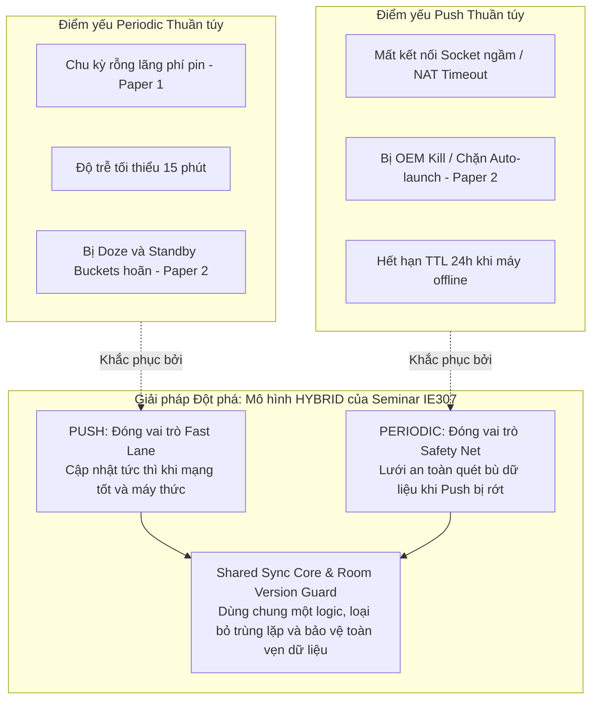

# Đối chiếu hai bài nghiên cứu với API push hiện hành — SEM-22

- **Người thực hiện:** Trang (`rosy179`).
- **Nhiệm vụ:** SEM-22 — Đối chiếu hai bài nghiên cứu với API push hiện hành.
- **Thuộc đề tài:** Seminar IE307 (Chủ đề 12: *Xử lý việc tìm nạp nền và thông báo đẩy im lặng, minh họa trên Android*).
- **Trạng thái:** Báo cáo đối chiếu học thuật và phân tích cơ chế kỹ thuật (Academic Literature Cross-check & Mechanism Mapping).
- **Ngày lập:** 05/11/2026 (UTC+7).
- **Đầu vào đã tiếp nhận và kế thừa:**
  - [SEM-15 (Trang)](../../docs/mechanisms/SILENT_PUSH.md): Đặc tả cơ chế Silent Push, FCM HTTP v1, data-only, normal priority, TTL 24h, WorkManager 2.12.0, giới hạn thực thi nền và rào cản OEM.
  - [SEM-20 (Tuấn)](PAPER_1.md) & [paper-1.bib](../metadata/paper-1.bib): Ghi chú toàn văn bài báo thứ nhất — Simon et al. (2017) về đồng bộ vi sai và chi phí chu kỳ rỗng trên iOS 7 / iPhone 5s.
  - [SEM-21 (Tâm)](PAPER_2.md) & [paper-2.bib](../metadata/paper-2.bib): Ghi chú toàn văn bài báo thứ hai — González-Pérez et al. (2022) về độ tin cậy lập lịch tác vụ nền trên Android 7–11 qua AlarmManager/WakeLock/NTD.
  - [Quy chuẩn thực nghiệm PROTOCOL 1.0.0](../../experiments/PROTOCOL.md) và [Hồ sơ thiết bị DEVICES.md](../../docs/environment/DEVICES.md).

> [!NOTE]
> Tài liệu này được biên soạn độc lập bởi Trang (`rosy179`), không trộn lẫn kết quả của các bài báo lịch sử với kết quả đo đạc thực tế của đề tài Seminar IE307. Toàn bộ các đối chiếu đều chỉ ra chính xác vị trí mục/trang trong bài gốc, phiên bản API/OS hiện hành, và phân định rõ ràng giữa phát hiện thực nghiệm lịch sử, lý thuyết API hiện đại, và giả thuyết cần kiểm chứng trong các ca `E01`–`E06`.

---

## Mục lục chi tiết

1. [Bối cảnh kỹ thuật và Nguyên tắc đối chiếu](#1-bối-cảnh-kỹ-thuật-và-nguyên-tắc-đối-chiếu)
2. [Bảng Documentation: Chuẩn hóa FCM HTTP v1 Data-Only Normal Priority](#2-bảng-documentation-chuẩn-hóa-fcm-http-v1-data-only-normal-priority)
3. [Đối chiếu Bài 1 (Simon et al., 2017) với API Push & Sync hiện hành](#3-đối-chiếu-bài-1-simon-et-al-2017-với-api-push--sync-hiện-hành)
4. [Đối chiếu Bài 2 (González-Pérez et al., 2022) với Lập lịch Android hiện hành](#4-đối-chiếu-bài-2-gonzález-pérez-et-al-2022-với-lập-lịch-android-hiện-hành)
5. [Ma trận Đối chiếu Toàn diện (Comprehensive Cross-check Matrix)](#5-ma-trận-đối-chiếu-toàn-diện-comprehensive-cross-check-matrix)
6. [Định vị Mô hình HYBRID của Seminar IE307 từ góc độ Học thuật](#6-định-vị-mô-hình-hybrid-của-seminar-ie307-từ-góc-độ-học-thuật)
7. [Thư viện Nguồn tham chiếu đối chiếu](#7-thư-viện-nguồn-tham-chiếu-đối-chiếu)
8. [Phụ lục: Early Access Program (EAP) và Các API thế hệ mới](#phụ-lục-early-access-program-eap-và-các-api-thế-hệ-mới)

---

## 1. Bối cảnh kỹ thuật và Nguyên tắc đối chiếu

Một nguyên tắc cốt lõi trong nghiên cứu kỹ thuật phần mềm di động là **không được khái quát hóa vội vã (Over-generalization)** các kết quả đo đạc từ một nền tảng hoặc phiên bản hệ điều hành cũ sang các hệ thống hiện đại. Giữa hai bài báo được tuyển chọn và hệ thống demo của đề tài Seminar IE307 có sự khác biệt rất lớn về bối cảnh công nghệ:

| Tiêu chí | Paper 1 (Simon et al., 2017) [SEM-20] | Paper 2 (González-Pérez et al., 2022) [SEM-21] | Đề tài Seminar IE307 (Chủ đề 12) |
|---|---|---|---|
| **Mục tiêu nghiên cứu** | Tối ưu hóa năng lượng cho đồng bộ vi sai (Differential Synchronization - DiffSync) khi cộng tác chỉnh sửa tài liệu PDF trên mobile. | Đánh giá độ tin cậy, tính đầy đủ (completeness) và độ trễ khi lập lịch tác vụ định kỳ để thu thập dữ liệu cảm biến khoa học. | Đánh giá cơ chế tìm nạp nền định kỳ (Periodic) kết hợp thông báo đẩy im lặng (Silent Push) để cập nhật bảng tin snapshot. |
| **Nền tảng & Thiết bị** | Một thiết bị **iPhone 5s chạy iOS 7** (bản đo năm 2014, công bố 2017). | Bốn thiết bị **Android 7.0 đến 11.0** (Nvidia Shield Tablet, BQ Aquaris, Xiaomi Mi A1, Honor 9, Poco F2 Pro). | **Android SDK 37 (Android 15+)** trên Android Emulator và **OPPO Find X9 chạy ColorOS** ([Hồ sơ SEM-12](../../docs/environment/DEVICES.md)). |
| **Cơ chế kích hoạt** | Polling đều đặn (interval 0–60 giây) so sánh với Push-triggered sync (APNs hoặc socket mô phỏng). | `AlarmManager`, `BroadcastReceiver`, `PARTIAL_WAKE_LOCK`, thư viện NativeScript Task Dispatcher (NTD) có watchdog. | **AndroidX WorkManager `2.12.0`** (ràng buộc `CONNECTED`) kết hợp **FCM HTTP v1 Data-only** (`NORMAL` priority). |
| **Chính sách nền của OS** | iOS 7 quản lý ngầm đời đầu; DiffSync chỉ bật khi mở app xem PDF và tắt khi đóng (§7.1). | Doze Mode đời đầu (Android 7–9), tắt tối ưu pin thủ công, can thiệp OEM (MIUI, EMUI). | **Doze Mode hiện đại, App Standby Buckets** (`RARE`/`RESTRICTED`), cấm background services, OEM battery freeze (ColorOS). |
| **Loại dữ liệu** | Diff/patch hai chiều giữa shadow copy và local PDF annotations (vài byte đến ~7 KB). | Bản ghi cảm biến định kỳ (chu kỳ 1 phút) lưu file CSV cục bộ. | Snapshot bảng tin JSON có phiên bản đơn điệu (`data_version`) lưu bền vững vào SQLite qua **Room `2.8.5`**. |

### Nguyên tắc đối chiếu của SEM-22:
1. **Không sao chép số liệu cũ thành kết quả hiện tại:** Các con số như *"96.8% chu kỳ rỗng"* của Paper 1 hay *"84% missing rate"* của Paper 2 là kết quả của workload và môi trường bài báo đó; tuyệt đối không tự ý khẳng định hệ thống của nhóm đạt cùng tỷ lệ.
2. **Kế thừa bài học kiến trúc (Architectural Takeaways):** Sử dụng các vấn đề kinh điển mà các tác giả chỉ ra (chu kỳ rỗng, lost wake-up, scheduler jitter, OEM process killing) để làm động lực thiết kế và xây dựng các ca kiểm thử `E01`–`E06`.
3. **Đối chiếu sự thay thế của API hiện đại:** Chỉ rõ những kỹ thuật mà bài báo sử dụng đã trở nên **lạc hậu hoặc bị cấm** trên Android hiện đại (ví dụ: dùng `AlarmManager` lặp mỗi phút, giữ `PARTIAL_WAKE_LOCK`, hoặc ép người dùng tắt tối ưu hóa pin).

---

## 2. Bảng Documentation: Chuẩn hóa FCM HTTP v1 Data-Only Normal Priority

Đáp ứng yêu cầu nghiệp vụ của SEM-22, bảng dưới đây chuẩn hóa toàn bộ đặc tả kỹ thuật của kênh Push trong đề tài theo chuẩn **FCM HTTP v1 Standard**, đối chiếu trực tiếp với tài liệu chính thức của Google:

| Thuộc tính API | Giá trị chuẩn hóa trong Đề tài | Hành vi trên Android Framework | Căn cứ kỹ thuật chính thức |
|---|---|---|---|
| **Giao thức Endpoint** | `POST https://fcm.googleapis.com/v1/projects/{project_id}/messages:send` | Sử dụng OAuth2 Google Service Account Token; bảo mật hơn legacy server key. | [FCM HTTP v1 API Reference](https://firebase.google.com/docs/reference/fcm/rest/v1/projects.messages) |
| **Cấu trúc Payload** | `message.data` (Chỉ chứa các cặp `key: string, value: string`) | **Data-only message:** Không chứa khóa `notification`. Khi tới máy, GmsCore bỏ qua System Tray, đánh thức `FirebaseMessagingService.onMessageReceived`. Không vẽ bất kỳ UI thông báo nào. | [About FCM Messages](https://firebase.google.com/docs/cloud-messaging/concept-options) & [Receive Messages in Android](https://firebase.google.com/docs/cloud-messaging/android/receive-messages) |
| **Mức ưu tiên (`priority`)** | `android.priority = "NORMAL"` | Tôn trọng chế độ Doze Mode của Android. Tin nhắn bị hoãn chuyển phát khi thiết bị ngủ sâu và gom cụm phân phối trong Maintenance Windows hoặc khi bật sáng màn hình. | [FCM Message Priority on Android](https://firebase.google.com/docs/cloud-messaging/android-message-priority) |
| **Thời gian sống (`ttl`)** | `android.ttl = "86400s"` (24 giờ) theo [PROTOCOL 1.0.0](../../experiments/PROTOCOL.md) | Thời gian máy chủ FCM lưu giữ gói tin trên đám mây khi thiết bị ngoại tuyến. Nếu máy offline quá 24h, FCM tự động hủy gói tin. | [Setting Message Lifespan and Limits](https://firebase.google.com/docs/cloud-messaging/customize-messages/setting-message-lifespan) |
| **Giới hạn kích thước** | Payload nhẹ (< 1 KB), mang metadata (`run_id`, `version_hint`, `signal_id`) | Nằm an toàn dưới giới hạn cứng **4 KB** của FCM data message. Không chứa snapshot thực tế. | [FCM Data Message Constraints](https://firebase.google.com/docs/cloud-messaging/concept-options#data_messages) |
| **Bàn giao xử lý nền** | `OneTimeWorkRequest` qua **AndroidX WorkManager `2.12.0`** | Callback chỉ ghi nhận `push_received` trong < 50ms, bàn giao ngay cho WorkManager với ràng buộc `NetworkType.CONNECTED`. | [Background Execution Limits](https://developer.android.com/about/versions/oreo/background) & [WorkManager Architecture](https://developer.android.com/topic/libraries/architecture/workmanager) |

---

## 3. Đối chiếu Bài 1 (Simon et al., 2017) với API Push & Sync hiện hành

Simon et al. (2017) nghiên cứu chi phí năng lượng của thuật toán đồng bộ vi sai (Differential Synchronization) trong ứng dụng Mendeley trên iOS 7. Dưới đây là phân tích đối chiếu chuyên sâu 3 luận điểm học thuật cốt lõi:

### 3.1. Chi phí của Chu kỳ Rỗng (Empty Cycles) trong Polling định kỳ
- **Phát hiện của Paper 1:**
  - Tác giả phân tích nhật ký máy chủ (server log) gồm 100.000 chu kỳ đồng bộ thực tế của người dùng Mendeley và phát hiện **96.792 chu kỳ (chiếm 96.8%) là chu kỳ rỗng**, nghĩa là không có bất kỳ thay đổi nào từ phía người dùng khác trên tài liệu (§7.2, trang 8).
  - Khi thực hiện chu kỳ rỗng, thiết bị vẫn phải bật kết nối mạng, gửi HTTP request, nhận phản hồi "không đổi" và tính toán diff, gây tiêu tốn năng lượng vô ích được tác giả đo là **0.22%/phút pin trên iPhone 5s** (§5.4, trang 5).
  - Khi chuyển từ Polling sang mô hình **Push-based trigger** (chỉ đồng bộ khi server thông báo có sửa đổi), trong một phiên làm việc 7 phút trên mạng 3G, mức tiêu thụ pin của app giảm ngoạn mục từ **1.729% xuống chỉ còn 0.084%** (§7.3, trang 8).
- **Đối chiếu với Android hiện đại & Đề tài Seminar:**
  - *Tính kế thừa:* Luận điểm "Polling định kỳ khi server không có dữ liệu mới gây lãng phí năng lượng" hoàn toàn đúng với mọi nền tảng di động. Trên mạng 4G/5G, mỗi lần WorkManager khởi chạy một worker để gọi GET mà server không đổi (`snapshot_unchanged`), modem buộc phải chuyển trạng thái `RRC_IDLE` $\to$ `RRC_CONNECTED` và chịu thời gian tiêu hao năng lượng đuôi (Tail Energy) 10–15 giây ([Mục 2 SILENT_PUSH.md](../../docs/mechanisms/SILENT_PUSH.md)).
  - *Điểm khác biệt công nghệ:* Trong Paper 1, tác giả khảo sát polling với interval cực ngắn từ **0 đến 60 giây** (do đặc thù cộng tác tài liệu thời gian thực). Trên Android hiện đại, hệ thống cấm hoàn toàn polling tần suất cao như vậy; AndroidX WorkManager áp đặt **chu kỳ tối thiểu cứng là 15 phút** (`PeriodicWorkRequest.MIN_PERIODIC_INTERVAL_MILLIS = 900.000 ms`).
  - *Áp dụng vào Seminar:* Trong ca thử nghiệm **`E01` (Periodic)**, nhóm sẽ đo đếm số lần worker chạy phát sinh event `snapshot_unchanged` khi server không cập nhật, từ đó chứng minh định tính sự lãng phí công việc của polling so với việc dùng push ngầm trong **`E02`**.

### 3.2. Vấn đề "Mất Tín Hiệu Thức Giấc" (Lost Wake-Up) và Đồng quy Tác vụ
- **Phát hiện của Paper 1:**
  - Một rủi ro kinh điển khi chuyển sang cơ chế push: Nếu một tín hiệu push mới từ server gửi tới đúng vào lúc một chu kỳ đồng bộ đang chạy dở trên client, nếu client phớt lờ tín hiệu này, client sẽ bị rơi vào trạng thái "mất tín hiệu thức giấc" (Lost Wake-Up) và dữ liệu mới nhất sẽ không bao giờ được áp dụng cho tới phiên làm việc tiếp theo (§7.1, trang 7).
  - Tác giả Simon et al. giải quyết bằng cách áp dụng một cờ boolean đơn giản: `loopOnceMore = true`. Khi chu kỳ sync hiện tại hoàn tất, client kiểm tra cờ này; nếu `true` thì lập tức chạy thêm một chu kỳ nữa.
- **Đối chiếu với Android hiện đại & Đề tài Seminar:**
  - *Giới hạn của giải pháp trong Paper 1:* Việc dùng một biến cờ boolean đơn luồng kiểu `loopOnceMore` chỉ hoạt động được trong môi trường app đơn giản mở trên màn hình (Foreground UI loop của iOS 7). Trong môi trường Android hiện đại với kiến trúc đa luồng, xử lý ngầm qua tiến trình riêng (GmsCore $\to$ Service $\to$ WorkManager Thread Pool $\to$ Room Transaction), một biến cờ bộ nhớ sẽ bị mất sạch nếu tiến trình bị hệ điều hành thu hồi RAM (Process Death).
  - *Giải pháp hiện đại của đề tài Seminar:* Thay vì dùng biến cờ, đề tài áp dụng cơ chế điều phối bền vững tại [Hợp đồng đồng bộ SHARED_SYNC.md](../../docs/mechanisms/SHARED_SYNC.md):
    1. Khi callback `onMessageReceived` nhận push mới, nó gọi `WorkManager.enqueueUniqueWork("sync_one_time_push", ExistingWorkPolicy.REPLACE, pushWorkRequest)`.
    2. WorkManager tự động ghi nhận yêu cầu vào cơ sở dữ liệu SQLite của hệ điều hành.
    3. Kết hợp với **Version Guard trong Room Transaction**: Worker khi chạy luôn thực hiện gọi HTTP GET lấy snapshot mới nhất trên server và so sánh với cache (`V_server > V_cache`). Ngay cả khi 2 push đến dồn dập hoặc đảo lộn thứ tự do độ trễ mạng, Version Guard đảm bảo dữ liệu mới nhất luôn được áp dụng mà không bị race condition hay ghi đè lùi dữ liệu.
  - *Liên hệ ca thử nghiệm:* Kịch bản **`E05-C` (Overlap / Signal Coalescing)** trong [PROTOCOL 1.0.0](../../experiments/PROTOCOL.md) trực tiếp kiểm chứng cơ chế xử lý tín hiệu đến trong lúc worker đang bận.

### 3.3. Tách rời Tín hiệu Kích hoạt (Trigger) với Dữ liệu Đồng bộ (Data Payload)
- **Phát hiện của Paper 1:**
  - Tác giả khẳng định thông báo đẩy chỉ nên đóng vai trò là một "tín hiệu kích hoạt" (Signal / Invalidation Notification) để đánh thức client chạy chu trình đồng bộ, chứ không nên nhét toàn bộ dữ liệu diff/patch vào payload của push (§4, trang 3 và §6, trang 6).
  - Lý do: Gói push mạng di động có độ tin cậy không cao, dễ bị mất hoặc đến lộn xộn thứ tự, và bị giới hạn kích thước gói tin mạng.
- **Đối chiếu với Android hiện đại & Đề tài Seminar:**
  - Hoàn toàn đồng thuận với nguyên tắc thiết kế của nhóm tại [SILENT_PUSH.md](../../docs/mechanisms/SILENT_PUSH.md): Payload FCM HTTP v1 chỉ mang `version_hint`, `run_id`, `signal_id`. Toàn bộ dữ liệu snapshot thực tế được tải qua HTTP GET của worker. Điều này tránh chạm ngưỡng 4 KB của FCM data message và bảo đảm dữ liệu luôn được xác thực tính nhất quán trước khi commit vào Room Cache.

---

## 4. Đối chiếu Bài 2 (González-Pérez et al., 2022) với Lập lịch Android hiện hành

González-Pérez et al. (2022) thực hiện nghiên cứu thực nghiệm trên 4 thiết bị Android (Android 7.0 đến 11.0) nhằm đánh giá độ tin cậy của việc lập lịch tác vụ định kỳ 1 phút để thu thập dữ liệu khoa học. Dưới đây là phân tích đối chiếu chuyên sâu 3 vấn đề cốt lõi:

### 4.1. Lập lịch dự kiến KHÔNG đồng nghĩa với Thực thi đúng hạn (Scheduled != Executed)
- **Phát hiện của Paper 2:**
  - Trong **Thí nghiệm 0** (§4.1, Bảng 2, trang 13), tác giả thiết lập `AlarmManager` lặp mỗi phút trong 48 giờ trên 4 máy Android (Nvidia Shield, BQ Aquaris, Xiaomi Mi A1, Honor 9). Kết quả cho thấy tỷ lệ thực hiện thiếu (missing execution rate) lên tới **84%** (cụ thể: BQ thiếu 94.45%, Honor thiếu 93.72%, Nvidia thiếu 88.24%, Xiaomi thiếu 59.67%). Hệ điều hành Android chủ động trì hoãn và triệt tiêu các alarm định kỳ khi máy rơi vào chế độ tiết kiệm pin.
  - Trong **Thí nghiệm 1** (§4.2, Hình 4 và Bảng 3, trang 13–15), ngay cả khi sử dụng thư viện chuyên dụng có cơ chế watchdog (NativeScript Task Dispatcher - NTD), độ trễ kích hoạt tác vụ (delay) vẫn dao động lớn và tác giả phải loại bỏ 77 giá trị ngoại lệ (outliers) kéo dài từ 2 đến hơn 3 giờ (§4.2, trang 14).
- **Đối chiếu với Android hiện đại & Đề tài Seminar:**
  - *Sự siết chặt của Android 15–17:* Nếu như trên Android 7–11 các tác giả đã ghi nhận tỷ lệ trễ và thiếu lớn như vậy, thì trên phiên bản Android hiện hành của đề tài (SDK 37), hệ thống còn siết chặt quản lý năng lượng hơn gấp bội qua **Doze Mode sâu và App Standby Buckets** (`RARE` / `RESTRICTED`).
  - *Bản chất của WorkManager:* Android Framework quy định rõ ràng rằng `PeriodicWorkRequest` không phải là một chiếc đồng hồ bấm giờ chính xác. Thời điểm chạy thực tế phụ thuộc hoàn toàn vào cửa sổ bảo trì (Maintenance Window) của Doze Mode và điều kiện mạng.
  - *Áp dụng vào Seminar:* Trong ca thử nghiệm **`E01` (Periodic 90 phút)**, nhóm theo dõi sát sao số lần chạy tự nhiên thực tế, đo đạc độ lệch thời gian (jitter) so với mốc 15 phút lý thuyết, và ghi nhận trung thực các chu kỳ bị hệ điều hành trì hoãn mà không dùng `adb shell cmd jobscheduler run` để ép chạy giả tạo.

### 4.2. Chống Lạm dụng Bỏ qua Quản lý Pin (Bypassing Battery Restrictions)
- **Cách tiếp cận của Paper 2:**
  - Để đạt được độ tin cậy cao hơn cho ứng dụng khoa học, nhóm tác giả phải sử dụng kết hợp: `AlarmManager.setExactAndAllowWhileIdle()`, cấp giữ `PARTIAL_WAKE_LOCK`, cài đặt một tiến trình watchdog chạy song song, và **hướng dẫn người dùng vào Cài đặt hệ thống để tắt thủ công chế độ Tối ưu hóa pin (Disable Battery Optimization)** (§2–3, trang 6–10).
- **Đối chiếu với Chính sách Google Play & Android Hiện đại:**
  - *Lạc hậu và Bị cấm:*
    1. Kể từ Android 12 (API 31), quyền `SCHEDULE_EXACT_ALARM` bị Google xếp vào nhóm quyền đặc biệt (Special App Access). Các ứng dụng thông thường tự ý xin quyền này sẽ bị Google Play Store **từ chối phê duyệt và gỡ bỏ khỏi cửa hàng** (chỉ cho phép các app đồng hồ báo thức hoặc lịch hẹn).
    2. Kể từ Android 14 (API 34), việc lạm dụng Foreground Service hay WakeLock chạy nền vô thời hạn bị chặn đứng bởi quy định bắt buộc phải khai báo `foregroundServiceType` rõ ràng và hiển thị User-Visible Notification liên tục.
    3. Yêu cầu người dùng tự tắt tối ưu hóa pin là một trải nghiệm tồi và không thực tế đối với ứng dụng phổ thông.
  - *Quyết định thiết kế của Seminar IE307:* [Tài liệu phạm vi SCOPE.md](../../docs/SCOPE.md) khẳng định dứt khoát: **Loại bỏ hoàn toàn việc dùng Alarm lách luật, Foreground Service hay ép tắt tối ưu pin**. Nhóm lựa chọn tuân thủ 100% cơ chế tự nhiên của hệ điều hành thông qua **WorkManager tiêu chuẩn và FCM Normal Priority**, chấp nhận quan sát độ trễ như một đặc tính kỹ thuật có thể đo lường được.

### 4.3. Sự phân mảnh nghiêm trọng giữa các nhà sản xuất thiết bị (OEM Fragmentation)
- **Phát hiện của Paper 2:**
  - Thí nghiệm 1 của tác giả chứng minh sự khác biệt cực lớn giữa các hãng phần cứng: Trên cùng một ứng dụng ad-hoc, thiết bị Nvidia dừng chạy sớm và mất tới 82.59% số lượt, Xiaomi mất 46.66% số lượt do hệ điều hành MIUI tự động tiêu diệt tiến trình ngầm, trong khi BQ và Honor duy trì hoàn tất được phần lớn (§4.2, Bảng 3).
- **Đối chiếu với Thiết bị thực tế của Seminar (OPPO Find X9):**
  - Nghiên cứu của Paper 2 hoàn toàn củng cố cho phát hiện thực tế của nhóm tại [Hồ sơ thiết bị SEM-12](../../docs/environment/DEVICES.md) đối với chiếc **OPPO Find X9 chạy ColorOS**:
    - Hệ điều hành ColorOS của OPPO tích hợp sẵn daemon quản lý pin độc quyền cực kỳ hung hãn. Nó tự động khóa quyền tự khởi chạy ngầm (Disable Auto-Start) và đóng băng tiến trình ứng dụng chỉ sau 5–10 phút tắt màn hình.
    - Kết quả là dù Google Play Services (GmsCore) đã nhận được push từ máy chủ FCM, Intent broadcast chuyển tiếp tới app vẫn bị ColorOS nuốt chửng ngay tại tầng framework của hãng.
  - *Liên hệ ca thử nghiệm:* Sự phân mảnh này là động lực chính để nhóm thiết kế song song hai môi trường đo: **Android Emulator tiêu chuẩn** (đại diện cho Android thuần AOSP) và **OPPO Find X9 thật** (đại diện cho môi trường OEM khắc nghiệt) trong các ca `E01`, `E02`, `E03`.

---

## 5. Ma trận Đối chiếu Toàn diện (Comprehensive Cross-check Matrix)

Bảng ma trận dưới đây tổng hợp 8 luận điểm khoa học đối chiếu giữa Paper 1, Paper 2 và Kiến trúc hệ thống Seminar IE307:

| STT | Mã Claim | Nguồn trong Paper (Mục, Trang) | Phát biểu / Luận điểm trong Bài báo | Hiện trạng Cơ chế & API Android hiện hành | Đánh giá Giá trị | Ca thực nghiệm liên quan | Bằng chứng cần ghi nhận trong Seminar |
|:---:|:---:|---|---|---|:---:|:---:|---|
| 1 | **P1-C1** | Paper 1 (§7.2, tr. 8) | 96.8% chu kỳ đồng bộ polling là chu kỳ rỗng; gây lãng phí năng lượng vô ích (0.22%/min). | Chu kỳ rỗng vẫn gây tiêu hao Tail Energy của modem (RRC CONNECTED). Tuy nhiên, WorkManager giới hạn chu kỳ tối thiểu là 15 phút, không polling dồn dập mỗi 6–60s như Mendeley. | **Kế thừa một phần** (Đúng về bản chất lãng phí, khác về tần suất chu kỳ). | **`E01` (Periodic)** vs **`E02` (Push)** | Đếm số lượng cuộc gọi HTTP GET trả về `snapshot_unchanged` trong 90 phút chạy `E01`. |
| 2 | **P1-C2** | Paper 1 (§7.3, tr. 8) | Push-based sync giảm tiêu thụ pin từ 1.729% xuống 0.084% trong phiên 7 phút trên 3G. | Push giúp giảm request thừa. Tuy nhiên, gửi push với tần suất cao sẽ kích hoạt modem liên tục và cạn kiệt pin. Không tự suy diễn tỷ lệ % pin cũ sang thiết bị Android mới. | **Kế thừa nguyên lý** (Không sử dụng số liệu pin cũ làm kết luận của nhóm). | **`E02` (Push)** | Đo đạc thời gian trễ từ `server_updated` đến `snapshot_applied`, ghi nhận số lần đánh thức worker. |
| 3 | **P1-C3** | Paper 1 (§7.1, tr. 7) | Dùng cờ boolean `loopOnceMore = true` để giải quyết bài toán Lost Wake-Up khi push đến lúc sync đang chạy. | Cờ boolean bộ nhớ không an toàn trong môi trường đa tiến trình Android. Thay thế bằng `WorkManager.enqueueUniqueWork` với policy `REPLACE` kết hợp Version Guard trong Room Transaction. | **Nâng cấp giải pháp** (Chuyển từ in-memory flag sang persistent queue và version guard). | **`E05-C` (Signal Overlap)** | Gửi tín hiệu mới khi worker đang chạy GET; chứng minh snapshot mới nhất vẫn được áp dụng bền vững. |
| 4 | **P1-C4** | Paper 1 (§4, tr. 3; §6, tr. 6) | Push chỉ nên là tín hiệu kích hoạt (Wake-up signal), không chứa toàn bộ nội dung dữ liệu. | Chuẩn mực trong FCM HTTP v1: Payload data-only nhẹ (< 1 KB) mang correlation, worker tự HTTP GET kéo snapshot có version guard. Tránh vượt trần 4 KB của FCM. | **Khớp hoàn toàn** (Đồng thuận với chuẩn thiết kế của đề tài). | **`E02` / `E04`** | Kiểm tra cấu trúc JSON fixture data-only chỉ chứa `run_id`, `version_hint`, `signal_id`. |
| 5 | **P2-C1** | Paper 2 (§4.1, tr. 13) | Alarm định kỳ bị hệ điều hành Android triệt tiêu tới 84% nếu không được miễn trừ tiết kiệm pin. | Trên Android 14–17, WorkManager định kỳ hoàn toàn phụ thuộc vào Doze Mode và App Standby Buckets. Lịch đăng ký không bao giờ bảo đảm thời điểm chạy chính xác. | **Khớp hoàn toàn** (Khẳng định tính chất không chính xác của scheduler). | **`E01` (Periodic 90 min)** | Ghi nhận độ lệch thời gian (jitter) thực tế giữa các lần chạy worker so với mốc 15 phút lý thuyết. |
| 6 | **P2-C2** | Paper 2 (§2–3, tr. 6–10) | Dùng `AlarmManager.setExactAndAllowWhileIdle`, giữ WakeLock và ép người dùng tắt tối ưu pin để chạy đúng hạn. | Kỹ thuật này đã bị Google cấm hoặc hạn chế tối đa trên Android 12–14 (thu hồi quyền exact alarm, siết chặt Foreground Service). Ứng dụng chuẩn phải dùng WorkManager. | **Lạc hậu / Bị cấm** (Đề tài kiên quyết loại bỏ kỹ thuật lách luật này khỏi scope). | **`E01` / `E03`** | Chạy kiểm thử trên môi trường chuẩn AOSP và ColorOS mà không can thiệp tắt tối ưu pin thủ công. |
| 7 | **P2-C3** | Paper 2 (§4.2, tr. 14) | Sự phân mảnh giữa các OEM dẫn đến tỷ lệ dừng tiến trình ngầm rất khác nhau (Xiaomi mất 46.6%, Nvidia mất 82.5%). | Hoàn toàn tương đồng với rào cản thực tế của hệ điều hành ColorOS trên điện thoại OPPO Find X9 (chặn Auto-launch, đóng băng tiến trình ngầm khi tắt màn hình). | **Khớp hoàn toàn** (Là cơ sở lý luận cho phân tích rào cản OEM). | **`E01` / `E02` trên OPPO vs Emulator** | So sánh tỷ lệ nhận push và thực thi worker giữa Android Emulator (AOSP) và OPPO Find X9. |
| 8 | **P2-C4** | Paper 2 (§4.2, tr. 14) | Loại bỏ 77 ngoại lệ trễ kéo dài 2–3 giờ khi vẽ đồ thị để dữ liệu trông "đẹp hơn". | Vi phạm tính trung thực khoa học. Đề tài cam kết giữ nguyên 100% các lần trễ hoặc timeout trong cửa sổ đo; không xóa bỏ outliers để làm kết quả đẹp hơn. | **Bài học phương pháp luận** (Cam kết ghi nhận trung thực mọi ngoại lệ). | **Toàn bộ `E01`–`E06`** | Báo cáo đầy đủ mọi run thất bại, timeout hoặc trễ quá cửa sổ quan sát vào `results.csv`. |

---

## 6. Định vị Mô hình HYBRID của Seminar IE307 từ góc độ Học thuật

Khi đặt hai bài báo nghiên cứu cạnh nhau, chúng ta nhận thấy một bức tranh toàn cảnh về sự bế tắc của các giải pháp đơn lẻ:
1. **Nếu chỉ dùng Periodic Polling thuần túy (như phân tích của Paper 1):**
   - Lãng phí tài nguyên mạng và pin khủng khiếp do hàng loạt chu kỳ rỗng (96.8% rỗng).
   - Nếu nâng interval lên để tiết kiệm pin (15 phút theo WorkManager), độ trễ dữ liệu sẽ rất lớn; người dùng phải chờ trung bình 7.5 phút mới thấy dữ liệu mới.
2. **Nếu chỉ dùng Silent Push thuần túy:**
   - Dù phản ứng nhanh khi server có biến động, nhưng push phụ thuộc hoàn toàn vào mạng và Google Play Services.
   - Khi thiết bị rơi vào Doze Mode sâu, kết nối socket bị đứt âm thầm (NAT timeout), hoặc thiết bị bị các trình diệt ngầm OEM (ColorOS trên OPPO) chặn broadcast (như cảnh báo của Paper 2), tín hiệu push sẽ bị rơi rụng vĩnh viễn. Client sẽ bị "mù thông tin" (Stale Cache) kéo dài.

### Kết luận Giá trị Khoa học của Đề tài:
Mô hình **HYBRID (Kết hợp Periodic WorkManager và FCM Silent Push qua một Sync Core chung)** do nhóm đề xuất chính là câu trả lời kiến trúc hoàn hảo cho các bài toán mà Simon et al. (2017) và González-Pérez et al. (2022) còn bỏ ngỏ:
- **Kênh Push đóng vai trò "Đường cao tốc" (Fast Lane):** Đảm bảo tính tức thời, cập nhật dữ liệu ngay khi server thay đổi trong điều kiện bình thường.
- **Kênh Periodic đóng vai trò "Lưới an toàn" (Safety Net):** Định kỳ 15–30 phút quét lại server một lần để bù đắp cho bất kỳ bản tin push nào bị thất lạc do Doze Mode sâu, do mạng chập chờn, hoặc do trình quản lý pin của OPPO nuốt chửng.
- **Room Version Guard:** Đóng vai trò chốt chặn cuối cùng, bảo đảm việc hai kênh cùng hoạt động không bao giờ gây ra hiện tượng ghi đè ngược hay làm hỏng tính đơn điệu của cơ sở dữ liệu.

---

## 7. Thư viện Nguồn tham chiếu đối chiếu

1. **[Simon2017DiffsyncEnergy]** Jörg Simon, Peter Schmidt, Viktoria Pammer-Schindler. *Analysis of Differential Synchronisation's Energy Consumption on Mobile Devices*. EAI Endorsed Transactions on Collaborative Computing, 3(11):e2, June 2017. DOI: [`10.4108/eai.30-6-2017.152756`](https://doi.org/10.4108/eai.30-6-2017.152756). [Paper 1 Notes](PAPER_1.md) & [BibTeX](../metadata/paper-1.bib).
2. **[GonzalezPerez2022ReliableScheduling]** Alberto González-Pérez, Miguel Matey-Sanz, Carlos Granell, Sven Casteleyn. *Using mobile devices as scientific measurement instruments: Reliable android task scheduling*. Pervasive and Mobile Computing, 81:101550, April 2022. DOI: [`10.1016/j.pmcj.2022.101550`](https://doi.org/10.1016/j.pmcj.2022.101550). [Paper 2 Notes](PAPER_2.md) & [BibTeX](../metadata/paper-2.bib).
3. **[FCM HTTP v1 Documentation]** Google Firebase. *Firebase Cloud Messaging HTTP v1 API Reference*. https://firebase.google.com/docs/reference/fcm/rest/v1/projects.messages
4. **[FCM Message Priority]** Google Firebase. *FCM Message Priority on Android*. https://firebase.google.com/docs/cloud-messaging/android-message-priority
5. **[Android WorkManager Guide]** Google Android Developers. *Define Work Requests & PeriodicWorkRequest constraints*. https://developer.android.com/develop/background-work/background-tasks/persistent/getting-started/define-work
6. **[Android Doze Optimization]** Google Android Developers. *Optimize for Doze and App Standby*. https://developer.android.com/training/monitoring-device-state/doze-standby
7. **[Android Background Limits]** Google Android Developers. *Background Execution Limits in Android 8.0 Oreo*. https://developer.android.com/about/versions/oreo/background
8. **[AOSP Intent Specification]** Android Open Source Project. *Intent.FLAG_EXCLUDE_STOPPED_PACKAGES*. https://developer.android.com/reference/android/content/Intent#FLAG_EXCLUDE_STOPPED_PACKAGES

---

## Phụ lục: Early Access Program (EAP) và Các API thế hệ mới

> [!NOTE]
> Phần phụ lục này phân định rõ ranh giới công nghệ tương lai, **hoàn toàn không được trộn lẫn vào baseline v1** của sản phẩm demo.

Trong các tài liệu công nghệ mới nhất của Google Cloud:
1. **FCM v2 API Send Reference:** Cung cấp thêm cấu trúc `AndroidConfigV2` hỗ trợ định nghĩa mục đích gói tin chi tiết hơn.
2. **BackgroundSync API (EAP):** Cho phép máy chủ yêu cầu Google Play Services trực tiếp lập lịch một phiên đồng bộ hóa ngầm mà không cần kích hoạt Service trong ứng dụng client.

**Đánh giá đối chiếu:**
- Các API EAP này là nỗ lực của Google nhằm giải quyết bài toán mâu thuẫn giữa lập lịch định kỳ và tiết kiệm pin mà Paper 2 đã chỉ ra.
- Tuy nhiên, EAP đòi hỏi tài khoản Google Cloud doanh nghiệp đặc quyền, phụ thuộc vào bản build SDK riêng và chưa hỗ trợ trên các ROM OEM như ColorOS.
- Đề tài Seminar IE307 kiên định giữ vững **FCM HTTP v1 Standard + AndroidX WorkManager** làm nền tảng đối chuẩn khoa học vững chắc nhất.
