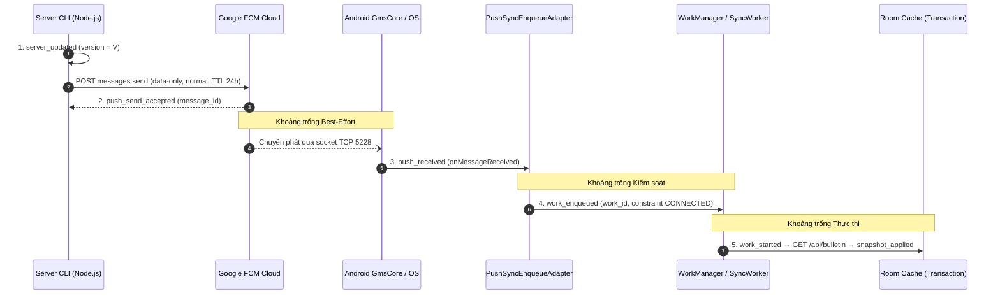

# Kịch bản Lời dẫn và Điều phối Demo 4 phút — SEM-47

- **Người thực hiện duy nhất:** Trang (`rosy179`).
- **Nhiệm vụ:** [SEM-47](../tasks/backlog/SEM-47.md) — Viết phần silent push và lời dẫn demo 4 phút.
- **Ngày bàn giao:** 11/11/2026 (UTC+7).
- **Đối chiếu base source:** `3fa78ac9ca00230253bb60008bedc16a7480b1fd` (`origin/main`).
- **Tài liệu đi kèm:** Nội dung Slide 4 & tổng quan [`slides/inputs/TRANG.md`](inputs/TRANG.md), hồ sơ kiểm chứng [`docs/evidence/SEM-47/CHECKS.md`](../docs/evidence/SEM-47/CHECKS.md).
- **Khung thời gian trong bài nói 15 phút:** **Slide 6 (`07:00–11:00`, tổng cộng `4:00` = 240 giây)** theo [PRESENTATION_PLAN.md](../docs/PRESENTATION_PLAN.md).
- **Phân vai cố định trong 4 phút demo:**
  - **Trang (`rosy179`):** Giữ mạch lời dẫn xuyên suốt cả 3 phần (**Push**, **Periodic**, **Doze / Hybrid**) để tránh mất thời gian đổi người nói giữa các thao tác kỹ thuật; trực tiếp giải thích ý nghĩa từng mốc sự kiện và quy tắc chuyển sang bản ghi dự phòng.
  - **Trí (`ThanhTris`):** Thao tác thiết bị Android/Emulator, chạy lệnh CLI cập nhật/gửi tín hiệu trên terminal và chuyển cửa sổ timeline/log hoặc video dự phòng có nhãn theo đúng nhịp dẫn của Trang.

> [!IMPORTANT]
> **Nguyên tắc trung thực bằng chứng trong Demo:**
> 1. Chỉ sử dụng động từ ở thì hoàn thành (*"đã nhận"*, *"đã áp dụng"*) khi dòng sự kiện tương ứng (`push_received`, `work_started`, `snapshot_applied`) **đang hiển thị thật** trên màn hình live hoặc trong bản ghi `[PLAYBACK]` của run đã nghiệm thu.
> 2. **Ngưỡng 30 giây** trong phần Push chỉ là **quy tắc điều phối thời lượng trình bày** để giữ trọn khung 4 phút, **tuyệt đối không phải bảo đảm kỹ thuật (SLA) rằng FCM phải giao tin trong 30 giây**.
> 3. Tại base `3fa78ac`, repo đã có dữ liệu thật của cột mốc Manual M1 ([`M1.md`](../docs/evidence/SEM-28/M1.md)) và 2 lượt chạy Pilot Periodic E01 ([`SEM-29 CHECKS`](../docs/evidence/SEM-29/CHECKS.md)); trong khi Pilot Push E02 ([SEM-34](../tasks/backlog/SEM-34.md)), tập chạy chính E01–E06 ([SEM-41](../tasks/backlog/SEM-41.md), [SEM-42](../tasks/backlog/SEM-42.md)), bản ứng viên ([SEM-37](../tasks/backlog/SEM-37.md)) và video dự phòng ([SEM-53](../tasks/backlog/SEM-53.md)) đang ở trạng thái **`Todo` (`Not run`)**. Kịch bản dưới đây cung cấp đầy đủ lời dẫn cho cả trường hợp chạy live/playback khi đã nhận đủ artifact và lời dẫn báo cáo minh bạch nếu tại thời điểm trình bày vẫn còn blocker **B1** (chưa có cấu hình Firebase thật).

---

## 1. Cấu trúc phân bổ 240 giây (07:00–11:00 toàn bài)

| Phân đoạn | Mốc trong Demo | Mốc toàn bài | Thời lượng | Chế độ hiển thị | Mục tiêu cốt lõi cần chứng minh |
|---|---|---|---:|---|---|
| **Phân đoạn 1** | `0:00–0:30` | `07:00–07:30` | `30s` | **`[LIVE]`** *(hoặc `[PLAYBACK]` nếu thiếu B1)* | Xác nhận `mode = PUSH`, `cachedVersion = N`, không còn lịch periodic cũ; đưa app về nền bằng nút Home (`stopped=false`); mở sẵn log đã lọc theo `device_alias` và `run_id`. |
| **Phân đoạn 2** | `0:30–1:30` | `07:30–08:30` | `60s` | **`[LIVE]`** $\to$ quá **30s** từ lúc gửi chưa `applied` thì chuyển **`[PLAYBACK]`** | Tạo `version N+1` và gửi FCM `data-only` `normal` priority; chỉ rõ chuỗi tách biệt `server_updated` $\to$ `push_send_accepted` (`accepted != delivered`) $\to$ `push_received` $\to$ `work_enqueued` $\to$ `work_started` $\to$ `snapshot_applied` **trước khi** mở lại UI đọc Room cache. |
| **Phân đoạn 3** | `1:30–2:30` | `08:30–09:30` | `60s` | **`[PLAYBACK — Đã ghi trước]`** | Dùng timeline/video đã ghi trước của ca `PERIODIC` tự nhiên (`E01`); chỉ rõ `periodic_registered` khác `work_started`, độ lệch thời gian thực tế so với chu kỳ 15 phút và các lượt `snapshot_unchanged`; không ép chạy worker thủ công. |
| **Phân đoạn 4** | `2:30–3:30` | `09:30–10:30` | `60s` | **`[PLAYBACK — Đã ghi trước]`** | Dùng clip/log đã ghi trước của ca Doze (`E03`) hoặc ca `HYBRID` cố ý bỏ gửi push (`E06` `--skip-push` $\to$ `push_send_skipped` / `FAULT_INJECTION_SKIP` rồi `PERIODIC` phục hồi) kèm cơ chế lọc trùng `DUPLICATE_SIGNAL` (`E05`, `SEM-38`). |
| **Phân đoạn 5** | `3:30–4:00` | `10:30–11:00` | `30s` | **`[TỔNG KẾT & CHUYỂN VAI]`** | Kết nối lại câu hỏi mở bài: *Ai kích hoạt — Ai quyết định thời điểm chạy — Khi nào dữ liệu thật sự đổi*; dành 5 giây cuối (`10:55–11:00`) chuyển lời sang Vinh (Slide 7). |

### Biến thể rút gọn 30 giây (Tổng Demo `3:30` = 210 giây cho phương án 13 phút trình bày + 2 phút Hỏi–Đáp)

Nếu giảng viên yêu cầu tính cả hỏi đáp trong 15 phút ([PRESENTATION_PLAN.md](../docs/PRESENTATION_PLAN.md)):
- Giữ nguyên **Phân đoạn 1 (`30s`)**, **Phân đoạn 2 (`60s`, giữ ngưỡng 30s)** và **Phân đoạn 5 (`30s`)**.
- Rút **Phân đoạn 3 (Periodic `[PLAYBACK]`)** từ `60s` xuống **`45s`** và **Phân đoạn 4 (Doze/Hybrid `[PLAYBACK]`)** từ `60s` xuống **`45s`** bằng cách mở sẵn con trỏ ngay tại dòng event trọng tâm trên file JSONL/analysis đã lọc, không cuộn log từ đầu file.

---

## 2. Những điều bắt buộc phải nhìn thấy trên màn hình và Quy tắc an toàn

Theo [PRESENTATION_PLAN.md mục Những điều phải nhìn thấy trong evidence](../docs/PRESENTATION_PLAN.md), [EVENT_SCHEMA.md](../docs/EVENT_SCHEMA.md) và [PUSH.md](../docs/PUSH.md), Trí và Trang phải kiểm tra 4 nhóm yêu cầu sau trước khi bắt đầu:

1. **Định danh & Trường dữ liệu bắt buộc trên màn hình:**
   - Phiên bản dữ liệu trước và sau (`cachedVersion` trên UI / Room và `data_version` / `version` trong event log).
   - Chế độ đồng bộ (`mode`: `PUSH`, `PERIODIC`, `HYBRID`) và nguồn kích hoạt (`source`: `PUSH`, `PERIODIC`, `MANUAL`).
   - Định danh thiết bị (`device_alias`, ví dụ `emulator-main` hoặc `emulator-01`), mã lượt chạy (`run_id`), thời gian `occurred_at_utc` (ISO 8601) kèm `elapsed_realtime_ms` (monotonic phía Android) và tên sự kiện (`event_type`).
   - Các mã nối chuỗi sự kiện (`request_id`, `work_id`, `message_id`, `signal_id`).
2. **Thứ tự nhân quả chứng minh đồng bộ nền:**
   - Phải chỉ cho người nghe thấy dòng `snapshot_applied` đã xuất hiện trong log/timeline **khi ứng dụng vẫn đang ở background**.
   - Chỉ sau khi đã chỉ rõ `snapshot_applied`, Trí mới mở lại giao diện ứng dụng để xác nhận màn hình đọc thẳng từ Room cache (không có cơ chế tự động gọi mạng khi mở màn hình và không bấm nút đồng bộ thủ công trong cửa sổ đo).
3. **Nhãn phân biệt chế độ trình chiếu (`[LIVE]` vs `[PLAYBACK]`):**
   - Mọi cửa sổ terminal, trình xem log hoặc trình phát video phải gắn nhãn rõ ràng ở góc trên hoặc tiêu đề cửa sổ: **`[LIVE — <device_alias> — <run_id>]`** hoặc **`[PLAYBACK — <run_id> — <device_alias> — commit <short_sha>]`**.
   - Ghi rõ điều kiện môi trường của bản phát lại (ví dụ: `Android 17 / API 37 Emulator, CONNECTED, Deep Doze = IDLE` hoặc `Natural Periodic 90m`).
4. **Quy tắc bảo mật (Không lộ bí mật lên màn hình/video):**
   - **Tuyệt đối không hiển thị** chuỗi FCM registration token thô, nội dung file `.local/secrets/device-token.txt`, `android/app/google-services.json`, khóa dịch vụ Firebase (`*service-account*.json`) hoặc số serial phần cứng cá nhân.
   - Nếu cần chứng minh trạng thái token của thiết bị, chỉ chiếu trường `fcmTokenStatus = READY` và `fcmTokenFingerprint` (16 ký tự hex đầu của SHA-256) do [`FcmTokenManager.kt`](../android/app/src/main/java/com/thanhtris/seminarie307/fcm/FcmTokenManager.kt) ghi nhận.

---

## 3. Kịch bản chi tiết từng phân đoạn (Lời dẫn của Trang & Thao tác của Trí)

### Phân đoạn 1 (`0:00–0:30` | Mốc toàn bài `07:00–07:30`) — `[LIVE]` Thiết lập Baseline Mode PUSH và đưa App về Background

- **Nhãn hiển thị:** **`[LIVE]`** *(Nếu trình bày khi chưa có cấu hình Firebase thật B1: gắn nhãn **`[PLAYBACK / DRY-RUN PREFLIGHT]`** theo Nhánh C ở Mục 4).*
- **Thao tác của Trí (`0:00–0:20`):**
  1. Chia đôi màn hình chiếu: bên trái là màn hình thiết bị Android (`emulator-main` / `emulator-01`), bên phải là hai khung terminal theo dõi log JSONL của Server và log timeline của Android đã lọc sẵn theo `run_id` và `device_alias`.
  2. Chỉ con trỏ vào thẻ trạng thái trên UI ứng dụng: `Mode = PUSH`, `Cached Version = N`, `fcmTokenStatus = READY` (kèm `fingerprint` 16 hex), xác nhận lịch `PERIODIC` không hoạt động.
  3. Tại giây `0:15`, nhấn nút **Home** đưa ứng dụng về background (`stopped=false`). Không chạm vào ứng dụng nữa.
- **Lời dẫn của Trang (`0:00–0:30`, ~70 từ):**
  > “Cảm ơn Tâm. Bây giờ chúng ta bước vào 4 phút demo để quan sát trực tiếp hành trình từ lúc có tín hiệu kích hoạt đến khi bộ nhớ đệm Room thực sự thay đổi.
  > Trên màn hình bên trái là ứng dụng đang ở chế độ **PUSH** với phiên bản cache ban đầu là **version N**, định danh `run_id` và `device_alias` đã được lọc sẵn ở khung log bên phải, và lịch định kỳ đã được tắt hoàn toàn. Trí vừa bấm nút **Home** để đưa ứng dụng về nền; gói ứng dụng ở trạng thái `stopped=false` và màn hình không còn mở.”
- **Điểm khớp nối sang Phân đoạn 2 (`0:30`):** Trí đặt sẵn lệnh cập nhật và gửi push trên terminal server.

---

### Phân đoạn 2 (`0:30–1:30` | Mốc toàn bài `07:30–08:30`) — `[LIVE / Chuyển PLAYBACK ở +30s]` Tạo Version N+1, Gửi Silent Push Data-only và Kiểm chứng Cache Nền

- **Nhãn hiển thị:** Bắt đầu ở **`[LIVE]`**; bắt đầu đếm đồng hồ **30 giây** ngay từ thời điểm lệnh `send-push` trả kết quả.
- **Thao tác của Trí (`0:30–1:00`):**
  1. Tại giây `0:30`, thực thi lệnh cập nhật snapshot lên **version N+1** (`npm run update`) và lệnh gửi tín hiệu FCM `data-only` với `priority = "normal"`, `ttl = 86400000` (`npm run send-push`).
  2. Tô sáng (highlight) ngay trên terminal Server hai dòng sự kiện vừa sinh ra: `server_updated` (`data_version = N+1`) và `push_send_accepted` (kèm `message_id` và `signal_id`).
  3. Theo dõi khung log Android trong cửa sổ **30 giây** (`0:30–1:00`):
     - **Nếu xuất hiện chuỗi sự kiện Android trước mốc `1:00` (Nhánh A):** Tô sáng lần lượt `push_received` $\to$ `work_enqueued` (có `workId`) $\to$ `work_started` $\to$ `snapshot_applied` (`version = N+1`). Sau khi đã chỉ rõ `snapshot_applied` trong log, mới mở lại ứng dụng từ màn hình Home để cho thấy UI hiển thị `version N+1`.
     - **Nếu đến mốc `1:00` (đủ 30 giây từ lúc gửi) mà chưa có `snapshot_applied` (Nhánh B):** Chuyển ngay sang tab log/video dự phòng đã gắn nhãn **`[PLAYBACK]`** của run đã kiểm chứng, chỉ vào chuỗi sự kiện hoàn chỉnh và mở UI tương ứng.
- **Lời dẫn của Trang (`0:30–1:30`):**
  - **Lời dẫn chung khi gửi tín hiệu (`0:30–0:50`, ~50 từ):**
    > “Ở giây thứ 30, Trí cập nhật bản tin trên server lên **version N+1** và phát một tín hiệu FCM `data-only` ở mức `normal` priority với TTL 24 giờ. Trên log server đã xuất hiện `server_updated` và `push_send_accepted` kèm `message_id`. Xin lưu ý: `push_send_accepted` chỉ chứng minh máy chủ FCM đã nhận yêu cầu gửi, **chưa chứng minh** điện thoại đã nhận được tin hay cache đã đổi.”
  - **Nhánh A — Khi Live ghi nhận `snapshot_applied` trong vòng 30 giây (`0:50–1:30`, ~90 từ):**
    > “Nhìn sang log phía Android khi ứng dụng vẫn đang ở nền: hệ điều hành đã đánh thức `BulletinFirebaseMessagingService` và ghi nhận `push_received`. Ngay lập tức, `PushSyncEnqueueAdapter` kiểm tra không trùng `signal_id` và bàn giao cho `WorkManager`, sinh ra sự kiện `work_enqueued` kèm `work_id`. Tiếp theo, `SyncWorker` bắt đầu chạy (`work_started`), gọi `GET /api/bulletin`, vượt qua Version Guard trong giao dịch Room và ghi nhận **`snapshot_applied` ở version N+1**.
    > Chỉ sau khi `snapshot_applied` đã xuất hiện ở nền như trên log, Trí mới mở lại ứng dụng: giao diện lập tức hiển thị **version N+1** đọc trực tiếp từ Room cache mà không hề phát sinh request tự động khi mở màn hình.”
  - **Nhánh B — Khi Live chưa có `snapshot_applied` sau ngưỡng 30 giây kể từ lúc gửi (`0:50–1:30`, ~95 từ):**
    > “Tính đến mốc **30 giây** kể từ lúc gửi, trên màn hình live chúng ta đã thấy `push_send_accepted` từ server nhưng phía Android **chưa ghi nhận `snapshot_applied` trong cửa sổ live vừa rồi**. Nhóm xin nhấn mạnh: **30 giây là ngưỡng điều phối thời lượng của buổi thuyết trình để sang phần tiếp theo, hoàn toàn không phải bảo đảm kỹ thuật rằng FCM `normal` priority phải giao tin trong 30 giây** — vì tín hiệu nền luôn chịu quản lý năng lượng và trạng thái kết nối của hệ điều hành.
    > Để giữ đúng khung 4 phút, Trí chuyển sang bản ghi **`[PLAYBACK]`** kèm đầy đủ metadata `run_id`, `device_alias` và commit build: trên bản ghi này, chúng ta thấy trọn vẹn chuỗi `push_received` $\to$ `work_enqueued` $\to$ `work_started` $\to$ `snapshot_applied` hoàn tất ở nền trước khi mở lại giao diện.”

---

### Phân đoạn 3 (`1:30–2:30` | Mốc toàn bài `08:30–09:30`) — `[PLAYBACK — Đã ghi trước]` Quan sát Periodic WorkManager Tự nhiên (E01)

- **Nhãn hiển thị bắt buộc:** **`[PLAYBACK — Run: run-sem29-periodic-emulator-20261107-r2 — Device: emulator-main (Android 17 / API 37) — App commit: 95eeecb — Server commit: a26646d]`** *(kèm đối chiếu lượt đầu `run-sem29-periodic-emulator-20261107` bị `ABORTED`). Khi có thêm run tập chính từ [SEM-41](../tasks/backlog/SEM-41.md), hiển thị thêm tab tương ứng với đúng nhãn `[PLAYBACK]`.*
- **Thao tác của Trí (`1:30–2:30`):**
  1. Mở cửa sổ trình chiếu artifact đã kiểm chứng của [SEM-29](../docs/evidence/SEM-29/CHECKS.md): [`manifest.json`](../experiments/runs/run-sem29-periodic-emulator-20261107-r2/manifest.json), [`analysis.json`](../experiments/runs/run-sem29-periodic-emulator-20261107-r2/analysis.json) và [`events.jsonl`](../experiments/runs/run-sem29-periodic-emulator-20261107-r2/events.jsonl).
  2. Chỉ con trỏ vào mốc đăng ký `periodic_registered` (`10:07:21.184Z` / `17:07:21 UTC+7`, `elapsedRealtimeMillis = 830979`), sau đó chỉ vào lượt recovery của setup (`snapshot_applied` version 3 lúc `10:08:35.405Z` / `17:08:35 UTC+7`), rồi quét qua **5 mốc `work_started` của 5 chu kỳ periodic tự nhiên mới** (`10:23:58Z`, `10:39:08Z`, `10:58:22Z`, `11:14:22Z`, `11:34:23Z` — tức `17:23:58`, `17:39:08`, `17:58:22`, `18:14:22`, `18:34:23 UTC+7`) cùng kết cục `snapshot_unchanged`.
- **Lời dẫn của Trang (`1:30–2:30`, ~145 từ):**
  > “Sang phút thứ hai, chúng ta chuyển sang chế độ **`[PLAYBACK]` đã ghi trước** của cơ chế **Periodic WorkManager**. Vì `PeriodicWorkRequest` của Android áp đặt chu kỳ tối thiểu là **15 phút**, nhóm tuyệt đối không bấm nút chạy cưỡng bức hay dùng lệnh `jobscheduler run` trong lúc demo rồi gọi đó là định kỳ tự nhiên, mà sử dụng bản ghi thực nghiệm 90 phút trên `emulator-main` Android 17 đã được kiểm chứng.
  > Trên timeline của run `run-sem29-periodic-emulator-20261107-r2`, xin lưu ý ba điểm bằng chứng:
  > - **Thứ nhất:** Sự kiện `periodic_registered` chỉ xác nhận `WorkManager` đã nhận lịch `periodic_bulletin_sync`, không phải lúc worker chạy.
  > - **Thứ hai:** Trong cửa sổ 90 phút (`5.400.050 ms`), có 6 lần `work_started`, nhưng bản ghi phân tách rất rõ: lần đầu tiên lúc `17:08:35` (`10:08:35Z`) là lượt recovery của request setup áp dụng `version 3` (`snapshot_applied`), còn **5 chu kỳ periodic tự nhiên mới** khởi chạy cách nhau từ 15 đến gần 20 phút (`17:23:58`, `17:39:08`, `17:58:22`, `18:14:22` và `18:34:23 UTC+7`). Khoảng cách thực tế này chứng minh bộ lập lịch Android co giãn thời điểm chạy theo tài nguyên hệ thống chứ không chạy đúng từng mốc đồng hồ.
  > - **Thứ ba:** Ở cả 5 chu kỳ mới, khi server không có bản tin mới hơn, Version Guard giữ nguyên cache và ghi `snapshot_unchanged` — minh họa trực tiếp chi phí chu kỳ rỗng khi chỉ dùng polling.”

---

### Phân đoạn 4 (`2:30–3:30` | Mốc toàn bài `09:30–10:30`) — `[PLAYBACK — Đã ghi trước]` Quan sát Giới hạn Hệ điều hành (Doze E03) và Phục hồi Hybrid / Chống trùng (E06 & E05)

- **Nhãn hiển thị bắt buộc:** **`[PLAYBACK — Doze / Fault-Injection Skip-Push & Input Policy Evidence]`** *(ghi rõ nguồn artifact trên màn hình: lệnh/log fault injection [SEM-40](../docs/evidence/SEM-40/FAULT_INJECTION.md), ma trận ca kiểm [SEM-38](../docs/evidence/SEM-38/PUSH_INPUT_CASES.md), protocol Doze [SEM-16](../experiments/PROTOCOL.md), và clip/log run thiết bị từ [SEM-41](../tasks/backlog/SEM-41.md)/[SEM-53](../tasks/backlog/SEM-53.md) khi đã bàn giao).*
- **Thao tác của Trí (`2:30–3:30`):**
  1. `2:30–2:55`: Chiếu đoạn log/clip điều kiện **Doze Mode (`E03`)**: hiển thị trạng thái `dumpsys deviceidle get deep` = `IDLE`, mốc gửi tín hiệu khi máy đang ngủ sâu, và mốc `t_idle_exit` sau khi thoát Doze (`deviceidle unforce`).
  2. `2:55–3:30`: Chiếu đoạn log **Fault Injection bỏ gửi push (`E06`)** từ CLI `npm run update -- ... --skip-push` ([`FAULT_INJECTION.md`](../docs/evidence/SEM-40/FAULT_INJECTION.md)) với sự kiện `server_updated` đi kèm `push_send_skipped` (`reason = "FAULT_INJECTION_SKIP"`, `message_id = null`), đối chiếu với luồng `HYBRID` nơi chu kỳ `PERIODIC` kế tiếp gọi `GET /api/bulletin`, và chiếu bảng kết quả kiểm `DUPLICATE_SIGNAL` / `version_hint` cũ của [`PushInputPolicy`](../docs/evidence/SEM-38/PUSH_INPUT_CASES.md).
- **Lời dẫn của Trang (`2:30–3:30`, ~150 từ):**
  - **Khi trình bày cùng bộ clip/log playback đầy đủ (hoặc chỉ rõ trạng thái từng phần trên base hiện tại):**
    > “Ở phút thứ ba, chúng ta tiếp tục quan sát trên bản ghi **`[PLAYBACK]`** cách hệ điều hành kiểm soát tác vụ nền trong các điều kiện khắc nghiệt và cách kiến trúc ứng dụng tự bảo vệ:
    > - **Về trạng thái hệ điều hành (Doze Mode — E03):** Khi thiết bị được xác nhận vào trạng thái `deep IDLE`, hệ điều hành tạm hoãn truy cập mạng thông thường. Một gói silent push ở mức `normal` priority hoặc một chu kỳ WorkManager rơi vào khoảng này sẽ bị giữ lại và chỉ được giải phóng trong cửa sổ bảo trì hoặc sau mốc thoát Doze (`t_idle_exit`). Riêng nếu ứng dụng bị người dùng bấm `Force-stop` (`stopped=true`), hệ điều hành chặn hoàn toàn mọi broadcast cho đến khi người dùng tự mở lại app.
    > - **Về sự cố bỏ gửi tín hiệu và phục hồi trong chế độ HYBRID (E06):** Trên log server, khi chạy lệnh cập nhật kèm cờ `--skip-push`, server vẫn tăng `data_version` (`server_updated`) nhưng chủ động không gọi FCM và ghi nhãn `push_send_skipped` với lý do `FAULT_INJECTION_SKIP` và `message_id = null` — đây là phép thử lỗi có kiểm soát, không phải kết luận FCM làm mất tin. Trong chế độ **HYBRID**, khi không có push đánh thức, chu kỳ `PERIODIC` tự nhiên đóng vai trò lưới an toàn gọi `GET /api/bulletin` vào cùng `SyncRepository` để cập nhật cache khi đủ điều kiện.
    > - **Về sự cố tín hiệu trùng hoặc `version_hint` cũ (E05 / SEM-38):** Nếu cùng một `signal_id` hoặc `message_id` bị gửi lặp, `PushInputPolicy` chặn ngay tại adapter với sự kiện `trigger_rejected` (`DUPLICATE_SIGNAL`); còn nếu `version_hint` cũ hơn cache, worker vẫn lấy bản hiện hành trên server và để Version Guard trong giao dịch Room quyết định.”
  - *(Lưu ý trung thực bắt buộc nếu tại thời điểm nói các run thiết bị E03/E05/E06 của SEM-41 vẫn ở trạng thái `Not run`):* Trang nói rõ thêm 1 câu: *“Trên bản code hiện tại, công cụ `--skip-push` (22/22 test server) và bộ lọc `PushInputPolicy` (29/29 test JVM) đã kiểm chứng xong; còn lượt đo thiết bị đầy đủ cho E03, E05 và E06 đang được giữ đúng nhãn `Not run` chờ đợt chạy tập chính.”*

---

### Phân đoạn 5 (`3:30–4:00` | Mốc toàn bài `10:30–11:00`) — `[KẾT NỐI & CHUYỂN VAI]` Tổng kết câu hỏi Trigger-to-Cache và Bàn giao cho Vinh

- **Nhãn hiển thị:** Quay về sơ đồ tổng kết **Trigger $\to$ OS/Scheduler $\to$ SyncWorker $\to$ Room Transaction (Version Guard) $\to$ UI** trên Slide 6.
- **Thao tác của Trí (`3:30–4:00`):** Thu nhỏ cửa sổ log, chiếu lại slide tóm tắt 3 câu hỏi đối chiếu của phần Demo, chuẩn bị chuyển sang Slide 7 cho Vinh đúng mốc `11:00`.
- **Lời dẫn của Trang (`3:30–3:55`, ~65 từ):**
  > “Khép lại 4 phút demo, chúng ta trả lời trọn vẹn câu hỏi ở đầu bài bằng ba mốc tách biệt:
  > 1. **Ai kích hoạt?** Lịch định kỳ `PERIODIC`, tín hiệu `PUSH data-only`, hoặc sự kết hợp của cả hai trong `HYBRID`.
  > 2. **Ai quyết định thời điểm chạy?** Hệ điều hành Android, `GmsCore` và `WorkManager` dựa trên trạng thái Doze, mạng `CONNECTED`, quota nền và trạng thái `stopped` của ứng dụng.
  > 3. **Khi nào dữ liệu thật sự đổi?** Chỉ khi `SyncWorker` hoàn tất `GET /api/bulletin` và giao dịch Room vượt qua Version Guard để ghi nhận `snapshot_applied`.”
- **Câu chuyển người sang Vinh (`3:55–4:00`, 5 giây — nằm trong khung 4 phút):**
  > “Từ các mốc bằng chứng vừa quan sát, Vinh sẽ trình bày tổng hợp kết quả thực nghiệm và các giới hạn đo đạc của nhóm.”

---

## 4. Quy tắc Ngưỡng 30 Giây và Ma trận Xử lý Tình huống Trực tiếp (Live Contingency Matrix)

### 4.1. Bản chất của Ngưỡng 30 Giây trong Kịch bản Demo

Theo [PRESENTATION_PLAN.md](../docs/PRESENTATION_PLAN.md) và yêu cầu nghiệm thu của [SEM-47](../tasks/backlog/SEM-47.md):

1. **Ngưỡng 30 giây là quy tắc quản trị thời gian trình bày (Presentation Timebox), KHÔNG PHẢI cam kết kỹ thuật (SLA) của FCM:**
   - Trong protocolo thực nghiệm [`PROTOCOL.md` §4 (E02)](../experiments/PROTOCOL.md), cửa sổ quan sát chuẩn của một lượt gửi push là **120 giây**, và TTL giữ tin trên FCM là **24 giờ (`86400000 ms`)**.
   - Tuy nhiên, toàn bộ phần Demo trên sân khấu chỉ có **4 phút (240 giây)** cho cả 3 nội dung (Push, Periodic, Doze/Hybrid). Nếu chờ hết 120 giây ở phần Push live thì sẽ phá vỡ toàn bộ thời lượng bài nói 15 phút.
   - Do đó, nhóm ấn định **mốc 30 giây kể từ lúc lệnh `send-push` hoàn tất**: nếu trong 30 giây đó chưa thấy `snapshot_applied`, người dẫn phải chủ động chuyển sang bản ghi `[PLAYBACK]` đã kiểm chứng.
2. **Cách diễn đạt bắt buộc khi chuyển ở giây thứ 30:**
   - **Phải nói:** *"Chưa ghi nhận cập nhật trong cửa sổ live 30 giây của buổi trình bày; nhóm chuyển sang bản ghi `[PLAYBACK]` của run đã kiểm chứng kèm metadata."*
   - **Tuyệt đối không được nói:** *"FCM bị lỗi vì quá 30 giây chưa tới"* hoặc *"Silent push đảm bảo cập nhật trong vòng 30 giây"*.

### 4.2. Ma trận hành động và câu dẫn cho 5 tình huống tại bàn Demo

| Tình huống quan sát được trên màn hình | Thao tác của Trí | Câu dẫn chuẩn của Trang | Bằng chứng bắt buộc phải chỉ ra |
|---|---|---|---|
| **TH1. Live hoàn tất trong $\le 30\text{s}$ (`snapshot_applied` đã hiện ở nền)** | Tô sáng chuỗi event từ `server_updated` đến `snapshot_applied`; sau đó mới mở lại UI ứng dụng từ màn hình Home. | *“Trong cửa sổ live, thiết bị đã ghi nhận trọn vẹn từ `push_received`, `work_enqueued`, `work_started` đến `snapshot_applied` ở nền. Bây giờ Trí mở lại UI để đọc cache đã cập nhật.”* | Timestamp của `snapshot_applied` nhỏ hơn mốc mở lại UI; `cachedVersion = N+1`. |
| **TH2. Đạt ngưỡng 30s từ lúc gửi nhưng chưa có `snapshot_applied` (dù đã có `push_send_accepted` hoặc `push_received`)** | Dừng chờ live ngay tại giây thứ 30 (`1:00` của demo); mở tab log/video **`[PLAYBACK]`** đã chuẩn bị sẵn. | *“Đến mốc 30 giây của khung trình bày live, server đã ghi `push_send_accepted` nhưng trên máy chưa hoàn tất `snapshot_applied`. Vì 30 giây là ngưỡng thời lượng trình chiếu chứ không phải bảo đảm độ trễ của FCM, nhóm chuyển sang bản ghi `[PLAYBACK]` có metadata của run đã kiểm chứng.”* | Chỉ rõ mốc đã dừng ở live (`accepted`/`received`), nhãn `[PLAYBACK]` và chuỗi event đầy đủ trong bản ghi dự phòng. |
| **TH3. Xuất hiện `trigger_rejected` với lý do `MODE_DISABLED` hoặc `DUPLICATE_SIGNAL`** | Tô sáng dòng `push_received` đi kèm `trigger_rejected` và cột `reason` trên timeline Android. | *“Log cho thấy callback `push_received` đã chạy, nhưng `PushSyncEnqueueAdapter` từ chối xếp lịch với lý do `MODE_DISABLED` / `DUPLICATE_SIGNAL` đúng theo hợp đồng bảo vệ đầu vào.”* | Cặp sự kiện `push_received` + `trigger_rejected` cùng `run_id`, `message_id` và `reason`. |
| **TH4. Sender báo `push_send_rejected` hoặc `push_send_failed_local`** | Giữ nguyên màn hình lỗi của CLI sender, mở sang tab `[PLAYBACK]` đã chuẩn bị. | *“CLI sender vừa ghi nhận trạng thái từ chối/lỗi preflight rõ ràng thay vì báo thành công giả. Chúng ta chuyển sang bản ghi `[PLAYBACK]` để quan sát tiếp các mốc phía Android.”* | Sự kiện `push_send_rejected` / `push_send_failed_local` (`message_id = null`) trên JSONL server. |
| **TH5. Trình bày khi chưa được cấp Firebase credential thật (Blocker B1 / chưa có run `SEM-34`)** | Hiển thị lệnh `npm run send-push -- --validate-only ...`, kết quả 22/22 test server ([SEM-35](../docs/evidence/SEM-35/CHECKS.md)/[SEM-40](../docs/evidence/SEM-40/CHECKS.md)), 29/29 test JVM messaging ([SEM-38](../docs/evidence/SEM-38/CHECKS.md)), bản ghi M1 ([SEM-28](../docs/evidence/SEM-28/M1.md)) và run thật Periodic E01 ([SEM-29](../docs/evidence/SEM-29/CHECKS.md)). | *“Do cấu hình Firebase thật đang ở trạng thái blocker B1 được ghi nhận trong CHECKS, nhóm không giả lập kết quả nhận push live mà trình diễn kiểm tra hợp đồng `--validate-only`, bộ kiểm thử adapter/policy đã pass và bản ghi thực nghiệm thật của luồng đồng bộ chung cùng Periodic E01.”* | Nhãn blocker B1 minh bạch, không dùng fixture làm kết quả chạy thật. |

---

## 5. Điểm nhấn Phản biện tại Demo: Giải thích "Vì sao `Accepted` khác `Delivered` và khác `Applied`?"

Khi trình chiếu Phân đoạn 2 (`0:30–1:30`) hoặc khi giảng viên đặt câu hỏi tại chỗ, Trang và Trí sử dụng bảng đối chiếu 5 chặng dưới đây để chỉ thẳng vào các trường trên màn hình log ([`EVENT_SCHEMA.md`](../docs/EVENT_SCHEMA.md), [`PUSH.md` §7](../docs/PUSH.md)):

### Câu trả lời 20 giây (dùng ngay trong lúc dẫn Demo)

> “Sự kiện `push_send_accepted` kèm `message_id` chỉ có nghĩa là **máy chủ Google FCM đã nhận gói tin từ backend của nhóm** (`accepted for delivery`). Từ đám mây FCM xuống đến bộ nhớ đệm Room của điện thoại còn phải đi qua **3 khoảng trống độc lập**:
> 1. **Từ FCM đến Callback (`push_received`):** Có thể bị chặn hoặc hoãn bởi mất mạng, Doze Mode đối với `normal` priority, trạng thái `Force-stop` (`stopped=true`), hoặc trình quản lý pin OEM.
> 2. **Từ Callback vào Hàng đợi (`work_enqueued`):** Có thể bị từ chối có chủ đích nếu đang ở mode `PERIODIC` (`MODE_DISABLED`) hoặc là tín hiệu giao lặp (`DUPLICATE_SIGNAL`).
> 3. **Từ Hàng đợi đến Lưu trữ (`work_started` $\to$ `snapshot_applied`):** Worker phải chờ có mạng (`CONNECTED`), gọi `GET /api/bulletin` thành công và vượt qua Version Guard trong giao dịch Room.
> Vì vậy, có `message_id` hoàn toàn chưa chứng minh máy đã nhận tin (`delivered`), và nhận được tin cũng chưa chứng minh cache đã đổi (`applied`).”

---

## 6. Kiểm kê Trạng thái Hiện có của Bộ Evidence phục vụ Demo tại Base `3fa78ac`

Để đảm bảo người ghép slide ([SEM-51](../tasks/backlog/SEM-51.md)), người viết runbook ([SEM-52](../tasks/backlog/SEM-52.md)), người quay video ([SEM-53](../tasks/backlog/SEM-53.md)) và người điều phối diễn tập ([SEM-54](../tasks/backlog/SEM-54.md)) nắm rõ những gì đã có thật trong kho lưu trữ tại thời điểm bàn giao `SEM-47`:

| Thành phần dùng trong Demo | Artifact / Tài liệu đã có trên `main` (`3fa78ac`) | Trạng thái Kiểm chứng thực tế | Việc cần làm ở các Task tiếp theo |
|---|---|---|---|
| **Luồng đồng bộ chung & UI đọc Room Cache** | [`M1.md`](../docs/evidence/SEM-28/M1.md), [`SEM-28 CHECKS`](../docs/evidence/SEM-28/CHECKS.md), [`SyncRepository.kt`](../android/app/src/main/java/com/thanhtris/seminarie307/sync/SyncRepository.kt) | **Pass (Đã chạy thật M1 trên Emulator)** — xác nhận version guard, Room Flow và mở lại offline không tự GET. | [SEM-37](../tasks/backlog/SEM-37.md) chốt `CANDIDATE_MANIFEST.json`. |
| **CLI Server Update, Sender & Skip-Push (`E06`)** | [`fcm_sender.js`](../server/src/fcm_sender.js), [`skip_push.js`](../server/src/skip_push.js), [`SEM-35 CHECKS`](../docs/evidence/SEM-35/CHECKS.md), [`SEM-40 CHECKS`](../docs/evidence/SEM-40/CHECKS.md) | **Pass (22/22 Node test & local CLI)**; gửi FCM thật đang **Not run — Blocker B1**. | Khi có credential/token thật (B1), dùng ngay lệnh đã khóa để chạy `SEM-34` và `SEM-41`. |
| **Callback FCM, Token Lifecycle & Input Policy (`E05`)** | [`BulletinFirebaseMessagingService.kt`](../android/app/src/main/java/com/thanhtris/seminarie307/fcm/BulletinFirebaseMessagingService.kt), [`FcmTokenManager.kt`](../android/app/src/main/java/com/thanhtris/seminarie307/fcm/FcmTokenManager.kt), [`PushInputPolicy.kt`](../android/app/src/main/java/com/thanhtris/seminarie307/fcm/PushInputPolicy.kt), [`SEM-38 CHECKS`](../docs/evidence/SEM-38/CHECKS.md) | **Pass (29/29 JVM unit tests)** cho callback, token fingerprint và 15 ca duplicate/stale hint/in-flight; chạy thiết bị E05 là **Not run — Blocker B1, B2**. | [SEM-34](../tasks/backlog/SEM-34.md) chạy pilot E02; [SEM-41](../tasks/backlog/SEM-41.md) chạy E05 trên emulator. |
| **Bản ghi `[PLAYBACK]` cho Periodic Tự nhiên (`E01`)** | [`run-sem29-periodic-emulator-20261107-r2/manifest.json`](../experiments/runs/run-sem29-periodic-emulator-20261107-r2/manifest.json), [`analysis.json`](../experiments/runs/run-sem29-periodic-emulator-20261107-r2/analysis.json), [`events.jsonl`](../experiments/runs/run-sem29-periodic-emulator-20261107-r2/events.jsonl) và run đầu [`ABORTED`](../experiments/runs/run-sem29-periodic-emulator-20261107/manifest.json) ([`SEM-29 CHECKS`](../docs/evidence/SEM-29/CHECKS.md)) | **Pass (Đã có run Pilot 90 phút thật trên Emulator API 37)** — dùng được ngay cho Phân đoạn 3 (`1:30–2:30`) với nhãn `pilot / legacy-room-v1`. | [SEM-41](../tasks/backlog/SEM-41.md) bổ sung thêm run main schema v2 nếu kịp trước giờ báo cáo. |
| **Bản ghi `[PLAYBACK]` cho Push (`E02`), Doze (`E03`) & Hybrid (`E06`) trên Android** | Đã có quy trình ADB Doze ([`PROTOCOL.md` §6](../experiments/PROTOCOL.md)), hướng dẫn skip-push ([`FAULT_INJECTION.md`](../docs/evidence/SEM-40/FAULT_INJECTION.md)) và phân tích kiến trúc ([`TAM.md`](inputs/TAM.md)). | **Not run** trên thiết bị Android tại base `3fa78ac` (chờ [SEM-34](../tasks/backlog/SEM-34.md), [SEM-36](../tasks/backlog/SEM-36.md), [SEM-41](../tasks/backlog/SEM-41.md), [SEM-42](../tasks/backlog/SEM-42.md)). | [SEM-53](../tasks/backlog/SEM-53.md) quay video dự phòng từ bản build thật và upload Drive; [SEM-54](../tasks/backlog/SEM-54.md) bấm giờ 2 lần diễn tập. |
