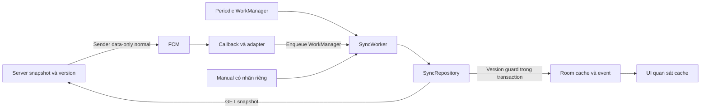

# SEM-49 — Nội dung kiến trúc và lập luận bài nghiên cứu thứ hai

Tâm (`HoaiTam`), bàn giao nội dung ngày 09/11/2026. Đối chiếu source tại `db5fab65920628eaa1cfa44ce229c7019b1b6905`. Đây là đầu vào văn bản cho SEM-51, gồm nội dung slide, lời nói và nguồn; chưa phải deck hay kết quả chạy mới. Các đầu vào SEM-18/21/27/35/40 đã Done trên Project khi nhận.

## 1. Vị trí trong bài nói

Theo [PRESENTATION_PLAN](../../docs/PRESENTATION_PLAN.md):

- **Slide 5, 06:00–07:00:** Tâm nói phần kiến trúc trong 60 giây, gồm chuyển người. Dùng nội dung mục 2, lời dẫn mục 3.
- **Slide 8, 12:45–14:00:** Tuấn trình bày lập luận hai nghiên cứu. Mục 5 cung cấp đoạn Paper 2 khoảng 25–30 giây để Tuấn ghép trong khung có sẵn; không thêm một lượt nói của Tâm.
- Chi tiết fault injection, provenance số liệu và phản biện để trong notes/phụ lục, không nhồi toàn bộ lên slide chính. Phần kết quả pilot do Vinh trình bày; bảng mục 6 giúp thống nhất cách diễn giải.

## 2. Slide 5 — Ba trigger, một đường đồng bộ

**Thông điệp trên slide:** Trigger tạo cơ hội thực thi; cache chỉ đổi sau khi worker lấy và commit dữ liệu hợp lệ.

Ba ý hiển thị:

1. Server commit snapshot/version trước; cập nhật dữ liệu và gửi tín hiệu là hai thao tác riêng.
2. PERIODIC và PUSH đi vào cùng `SyncWorker`/`SyncRepository`; HYBRID kết hợp hai trigger. Manual là thao tác riêng, loại khỏi thống kê nền.
3. Room transaction kiểm version mới nhất trước khi apply. UI quan sát cache; mở UI không được tính là bằng chứng cập nhật nền.



Mũi tên thể hiện luồng kiến trúc; không cam kết mỗi trigger đều được thực thi ngay. Sơ đồ không biểu diễn mọi bước retry, policy trùng tín hiệu hoặc error branch.

Nguồn source/contract: [HTTP API](../../docs/API.md), [event schema](../../docs/EVENT_SCHEMA.md), [server](../../server/src/server.ts), [store](../../server/src/snapshot_store.ts), [sender](../../server/src/fcm_sender.js), [callback](../../android/app/src/main/java/com/thanhtris/seminarie307/fcm/BulletinFirebaseMessagingService.kt), [adapter](../../android/app/src/main/java/com/thanhtris/seminarie307/fcm/PushSyncEnqueueAdapter.kt), [worker](../../android/app/src/main/java/com/thanhtris/seminarie307/sync/SyncWorker.kt), [repository](../../android/app/src/main/java/com/thanhtris/seminarie307/sync/SyncRepository.kt), [UI ViewModel](../../android/app/src/main/java/com/thanhtris/seminarie307/ui/BulletinViewModel.kt).

## 3. Lời nói của Tâm cho slide 5

**Dự kiến 50–55 giây nội dung, còn khoảng 5 giây chuyển người; cần xác nhận khi diễn tập SEM-54.**

“Server lưu snapshot với version tăng dần. Cập nhật dữ liệu và gửi tín hiệu FCM là hai bước riêng. Trong app, periodic và push cùng đưa việc về một worker và sync engine; hybrid kết hợp hai trigger. Worker lấy snapshot, kiểm version trong transaction rồi mới ghi Room. UI quan sát cache.

Vì vậy FCM accepted, callback nhận, worker bắt đầu và cache áp dụng là các mốc riêng. Với ca bỏ gửi push, server vẫn tăng version và ghi nhãn cố ý không gửi. Chỉ khi log cho thấy periodic áp dụng version mục tiêu, nhóm mới kết luận đã quan sát được cơ hội phục hồi trong điều kiện run đó.”

**Chuyển cho Trang:** “Tiếp theo là demo để quan sát các mốc này.”

Đoạn cuối nói điều kiện kết luận của E06; nếu chưa có run E06 thì không đổi sang lời khẳng định đã phục hồi thành công.

## 4. Notes kiến trúc và fault injection

### Những gì source đang thực hiện

- `POST /api/bulletin/update` chỉ cập nhật snapshot. Store giữ snapshot, idempotency ledger và `server_updated` cùng state bền vững; exporter tạo JSONL. Retry cùng update/payload trả response gốc, không tăng version lần hai. Đối chiếu [SEM-27 CHECKS](../../docs/evidence/SEM-27/CHECKS.md).
- Sender SEM-35 kiểm version và event commit tương ứng rồi gọi Firebase Admin với data-only/normal; TTL mặc định 86400000 ms. Callback xử lý tín hiệu qua adapter và shared enqueuer, không tự tải và apply snapshot ngay trong callback. Các bước tích hợp phải được kiểm bằng run riêng; source không thay thế evidence runtime. Đối chiếu [sender setup](../../docs/setup/FCM_SENDER.md), [SEM-35 CHECKS](../../docs/evidence/SEM-35/CHECKS.md).
- Repository fetch ngoài Room transaction, đọc lại cached version trong transaction trước khi compare-and-apply. Version lớn hơn thì thay cache và ghi applied trong transaction; bằng thì unchanged; thấp hơn thì stale, giữ cache. Không dùng version hint làm dữ liệu đã xác nhận.
- Policy chống trùng ở adapter SEM-38 không loại tín hiệu mới chỉ vì hint cũ; việc enqueue và worker chạy vẫn là những mốc khác nhau. Không trình bày mọi lời gọi enqueue như một lần cache thay đổi.

### Cách giải thích E06

Lệnh bàn giao từ `server/`, với ID và nội dung minh họa:

```sh
npm run update -- --update-id update-e06-01 --run run-e06-01 --mode HYBRID --device emulator-01 --title 'E06' --body 'Nội dung thử' --skip-push --events ../experiments/private/run-e06-01/fault-injection.jsonl
```

Lệnh đi qua API như update bình thường, rồi ghi `push_send_skipped` với `FAULT_INJECTION_SKIP` sau response commit hợp lệ. `data_version` là version đã commit; `message_id` và `send_attempt_id` null. Đường skip không gọi Firebase. Nó không khóa một process khác chủ động chạy sender, nên người đo phải kiểm soát luồng gửi và drain tín hiệu cũ.

Log skip và state server là hai bước riêng; nếu lỗi sau commit trước ghi log, retry cùng update ID để phục hồi ghi nhận. Cửa sổ đo tính từ commit, không tính lại từ timestamp của lần retry. Không giả định đây là giao dịch nguyên tử server–FCM–Android.

Theo [protocol E06](../../experiments/PROTOCOL.md), chạy hai lượt, 45 phút/lượt với periodic tự nhiên; không force-run hoặc đăng ký lại để tạo thành công. Chỉ gọi là phục hồi từ periodic nếu log nối được source/run/version và applied. [FAULT_INJECTION](../../docs/evidence/SEM-40/FAULT_INJECTION.md) và [CHECKS](../../docs/evidence/SEM-40/CHECKS.md) bàn giao công cụ; tại base đang đối chiếu chưa có run E06 trên Android.

**Câu dùng được:** “Nhóm chủ động bỏ gửi để kiểm tra cơ hội cập nhật từ periodic.”

**Không suy ra:** FCM đã làm mất tin; hybrid luôn cập nhật tức thì; hybrid vượt Doze hoặc force-stop.

## 5. Nội dung Paper 2 để ghép slide 8

### Một ý ngắn trên slide

**Đánh giá lập lịch cần cả tính đầy đủ và thời điểm chạy; kết luận phải gắn với thiết bị, OS và cấu hình.**

Chân slide: González-Pérez et al., *Pervasive and Mobile Computing* 81 (2022), 101550; DOI [10.1016/j.pmcj.2022.101550](https://doi.org/10.1016/j.pmcj.2022.101550). BibTeX key `GonzalezPerez2022AndroidScheduling`.

### Lời dẫn khoảng 25–30 giây cho Tuấn

“Bài thứ hai đánh giá độ tin cậy của lập lịch nền Android qua số lượt thực hiện và sai lệch thời gian. Bài cho thấy cần nhìn cả lượt thiếu và ngoại lệ, thay vì chỉ những lượt thành công. Demo dùng cơ chế khác, nên nhóm đối chiếu cách đo và điều kiện chạy; số liệu của bài không được xem là kết quả của WorkManager hay FCM trong app nhóm.”

### Nguồn và các số liệu dành cho notes

Tên bài: **Using mobile devices as scientific measurement instruments: Reliable android task scheduling**, Alberto González-Pérez, Miguel Matey-Sanz, Carlos Granell, Sven Casteleyn, 2022. [Ghi chú đã bàn giao SEM-21](../../research/notes/PAPER_2.md), [BibTeX](../../research/metadata/paper-2.bib), [toàn văn kho UJI](https://repositori.uji.es/bitstreams/369ca302-bfdc-4c69-901d-30b374277ba9/download).

| Kết quả gốc | Điều kiện và cách dùng |
|---|---|
| Thí nghiệm 0: thiếu trung bình khoảng 84% lượt (bảng 2, tr. 13) | Alarm mỗi phút, khoảng 48 giờ trên bốn máy. Không phải tỷ lệ mất push hoặc lượt WorkManager của nhóm. |
| Thí nghiệm 1: NTD thiếu 0,39–1,24% tùy máy (§4.2, tr. 14) | Tác vụ mỗi phút trong hai tuần, app ad-hoc so với NTD có watchdog; cấu hình/giải pháp khác demo. Không so trực tiếp 84% và khoảng này như cùng điều kiện. |
| Hình 4 lược 77 trong 138.653 giá trị, có ngoại lệ hơn 3 giờ và gần 2 giờ (tr. 14) | Phân bố các lượt chạy cần đọc cùng completeness và ngoại lệ. Hai app ad-hoc dừng sớm nên dữ liệu thời gian bị giới hạn trước lúc dừng. |
| Trung vị alarm → bắt đầu: 45 ms ad-hoc, 84 ms NTD trên BQ+H9 (bảng 3, tr. 15) | Chênh 39 ms là chi phí bắt đầu tác vụ cục bộ; không phải FCM latency hay độ trễ update → cache. |

Giới hạn cần giữ: mẫu Android 7–11, không có OPPO/ColorOS; NTD dùng alarm/wake lock/watchdog cùng cấu hình pin riêng. Demo giữ WorkManager/FCM theo [SCOPE](../../docs/SCOPE.md), không sao chép scheduler để né chính sách. Bài có bất nhất 46,55% trên hình 4 so với 46,66% ở văn bản A1 ad-hoc, và mô tả chung về tắt tiết kiệm pin khác ngoại lệ ở §4.1. Không dùng các điểm đó như số liệu hoàn toàn nhất quán. Bài không chứng minh định lượng hybrid tốt hơn hoặc tiết kiệm pin cho demo.

## 6. Đối chiếu với bằng chứng demo đang có

**Mọi nhận định trong mục này giới hạn ở artifacts trên base `db5fab6`, không phải kết luận tập chính đã được audit.**

### Pilot E01 đã quan sát

Nguồn [SEM-29 CHECKS](../../docs/evidence/SEM-29/CHECKS.md), [manifest r2](../../experiments/runs/run-sem29-periodic-emulator-20261107-r2/manifest.json), [analysis r2](../../experiments/runs/run-sem29-periodic-emulator-20261107-r2/analysis.json), [validator](../../docs/evidence/SEM-29/validate_pilot.py).

- Run `run-sem29-periodic-emulator-20261107-r2`, phase **pilot**, emulator Android 17/API 37; app commit `95eeecb6bfa1a0963a95e581b5322c15443711e4`, server `a26646d72e8ee93f9e46a03b16d66f81be0552e0`; APK hash trong manifest. Không gộp số liệu này thành kết quả của base source mới hơn.
- Cửa sổ monotonic Android **5.400.050 ms**, khoảng 90 phút. Có **6 work_started**, trong đó **1 recovery của request setup** và **5 chu kỳ periodic mới**. Có 1 applied target version 3 và 5 unchanged; applied thuộc recovery setup, không phải một chu kỳ periodic mới.
- Log Android là **legacy-room-v1**, `canonical_v2_handoff_ready=false`, `validity=NOT_ASSESSED`, clock offset chưa kiểm soát. Bằng chứng đủ diễn giải pilot trong phạm vi SEM-29 đã nghiệm thu; không gọi là main v2 đã audit.
- Giữ [run đầu bị ABORTED/FAILURE](../../experiments/runs/run-sem29-periodic-emulator-20261107/manifest.json) do lỗi mạng: 2 worker start là retry setup, 0 chu kỳ mới trong cửa sổ 113100 ms. Không bỏ lượt lỗi để chỉ kể run thành công.

### Bảng lập luận có thể dùng

| Nhận định | Nguồn và đối chiếu | Giới hạn kết luận |
|---|---|---|
| Đăng ký lịch khác việc thực thi đầy đủ, đúng thời điểm | Paper 2 đo completeness/accuracy; pilot E01 ghi riêng chu kỳ mới và recovery | Chỉ hỗ trợ lý do cần đo nhiều mốc; không tái lập tỷ lệ thiếu 84% hoặc định lượng cơ chế NTD trên demo. |
| Cần giữ lượt lỗi và phân loại những gì quan sát được | Hình 4 có ngoại lệ; pilot có một lượt aborted và run r2 | Không tính tỷ lệ thành công chung hoặc thống kê latency từ một pilot hay tập mẫu chọn lọc. |
| Version/cache là mốc kết quả, không chỉ trigger | Source có version guard; pilot r2 giữ applied/unchanged và nguồn PERIODIC | Applied duy nhất thuộc recovery setup; không biến 5 cycle thành 5 lần cập nhật mới. |
| Hybrid có thể thêm cơ hội cập nhật khi không gửi push | SEM-40 có skip log và protocol E06 | Là giả thuyết/phương pháp ở base; E06 Android **Not run trong bộ artifacts được dùng ở đây**. |
| Giới hạn pin, OS, máy và workload phải đi cùng số liệu | Bài dùng Android 7–11/NTD; pilot là emulator Android 17/WorkManager | Không ngoại suy sang OPPO hoặc tuyên bố so sánh năng lượng. |

Trên base có hai manifest pilot SEM-29; chưa có artifact main E03/E06/OPPO để dùng trong phần này, chưa có SUMMARY/results CSV trong bộ nguồn đối chiếu. [AUDIT_RESULTS](../../experiments/AUDIT_RESULTS.md) là báo cáo lịch sử, không dùng số “0 runs” cũ để phủ nhận pilot mới. Khi SEM-41/42/43/44/45 bàn giao dữ liệu mới, SEM-51 cần nhận đúng run/build/audit, giữ mẫu số/timeout và bổ sung kết luận tương ứng; chưa có dữ liệu thì giữ nhãn chưa đo.

## 7. Notes phản biện và bàn giao SEM-51

| Câu hỏi | Trả lời dựa trên bằng chứng |
|---|---|
| FCM trả ID sao cache vẫn cũ? | ID xác nhận accepted; cần thêm callback, worker và cache commit. Không suy delivered từ accepted. |
| Skip-push có chứng minh mạng FCM kém không? | Không. Nhóm chưa gửi tín hiệu đó; đây là tình huống lỗi được tạo có kiểm soát. |
| WorkManager có chạy đúng từng mốc 15 phút không? | Không đưa ra cam kết đúng giờ; trình bày lịch cấu hình và quan sát tự nhiên theo run cụ thể. |
| Có dùng 39 ms của bài làm độ trễ demo được không? | Không; khác hai mốc đo, thiết bị và cơ chế. |
| Có thể nói 6 lần periodic cập nhật dữ liệu mới không? | Pilot có 6 start nhưng chỉ 5 cycle mới; applied duy nhất là recovery setup, còn 5 unchanged. |
| Có phải mọi trường hợp hybrid đều phục hồi? | Chỉ kết luận theo run có source/version/applied, trong cửa sổ quan sát; không hứa vượt Doze/force-stop. |

Đầu ra này cung cấp nội dung và căn cứ để Tuấn ghép slide/notes trong SEM-51. Không thay phần kết quả của Vinh, báo cáo/CLAIMS của SEM-50 hoặc deck của SEM-51. Những thời lượng nêu trên là dự kiến, chưa có lần diễn tập được đo trong SEM-49. [CHECKS SEM-49](../../docs/evidence/SEM-49/CHECKS.md) ghi source, thao tác kiểm và các phần Not run.
