# SEM-47 — Nội dung cơ chế Silent Push và đầu vào bài nói

- **Người thực hiện:** Trang (`rosy179`).
- **Nhiệm vụ:** [SEM-47](../../tasks/backlog/SEM-47.md) — Viết phần silent push và lời dẫn demo 4 phút.
- **Ngày cập nhật:** 11/11/2026 (UTC+7).
- **Đối chiếu base source:** `3fa78ac9ca00230253bb60008bedc16a7480b1fd` (`origin/main`).
- **Đầu vào bàn giao cho SEM-51:** Slide 4 (`04:00–06:00`), kịch bản demo [`slides/DEMO_SCRIPT.md`](../DEMO_SCRIPT.md) cho Slide 6 (`07:00–11:00`), và hồ sơ [`docs/evidence/SEM-47/CHECKS.md`](../../docs/evidence/SEM-47/CHECKS.md).
- **Trạng thái phụ thuộc:** SEM-15, SEM-22, SEM-29, SEM-32, SEM-33, SEM-35, SEM-38, SEM-40, SEM-49 đã `Done`. SEM-34 (Pilot Push E02) đang `Todo` do Blocker B1 (chưa có Firebase credential/token thật); SEM-36, SEM-37, SEM-41, SEM-42, SEM-53, SEM-54 đang `Todo` (`Not run`).

---

## 1. Vị trí trong bài nói 15 phút

Theo [PRESENTATION_PLAN.md](../../docs/PRESENTATION_PLAN.md):
- **Slide 4 (04:00–06:00, 120 giây):** Trang trình bày cơ chế Silent Push, cấu hình payload/TTL/token, chính sách input và ranh giới sự kiện.
- **Slide 6 (07:00–11:00, 240 giây):** Trang dẫn demo xuyên suốt 3 phần (Push, Periodic, Doze/Hybrid), Trí thao tác thiết bị/CLI và mở log/playback. Chi tiết tại [`slides/DEMO_SCRIPT.md`](../DEMO_SCRIPT.md).
- **Biến thể 13 phút nói + 2 phút Q&A:** Slide 4 rút 30 giây (còn 90 giây); Slide 6 Demo rút 30 giây (còn 210 giây, rút 15s ở mỗi phần playback Periodic và Doze/Hybrid).

---

## 2. Slide 4 — Cơ chế Silent Push và Rào cản Chuyển phát Nền

### Ý chính trên Slide (dành cho PPTX)

1. **`Data-only` khác `Notification` tắt tiếng:** Không có trường `notification`; khi app ở nền, `GmsCore` chuyển Intent vào callback `onMessageReceived` thay vì vẽ lên khay hệ thống.
2. **Payload nhẹ, TTL 24h & Token an toàn:** Payload chỉ chứa metadata correlation (`run_id`, `signal_id`, `version_hint`); `ttl = 86400000` ms (24h). Token lưu cục bộ trong Room, chỉ log `fingerprint` SHA-256 (16 hex), không in token thô.
3. **Callback ngắn & Input Policy (SEM-32 / SEM-38):** Callback chỉ nhận và enqueue `SyncWorker` (`NetworkType.CONNECTED`). Sổ cái 64 khóa dưới `Mutex` chặn `DUPLICATE_SIGNAL`; giữ nguyên `version_hint` cũ và tín hiệu mới khi worker đang chạy để Version Guard trong Room quyết định.
4. **Ranh giới nhận thức:** `push_send_accepted` $\neq$ `push_received` $\neq$ `work_started` $\neq$ `snapshot_applied`. Chịu ảnh hưởng của Doze, App Standby, `stopped=true` (Force-stop), TTL/mạng và chính sách pin OEM.

```mermaid
flowchart LR
    S["Server commit V<br/>(server_updated)"] -->|CLI send-push<br/>data-only, normal, TTL 24h| F["FCM HTTP v1<br/>(push_send_accepted)"]
    F -.->|Best-effort qua GmsCore<br/>Chịu Doze / mạng / OEM / stopped| C["onMessageReceived<br/>(push_received)"]
    C -->|PushInputPolicy<br/>Chặn DUPLICATE_SIGNAL| W["WorkManager<br/>(work_enqueued)"]
    W -->|Constraint CONNECTED| K["SyncWorker<br/>GET /api/bulletin (work_started)"]
    K -->|Room Transaction<br/>Version Guard| R["Room Cache<br/>(snapshot_applied)"]
```



### Phân biệt 3 loại Payload FCM HTTP v1

| Loại payload | Cấu trúc | Khi app ở Background | Chuẩn đề tài? |
|---|---|---|---|
| **Notification** | Có `notification` | `GmsCore` tự hiển thị UI trên khay hệ thống dù tắt âm (`IMPORTANCE_LOW`). | Không |
| **Mixed** | Có `notification` + `data` | `GmsCore` tự vẽ UI; `onMessageReceived` không chạy; `data` chỉ vào Activity khi user chạm. | Không |
| **Data-only** | Chỉ có `data`, `priority: normal` | Không vẽ UI; `GmsCore` gọi `onMessageReceived` khi OS cho phép; app tự enqueue worker. | **Chuẩn duy nhất** |

*Ghi chú phụ lục:* FCM v2 send API và `BackgroundSync` thuộc Early Access Program (EAP) được ghi nhận trong phụ lục đối chiếu ([`SILENT_PUSH.md`](../../docs/mechanisms/SILENT_PUSH.md)), không đưa vào baseline thực nghiệm v1 để giữ tính ổn định và khả năng tái lập.

### Payload, TTL và Vòng đời Token (SEM-33 & SEM-35)

- **Payload gửi ([`fcm_sender.js`](../../server/src/fcm_sender.js)):**
  ```json
  {
    "data": { "run_id": "run-e02-01", "mode": "PUSH", "source": "PUSH", "version_hint": "1", "signal_id": "signal-e02-01" },
    "android": { "priority": "normal", "ttl": 86400000 }
  }
  ```
- **TTL 24 giờ (`86400000` ms):** Thời gian FCM lưu tin khi máy offline, không phải thời gian chạy tối đa của worker.
- **Bảo mật token ([`FcmTokenManager.kt`](../../android/app/src/main/java/com/thanhtris/seminarie307/fcm/FcmTokenManager.kt)):** Token đăng ký và trạng thái an toàn (`fcmTokenStatus: READY / FIREBASE_NOT_CONFIGURED / FETCH_FAILED`) chỉ lưu trong Room `sync_metadata`. Logcat chỉ in dòng an toàn `FCM token stored: source=..., changed=..., fingerprint=<16-hex>` (SHA-256), tuyệt đối không in token thô. Debug build ghi ra file riêng `files/fcm/device-token.txt` để lấy qua `adb exec-out run-as` vào `FCM_TOKEN_FILE`.

### Input Policy tại Messaging (SEM-38) & Version Guard tại Core (SEM-39)

1. **Tín hiệu trùng (Case A):** Cùng `run_id` và trùng `signal_id` hoặc `message_id` đã enqueue thành công $\to$ ghi `push_received`, tiếp theo ghi `trigger_rejected` (`DUPLICATE_SIGNAL`), không enqueue lần hai.
2. **`version_hint` cũ (Case B):** Không lọc bỏ ở messaging; `version_hint` chỉ là correlation. Worker vẫn lấy snapshot hiện hành qua `GET /api/bulletin`; Version Guard trong transaction Room đối chiếu `remoteVersion > lockedVersion` để quyết định `applied`, `unchanged` hoặc `stale`.
3. **Tín hiệu mới khi worker đang chạy (Case C):** Tín hiệu mang id mới luôn được enqueue để tránh Lost Wake-Up (Paper 1, Simon et al., 2017). Hai worker gối nhau vẫn an toàn nhờ khóa transaction trong Room.

### Ranh giới sự kiện và 8 nguyên nhân trễ/mất tin

| Mốc sự kiện | Ý nghĩa | Chưa chứng minh |
|---|---|---|
| `server_updated` | Server đã commit version mới vào store. | Chưa biết sender có gửi push hay không. |
| `push_send_accepted` | FCM tiếp nhận yêu cầu (HTTP 200, `message_id`). | **Chưa biết máy online, app nhận được hay cache đổi.** |
| `push_received` | `onMessageReceived` đã chạy. | Chưa biết WorkManager có chấp nhận và chạy worker không. |
| `work_enqueued` | WorkManager đã nhận `OneTimeWorkRequest` (`workId`). | Chưa biết khi nào worker được cấp phát chạy. |
| `work_started` | `SyncWorker` bắt đầu chạy, chuẩn bị gọi HTTP. | Chưa biết HTTP thành công hay version mới hơn cache. |
| `snapshot_applied` | Giao dịch Room commit version mới vào cache. | **Chu trình hoàn tất**; mở UI chỉ đọc lại cache này. |

**8 nguyên nhân trễ/mất tin:** (1) Doze Mode hoãn `normal` priority; (2) App Standby Buckets giới hạn job; (3) Gửi `high` priority không kèm UI bị phạt hạ cấp (deprioritization); (4) `Force-stop` (`stopped=true`) chặn toàn bộ broadcast; (5) Offline quá TTL 24h bị xóa tin trên cloud; (6) Hàng đợi FCM tràn >100 pending messages; (7) Socket TCP 5228 rớt âm thầm (NAT timeout); (8) Token hết hạn (`UNREGISTERED`) hoặc ROM OEM (như ColorOS trên OPPO) đóng băng tiến trình ngầm.

---

## 3. Lời nói của Trang cho Slide 4 (04:00–06:00)

*Ngân sách: ~250 từ, tốc độ 135–145 từ/phút, khoảng 110–115 giây nội dung + 5 giây chuyển vai.*

> “Cảm ơn Trung. Với **Silent Push**, máy chủ chủ động gửi tín hiệu báo có dữ liệu mới. Điểm cốt lõi là phân biệt silent push với thông báo tắt tiếng: thông báo tắt tiếng vẫn hiện trên khay hệ thống; còn gói tin có khối `notification` khi app ở nền sẽ bị Google Play Services tự vẽ giao diện và bỏ qua callback của app. Vì vậy, demo dùng chuẩn **FCM HTTP v1 `data-only`**, mức **`normal` priority** và **TTL 24 giờ**. Payload không chứa nội dung bản tin mà chỉ mang correlation như `run_id`, `signal_id` và `version_hint`. Token được quản lý qua `FcmTokenManager`, chỉ log dấu vân tay SHA-256 mười sáu ký tự hex để bảo mật.
>
> Khi nhận callback, do cửa sổ chạy ngầm rất ngắn, app không gọi mạng trong `onMessageReceived` mà ghi `push_received` rồi bàn giao sang `WorkManager`. Bộ lọc `PushInputPolicy` chặn tín hiệu trùng bằng sự kiện `DUPLICATE_SIGNAL`; đồng thời bảo toàn tín hiệu có `version_hint` cũ và tín hiệu mới đến khi worker đang chạy, để `SyncWorker` gọi `GET /api/bulletin` khi có mạng và Version Guard trong Room quyết định cập nhật.
>
> Ranh giới quan trọng nhất là: **FCM `accepted` không phải là `delivered`, và càng không phải dữ liệu đã cập nhật**. Tín hiệu còn phải qua Doze Mode, App Standby, trạng thái `stopped` khi Force-stop và quản lý pin OEM trước khi worker commit `snapshot_applied`.
>
> Tiếp theo, Tâm sẽ trình bày kiến trúc hợp nhất hai cơ chế này.”

---

## 4. Bảng câu hỏi phản biện trọng tâm (Speaker Notes)

| Câu hỏi | Đáp án dựa trên code & evidence |
|---|---|
| **FCM trả `message_id` sao cache vẫn cũ?** | `message_id` chỉ xác nhận FCM nhận tin (`push_send_accepted`). Tín hiệu còn cần qua mạng, callback (`push_received`), WorkManager (`work_enqueued`), worker (`work_started`), HTTP GET và Room transaction (`snapshot_applied`). Bất kỳ khâu nào bị nghẽn do Doze, mạng rớt, Force-stop hoặc OEM đều giữ cache cũ. |
| **Ngưỡng 30 giây đổi video có phải cam kết của FCM?** | Không. 30 giây là ngưỡng điều phối thời lượng demo trong bài nói 15 phút. FCM `normal` priority là kênh best-effort, không cam kết độ trễ 30 giây. |
| **Silent push khác notification tắt tiếng thế nào?** | Notification tắt tiếng vẫn do `NotificationManager` vẽ UI. Silent push là `data-only`, không vẽ UI, đánh thức `FirebaseMessagingService` để xếp lịch đồng bộ nền. |
| **Callback có thể tải snapshot trực tiếp không?** | Không nên. Cửa sổ callback ngắn; gọi mạng kéo dài dễ bị OS thu hồi wakelock hoặc kill tiến trình. App ghi nhận mốc rồi bàn giao ngay cho WorkManager. |
| **Tín hiệu trùng hoặc `version_hint` cũ xử lý ra sao?** | Messaging chặn redelivery bằng `DUPLICATE_SIGNAL` qua sổ cái 64 khóa. `version_hint` cũ vẫn được enqueue; Version Guard trong Room transaction ngăn rollback cache. |
| **Đóng app bằng Home, vuốt Recent và Force-stop khác nhau ra sao?** | Bấm Home: app ở nền (`stopped=false`), push và worker vẫn chạy bình thường. Vuốt Recent xóa task, hành vi process tùy ROM OEM. Force-stop gán `stopped=true`, chặn hoàn toàn broadcast đánh thức cho đến khi user tự mở lại app. |
