# SEM-47 — Nội dung cơ chế Silent Push và khung dẫn Demo 4 phút

- **Người thực hiện duy nhất:** Trang (`rosy179`).
- **Nhiệm vụ:** [SEM-47](../../tasks/backlog/SEM-47.md) — Viết phần silent push và lời dẫn demo 4 phút.
- **Ngày bàn giao:** 11/11/2026 (UTC+7).
- **Đối chiếu base source:** `3fa78ac9ca00230253bb60008bedc16a7480b1fd` (`origin/main`).
- **Đầu ra cùng cặp trong task:** Tài liệu này (`slides/inputs/TRANG.md`), kịch bản điều phối demo chi tiết [`slides/DEMO_SCRIPT.md`](../DEMO_SCRIPT.md) và hồ sơ kiểm chứng [`docs/evidence/SEM-47/CHECKS.md`](../../docs/evidence/SEM-47/CHECKS.md).
- **Trạng thái các đầu vào nguồn trên Project tại thời điểm đối chiếu:**
  - Đã hoàn thành (`Done`): [SEM-15](../../tasks/backlog/SEM-15.md) ([`SILENT_PUSH.md`](../../docs/mechanisms/SILENT_PUSH.md), [CHECKS](../../docs/evidence/SEM-15/CHECKS.md)), [SEM-22](../../tasks/backlog/SEM-22.md) ([`API_CROSSCHECK.md`](../../research/notes/API_CROSSCHECK.md)), [SEM-32](../../tasks/backlog/SEM-32.md) ([`BulletinFirebaseMessagingService.kt`](../../android/app/src/main/java/com/thanhtris/seminarie307/fcm/BulletinFirebaseMessagingService.kt), [`PushSyncEnqueueAdapter.kt`](../../android/app/src/main/java/com/thanhtris/seminarie307/fcm/PushSyncEnqueueAdapter.kt), [CHECKS](../../docs/evidence/SEM-32/CHECKS.md)), [SEM-33](../../tasks/backlog/SEM-33.md) ([`FcmTokenManager.kt`](../../android/app/src/main/java/com/thanhtris/seminarie307/fcm/FcmTokenManager.kt), [`PUSH.md`](../../docs/PUSH.md), [CHECKS](../../docs/evidence/SEM-33/CHECKS.md)), [SEM-35](../../tasks/backlog/SEM-35.md) ([`fcm_sender.js`](../../server/src/fcm_sender.js), [`FCM_SENDER.md`](../../docs/setup/FCM_SENDER.md), [CHECKS](../../docs/evidence/SEM-35/CHECKS.md)), [SEM-38](../../tasks/backlog/SEM-38.md) ([`PushInputPolicy.kt`](../../android/app/src/main/java/com/thanhtris/seminarie307/fcm/PushInputPolicy.kt), [`PUSH_INPUT_CASES.md`](../../docs/evidence/SEM-38/PUSH_INPUT_CASES.md), [CHECKS](../../docs/evidence/SEM-38/CHECKS.md)), [SEM-29](../../tasks/backlog/SEM-29.md) ([CHECKS](../../docs/evidence/SEM-29/CHECKS.md)), [SEM-40](../../tasks/backlog/SEM-40.md) ([`FAULT_INJECTION.md`](../../docs/evidence/SEM-40/FAULT_INJECTION.md)) và [SEM-49](../../tasks/backlog/SEM-49.md) ([`TAM.md`](TAM.md)).
  - Chưa chạy / Đang ở `Todo` (`Not run`): [SEM-34](../../tasks/backlog/SEM-34.md) (Vinh — Chạy pilot push E02 và xác nhận cache nền) hiện chưa có artifact `experiments/runs/<push-pilot-run>/` và `docs/evidence/SEM-34/CHECKS.md` do đang vướng blocker cấu hình Firebase thật **B1** ([`SERVER_FIREBASE.md`](../../docs/environment/SERVER_FIREBASE.md), [`SEM-33 CHECKS`](../../docs/evidence/SEM-33/CHECKS.md), [`SEM-35 CHECKS`](../../docs/evidence/SEM-35/CHECKS.md)). Các ca chạy chính [SEM-41](../../tasks/backlog/SEM-41.md), [SEM-42](../../tasks/backlog/SEM-42.md), bản ứng viên [SEM-37](../../tasks/backlog/SEM-37.md), video dự phòng [SEM-53](../../tasks/backlog/SEM-53.md) và diễn tập bấm giờ [SEM-54](../../tasks/backlog/SEM-54.md) cũng đang ở trạng thái `Todo` (`Not run`).

> [!IMPORTANT]
> Tài liệu này là đầu vào nội dung slide và lời dẫn cho [SEM-51](../../tasks/backlog/SEM-51.md), tuân thủ nghiêm ngặt nguyên tắc trung thực bằng chứng: mọi khẳng định về cơ chế đều dẫn nguồn chính thức hoặc mã nguồn/unit test đã nghiệm thu; các ca chạy thiết bị chưa thực hiện (`SEM-34` E02, `E03`, `E05` thiết bị, `E06` Android, `SEM-42` OPPO) được giữ nguyên nhãn **`Not run` / giả thuyết cần đo**, tuyệt đối không trình bày như kết quả đã đo xong.

---

## 1. Vị trí và ngân sách thời gian của Trang trong bài nói 15 phút

Theo [PRESENTATION_PLAN.md](../../docs/PRESENTATION_PLAN.md), Trang đảm nhận **2 lượt nói** trong tổng số 7 lượt liên tục của nhóm (`Trí → Trung → Trang → Tâm → Trang (demo) → Vinh → Tuấn`):

| Lượt nói | Mốc toàn bài | Thời lượng | Slide / Phần nội dung | Phối hợp chuyển người (5 giây nằm trong khung) |
|---|---|---:|---|---|
| **Lượt 3** | `04:00–06:00` | `2:00` (120s) | **Slide 4 — Cơ chế Silent Push:** Server/FCM/callback/work; phân biệt notification và data-only v1; payload/TTL/token; chính sách input và giới hạn | Nhận từ Trung ở `04:00`; nói nội dung ~115s; chuyển sang Tâm ở `05:55–06:00` |
| **Lượt 5** | `07:00–11:00` | `4:00` (240s) | **Slide 6 — Demo 4 phút:** Push `[LIVE]` (ngưỡng 30s chuyển `[PLAYBACK]`) + Periodic `[PLAYBACK]` + Doze/Hybrid `[PLAYBACK]` | Nhận từ Tâm ở `07:00` (`"Tiếp theo là demo để quan sát các mốc này."`); Trang dẫn lời xuyên suốt, Trí thao tác máy/log/video; chuyển sang Vinh ở `10:55–11:00` |

### Phương án co giãn khi giảng viên tính cả Hỏi–Đáp trong 15 phút (Biến thể 13 phút nói + 2 phút Q&A)

Theo [PRESENTATION_PLAN.md mục Phân bổ](../../docs/PRESENTATION_PLAN.md), nếu cần áp dụng biến thể 13 phút trình bày + 2 phút hỏi đáp:
- **Slide 4 (rút 30 giây, từ `2:00` còn `1:30`):** Giữ nguyên 3 trụ cột trên slide (Data-only v1 Normal Priority, bàn giao Callback $\to$ WorkManager, và ranh giới `push_send_accepted != push_received != snapshot_applied`). Rút gọn phần giải thích chi tiết SHA-256 fingerprint của token và sổ cái 64 khóa `pushSeenSignalKeys` thành 1 câu tóm tắt, đẩy chi tiết sang `SPEAKER_NOTES.md` để trả lời khi hỏi đáp.
- **Slide 6 — Demo (rút 30 giây, từ `4:00` còn `3:30`):** Giữ nguyên quy tắc ngưỡng 30 giây cho phần Push `[LIVE]`; rút mỗi phần `[PLAYBACK]` (Periodic và Doze/Hybrid) từ 60 giây xuống 45 giây bằng cách mở sẵn con trỏ ngay tại dòng event trọng tâm.

---

## 2. Nội dung Slide 4 — Cơ chế Silent Push (04:00–06:00)

### 2.1. Thông điệp cốt lõi hiển thị trên Slide 4

**Tiêu đề slide:** Cơ chế Silent Push: Tín hiệu đánh thức `data-only` và các rào cản chuyển phát nền

**Thông điệp chính (1 câu):** Silent push trong demo là gói tin **FCM HTTP v1 `data-only` ở mức `normal` priority** dùng để báo hiệu cho ứng dụng xếp lịch `SyncWorker`, hoàn toàn không tạo thông báo giao diện và không cam kết đánh thức tức thì.

**Bốn ý ngắn gọn hiển thị trên mặt slide (dành cho thiết kế PPTX ở SEM-51):**

1. **`Data-only` khác `Notification` tắt tiếng:** Không chứa khối `notification`; khi app ở nền, Google Play Services (`GmsCore`) chuyển Intent vào `BulletinFirebaseMessagingService.onMessageReceived` thay vì vẽ lên System Tray.
2. **Payload nhẹ, TTL 24 giờ & Token an toàn:** Payload chỉ mang metadata (`run_id`, `mode`, `source`, `version_hint`, `signal_id`); `ttl = 86400000 ms` (24h giữ tin trên FCM khi máy offline). Token lưu cục bộ, chỉ log `fingerprint` SHA-256 (16 hex).
3. **Callback ngắn & Chính sách Input (SEM-32 / SEM-38):** Callback không tự gọi mạng dài; ghi `push_received`, lọc mode và chống trùng `DUPLICATE_SIGNAL`, bảo toàn tín hiệu mới lẫn `version_hint` cũ để xếp lịch `SyncWorker` (`CONNECTED`) gọi `GET /api/bulletin`.
4. **Ranh giới sự kiện & Giới hạn Best-Effort:** `push_send_accepted` $\neq$ `push_received` $\neq$ `work_started` $\neq$ `snapshot_applied`. Chịu ảnh hưởng của Doze, App Standby, Force-stop (`stopped=true`), mất mạng/TTL và chính sách tiết kiệm pin OEM.

### 2.2. Sơ đồ luồng xử lý và cổng kiểm soát của Silent Push

```mermaid
flowchart LR
    SRV["Server commit V<br/>(server_updated)"] -->|CLI send-push<br/>data-only, normal, TTL 24h| FCM["FCM HTTP v1<br/>(push_send_accepted)"]
    FCM -.->|Best-effort qua GmsCore<br/>Chịu Doze / mạng / stopped / OEM| CB["onMessageReceived<br/>(BulletinFirebaseMessagingService)"]
    CB --> ADP["PushSyncEnqueueAdapter<br/>Ghi push_received"]
    ADP -->|Mode guard & PushInputPolicy<br/>Chặn MODE_DISABLED / DUPLICATE_SIGNAL| ENQ["SyncWorkEnqueuer<br/>(work_enqueued)"]
    ENQ -->|Constraint: CONNECTED| WRK["SyncWorker → SyncRepository<br/>GET /api/bulletin (work_started)"]
    WRK -->|Room Transaction<br/>Version Guard| DB["Room Cache<br/>(snapshot_applied / unchanged / stale)"]
```



*Ghi chú sơ đồ trên slide:* Nét đứt từ FCM xuống thiết bị biểu diễn kênh truyền **best-effort** (có thể bị hoãn hoặc chặn bởi trạng thái hệ điều hành/thiết bị); việc nhận callback và việc dữ liệu thật sự đổi trong Room là hai giai đoạn tách biệt.

### 2.3. Bảng phân biệt 3 loại Payload FCM HTTP v1 (tài liệu hóa cho Slide / Notes)

Căn cứ: [`SILENT_PUSH.md` §1](../../docs/mechanisms/SILENT_PUSH.md), [Firebase: About FCM messages](https://firebase.google.com/docs/cloud-messaging/concept-options), [Firebase: Receive messages in an Android app](https://firebase.google.com/docs/cloud-messaging/android/receive-messages) và đối chiếu chuẩn hóa [`INPUT_REVIEW.md` (SEM-19)](../../docs/evidence/SEM-19/INPUT_REVIEW.md).

| Loại Payload | Cấu trúc FCM HTTP v1 | Hành vi khi App ở Background | Phù hợp với Silent Push của Demo? | Cách code Android của nhóm xử lý |
|---|---|---|---|---|
| **1. Notification (kể cả tắt âm / `IMPORTANCE_LOW`)** | Có `message.notification` | `GmsCore` giao cho `NotificationManager` vẽ biểu tượng/banner trên khay hệ thống; người dùng vẫn nhìn thấy thông báo. | **Không.** Tắt tiếng chỉ tắt chuông/rung, vẫn là UI notification. | Không sử dụng trong sender ([`fcm_sender.js`](../../server/src/fcm_sender.js)). |
| **2. Mixed (`notification` + `data`)** | Có cả `notification` và `data` | `GmsCore` tự vẽ notification lên System Tray; `onMessageReceived` **không** được gọi ở nền (`data` chỉ vào `Intent` extras khi người dùng chạm vào thông báo). | **Không.** Nếu người dùng không bấm thông báo thì đồng bộ nền không chạy. | [`PushSyncEnqueueAdapter.kt`](../../android/app/src/main/java/com/thanhtris/seminarie307/fcm/PushSyncEnqueueAdapter.kt) kiểm tra `hasNotificationPayload == true` $\to$ từ chối ngay (`Ignored("NOTIFICATION_PAYLOAD_NOT_ALLOWED")`). |
| **3. Data-only (Baseline của đề tài)** | Chỉ có `message.data` (mọi value là `string`), `android.priority = "normal"` | Không hiển thị bất kỳ UI nào; `GmsCore` phát broadcast đánh thức `BulletinFirebaseMessagingService.onMessageReceived` khi hệ điều hành cho phép. | **Có (Chuẩn duy nhất của demo).** | Ghi `push_received`, kiểm mode & [`PushInputPolicy`](../../android/app/src/main/java/com/thanhtris/seminarie307/fcm/PushInputPolicy.kt), rồi gọi [`SyncWorkEnqueuer`](../../android/app/src/main/java/com/thanhtris/seminarie307/sync/SyncWorkEnqueuer.kt). |

*Lưu ý về nhánh API mới (dành cho Phụ lục / Q&A):* Tài liệu Firebase hiện có nhánh thử nghiệm `AndroidConfigV2` và `BackgroundSync` thuộc chương trình Early Access Program (EAP) ([Firebase v2 send API](https://firebase.google.com/docs/cloud-messaging/send/v2-api)). Theo [`PLAN.md` §3](../../docs/PLAN.md), [`SILENT_PUSH.md` Phụ lục](../../docs/mechanisms/SILENT_PUSH.md) và [`API_CROSSCHECK.md` Phụ lục](../../research/notes/API_CROSSCHECK.md), nhóm cố định baseline ở **FCM HTTP v1 Standard + AndroidX WorkManager `2.12.0`** để đảm bảo tính ổn định, minh bạch và khả năng tái lập; không trộn lẫn callback/payload EAP vào bản thực nghiệm.

### 2.4. Chi tiết Payload (đã loại token), TTL 24 giờ và Vòng đời Token (SEM-33 & SEM-35)

1. **Cấu trúc Payload gửi qua Firebase Admin SDK ([`fcm_sender.js`](../../server/src/fcm_sender.js), [`PUSH.md` §6](../../docs/PUSH.md)):**
   ```json
   {
     "data": {
       "run_id": "run-e02-01",
       "mode": "PUSH",
       "source": "PUSH",
       "version_hint": "1",
       "signal_id": "signal-e02-01"
     },
     "android": {
       "priority": "normal",
       "ttl": 86400000
     }
   }
   ```
   - **Không nhét dữ liệu bảng tin vào push:** Gói `data` chỉ giữ các chuỗi định danh/correlation nhỏ gọn (dưới giới hạn 4 KB của FCM), phù hợp với nguyên lý tách tín hiệu kích hoạt khỏi dữ liệu tải về (Claim `P1-C4` từ bài báo Simon et al., 2017 trong [`API_CROSSCHECK.md` §3.3](../../research/notes/API_CROSSCHECK.md)). Dữ liệu thật luôn được worker lấy qua `GET /api/bulletin` ([`SnapshotRemoteDataSource.kt`](../../android/app/src/main/java/com/thanhtris/seminarie307/data/remote/SnapshotRemoteDataSource.kt)).
   - **TTL 24 giờ (`86400000 ms` trong Admin SDK $\leftrightarrow$ `"86400s"` trong HTTP v1 REST):** Khóa theo [`PROTOCOL.md` §3](../../experiments/PROTOCOL.md). Đây là thời gian tối đa FCM giữ tin chờ trên đám mây khi thiết bị mất kết nối, **không phải** thời gian chạy tối đa của worker và không phải cam kết giao tin trong 24 giờ ([`QUESTIONS.md` câu 9](../../docs/QUESTIONS.md)).
   - **Kiểm tra trước khi gửi (Preflight):** CLI sender ([`FCM_SENDER.md`](../../docs/setup/FCM_SENDER.md)) chỉ phát tín hiệu khi xác nhận server đã commit `server_updated` khớp `run_id`, `mode`, `device_alias`, `update_id` và `version`.

2. **Quản lý vòng đời Token và Bảo mật thông tin nhạy cảm ([`FcmTokenManager.kt`](../../android/app/src/main/java/com/thanhtris/seminarie307/fcm/FcmTokenManager.kt), [`PUSH.md` §2–§4](../../docs/PUSH.md), [`SEM-33 CHECKS`](../../docs/evidence/SEM-33/CHECKS.md)):**
   - **Hai nguồn cập nhật:** Khi khởi động ứng dụng (`FcmTokenSource.STARTUP` từ `SeminarApp`) và khi Firebase xoay vòng token (`FcmTokenSource.ON_NEW_TOKEN` trong `BulletinFirebaseMessagingService.onNewToken`).
   - **Theo dõi xoay vòng bằng Fingerprint:** Token hợp lệ (không rỗng, không khoảng trắng, $\le 8192$ ký tự) được lưu vào bảng `sync_metadata` nội bộ của Room. Khi token thay đổi, manager lưu `fcmTokenPreviousFingerprint`, cập nhật `fcmTokenFingerprint` (16 ký tự hex đầu của SHA-256) và tăng bộ đếm `fcmTokenRefreshCount`.
   - **Không lộ Token thô:** Đã loại bỏ hoàn toàn việc in token ra Logcat. Logcat, timeline và hồ sơ kiểm chứng chỉ ghi `fingerprint` và mã trạng thái an toàn (`READY`, `FIREBASE_NOT_CONFIGURED`, `FETCH_FAILED`, `INVALID_TOKEN`).
   - **Cơ chế chuyển giao token cho Sender:** Chỉ ở bản `debug`, `DebugTokenFile` ghi token vào bộ nhớ riêng `files/fcm/device-token.txt` để người vận hành trích xuất qua `adb exec-out run-as` vào `.local/secrets/device-token.txt` (`FCM_TOKEN_FILE`, đã gitignore). Khi token xoay vòng (do cài lại app, `pm clear` hoặc `onNewToken`), phải copy lại file này; nếu dùng token cũ, FCM trả lỗi `registration-token-not-registered` và sender ghi nhận `push_send_rejected`.

### 2.5. Xử lý Callback, Chống trùng và Bảo toàn tín hiệu (SEM-32, SEM-38 & SEM-39)

Đối chiếu trực tiếp mã nguồn đã hợp nhất trên `main` ([`PushSyncEnqueueAdapter.kt`](../../android/app/src/main/java/com/thanhtris/seminarie307/fcm/PushSyncEnqueueAdapter.kt), [`PushInputPolicy.kt`](../../android/app/src/main/java/com/thanhtris/seminarie307/fcm/PushInputPolicy.kt), [`PUSH_INPUT_CASES.md`](../../docs/evidence/SEM-38/PUSH_INPUT_CASES.md)):

| Tình huống đầu vào tại tầng Messaging | Hành vi trong `PushSyncEnqueueAdapter` & `PushInputPolicy` | Sự kiện ghi vào Room (`timeline_events`) | Lý do kỹ thuật & Ranh giới với Core (`SEM-39`) |
|---|---|---|---|
| **1. Tín hiệu mới hợp lệ (`PUSH` / `HYBRID`)** | Kiểm `run_id` khớp `APP_ID_PATTERN`; kiểm khóa `(runId, signalId, messageId)` chưa có trong ledger; gọi `SyncWorkEnqueuer.enqueue(syncInput)`; lưu khóa vào `pushSeenSignalKeys` (tối đa 64 khóa mới nhất). | `push_received` (`outcome="received"`) $\to$ `work_enqueued` (`outcome="enqueued"`, kèm `workId` thật). | Offload ngay sang `OneTimeWorkRequest<SyncWorker>` có constraint `NetworkType.CONNECTED`; không chạy HTTP GET trong callback. |
| **2. Tín hiệu trùng / FCM giao lại (Case A — Duplicate)** | Cùng `run_id` và trùng `signal_id` hoặc `message_id` đã được enqueue thành công trước đó (kiểm dưới khóa `Mutex` `ledgerLock`). | Ghi `push_received` (vì callback có thật) $\to$ ghi `trigger_rejected` (`outcome="rejected"`, `reason="DUPLICATE_SIGNAL"`). Không enqueue lần hai. | Chặn phát sinh worker thừa khi sender retry cùng `signal_id` hoặc FCM redeliver cùng `message_id`. Nếu lần enqueue trước bị lỗi (`workId == null`), khóa chưa được ghi nên lần retry vẫn chạy. |
| **3. `version_hint` cũ hoặc bằng cache (Case B — Stale/Equal Hint)** | **Không** lọc bỏ ở tầng messaging; giữ nguyên `versionHint` trong `SyncInput` và vẫn enqueue `SyncWorker`. | `push_received` $\to$ `work_enqueued` $\to$ worker chạy `work_started` $\to$ `snapshot_applied` / `snapshot_unchanged` / `snapshot_stale`. | `version_hint` chỉ là gợi ý correlation; server có thể đã ở `V+1`. Worker bắt buộc `GET /api/bulletin` và để Version Guard trong Room transaction của [`SyncRepository.kt`](../../android/app/src/main/java/com/thanhtris/seminarie307/sync/SyncRepository.kt) quyết định. |
| **4. Tín hiệu mới đến khi worker trước đang chạy (Case C — In-flight)** | Mang `signal_id` / `message_id` mới chưa có trong ledger $\to$ luôn được phép đi qua `ledgerLock` và gọi `SyncWorkEnqueuer.enqueue` tạo `OneTimeWorkRequest` mới. | `push_received` $\to$ `work_enqueued` (sinh `workId` mới). | Tránh mất tín hiệu thức giấc (Lost Wake-Up — đối chiếu `P1-C3` [`API_CROSSCHECK.md` §3.2](../../research/notes/API_CROSSCHECK.md)). Hai worker nếu gối nhau vẫn an toàn nhờ `database.withTransaction` đọc lại `lockedVersion` tại [`SyncRepository.kt`](../../android/app/src/main/java/com/thanhtris/seminarie307/sync/SyncRepository.kt). |
| **5. Nhận push khi thiết bị đang ở mode `PERIODIC`** | Kiểm `metadataDao.getValue("mode") == "PERIODIC"` $\to$ từ chối xếp lịch, **không** ghi khóa vào ledger. | `push_received` $\to$ `trigger_rejected` (`reason="MODE_DISABLED"`). | Giữ tính cô lập giữa các mode thí nghiệm; không tiêu thụ khóa để nếu đổi sang mode cho phép thì tín hiệu đó vẫn dùng được. |

*Trạng thái kiểm chứng của chính sách Input:* Toàn bộ 29/29 unit test JVM (`PushInputPolicyTest` 15 ca, `PushSyncEnqueueAdapterTest` 6 ca, `FcmTokenManagerTest` 8 ca) đã **Pass** tại [`SEM-38 CHECKS`](../../docs/evidence/SEM-38/CHECKS.md); các ca đo thiết bị `E05-A/B/C` hiện ở trạng thái **`Not run`** (chờ cấu hình Firebase B1 và đợt chạy `SEM-41`).

---

## 3. Lời nói (Speaker Script) của Trang cho Slide 4 (04:00–06:00)

- **Tổng khung thời gian:** 120 giây (`04:00–06:00`), gồm **~110–115 giây nội dung** (~260 từ tiếng Việt ở tốc độ nói rõ ràng 135–140 từ/phút) và **5 giây chuyển lời cho Tâm**.
- **Trạng thái bấm giờ:** Đây là ngân sách biên tập; việc bấm giờ thực tế hai lượt được thực hiện tại [SEM-54](../../tasks/backlog/SEM-54.md) (`Not run` trong SEM-47).

### Kịch bản lời nói chia theo mốc giây

- **Đoạn 1 — Bản chất `data-only` v1 và cấu hình payload/TTL/token (`04:00–04:35`, ~35 giây):**
  > “Cảm ơn Trung. Nếu lập lịch định kỳ là ứng dụng tự thức dậy theo chu kỳ, thì với **Silent Push**, máy chủ chủ động gửi một tín hiệu báo có thay đổi. Điểm cốt lõi đầu tiên là phân biệt **silent push** với một thông báo bị tắt tiếng: thông báo tắt tiếng vẫn do `NotificationManager` vẽ lên thanh trạng thái; còn gói tin có kèm khối `notification` khi ứng dụng ở nền sẽ bị Google Play Services tự hiển thị giao diện và bỏ qua hàm xử lý ngầm của app. Vì vậy, demo cố định chuẩn **FCM HTTP v1 `data-only` với `normal` priority** và **TTL 24 giờ**. Payload hoàn toàn không chứa nội dung bản tin hay token, mà chỉ mang các trường đối chiếu như `run_id`, `signal_id` và `version_hint`. Token đăng ký được quản lý cục bộ qua `FcmTokenManager` và chỉ ghi dấu vân tay băm 16 ký tự hex để không lộ thông tin nhạy cảm.”

- **Đoạn 2 — Bàn giao Callback sang WorkManager và chính sách lọc tín hiệu (`04:35–05:15`, ~40 giây):**
  > “Điểm thứ hai là giới hạn thực thi trong callback. Khi hệ điều hành đánh thức `BulletinFirebaseMessagingService`, cửa sổ chạy nền rất ngắn nên ứng dụng không gọi mạng trực tiếp trong `onMessageReceived`. Thay vào đó, adapter ghi nhận ngay sự kiện `push_received` vào Room, kiểm tra chế độ hoạt động và áp dụng chính sách đầu vào `PushInputPolicy`: nếu cùng một `signal_id` hoặc `message_id` trong cùng `run_id` bị gửi lặp, hệ thống ghi `trigger_rejected` với lý do `DUPLICATE_SIGNAL` và không xếp lịch lần hai. Ngược lại, nếu `version_hint` cũ hơn cache hoặc có tín hiệu mới đến khi worker trước đang chạy, adapter vẫn bàn giao qua `SyncWorkEnqueuer` để `SyncWorker` gọi `GET /api/bulletin` khi có mạng, nhường quyền quyết định cuối cùng cho chốt chặn Version Guard trong giao dịch Room.”

- **Đoạn 3 — Ranh giới `Accepted != Delivered != Applied` và các rào cản nền (`05:15–05:55`, ~40 giây):**
  > “Từ luồng này, chúng ta rút ra ranh giới quan trọng nhất khi đọc bằng chứng: **FCM `accepted` không phải là `delivered`, và càng không phải là dữ liệu đã cập nhật**. Khi FCM trả về `message_id`, đó mới là mốc máy chủ Google chấp nhận gói tin. Để dữ liệu thực sự đổi trên máy, tín hiệu còn phải vượt qua Doze Mode, App Standby Buckets, trạng thái mạng, thời hạn TTL, trạng thái `Force-stop` của gói ứng dụng và cả cơ chế quản lý pin của từng hãng phần cứng, rồi worker mới tải và commit `snapshot_applied`. Không dùng `high` priority để ép chạy tức thì vì gói tin không hiển thị giao diện sẽ bị hệ thống phạt hạ cấp.”

- **Đoạn 4 — Câu chuyển vai sang Tâm (`05:55–06:00`, 5 giây):**
  > “Tiếp theo, Tâm sẽ trình bày cách hai cơ chế Periodic và Push hội tụ về một kiến trúc đồng bộ chung.”

---

## 4. Ranh giới sự kiện (`Accepted != Delivered != Applied`) và 8 giới hạn Best-Effort

### 4.1. Bảng phân định bằng chứng từng mốc sự kiện (dùng chung cho Slide 4 và phần dẫn Demo)

Căn cứ: [`EVENT_SCHEMA.md` 2.0.0](../../docs/EVENT_SCHEMA.md), [`PUSH.md` §7](../../docs/PUSH.md), [`SILENT_PUSH.md` §7](../../docs/mechanisms/SILENT_PUSH.md), [`SERVER_FCM.md`](../../docs/mechanisms/SERVER_FCM.md).

| Thứ tự | Sự kiện (`event_type`) | Nơi ghi | Bằng chứng ĐÃ được chứng minh | Điều TUYỆT ĐỐI CHƯA ĐƯỢC suy diễn |
|:---:|---|---|---|---|
| 1 | `server_updated` | Server JSONL | Server đã lưu bền vững snapshot `version = V` vào store. | Chưa biết CLI sender đã gửi push hay cố ý bỏ gửi (`push_send_skipped`). |
| 2 | `push_send_accepted` | Server JSONL | FCM HTTP v1 trả HTTP 200 kèm `message_id` thật; đám mây FCM đã nhận yêu cầu chuyển tiếp. | **Chưa chứng minh** thiết bị đang online, GmsCore đã nhận tin, app được đánh thức, hay cache đã đổi. |
| 3 | `push_received` | Android Room | `GmsCore` đã giao broadcast tới app và `onMessageReceived` đã chạy, ghi nhận `messageId`/`versionHint`. | **Chưa chứng minh** trigger được phép chạy ở mode hiện tại, chưa chứng minh không phải bản trùng, chưa chứng minh đã tải snapshot. |
| 4 | `work_enqueued` | Android Room | `SyncWorkEnqueuer` đã đưa `OneTimeWorkRequest` vào `WorkManager` thành công kèm `workId`. | **Chưa chứng minh** `SyncWorker` đã được hệ điều hành cấp phát chạy ngay (còn phụ thuộc constraint `CONNECTED` và quota nền). |
| 5 | `work_started` | Android Room | `SyncWorker.doWork()` đã bắt đầu chạy và chuẩn bị gọi `GET /api/bulletin`. | Chưa chứng minh cuộc gọi HTTP thành công hay phiên bản trả về mới hơn cache. |
| 6 | `snapshot_applied` | Android Room | Cuộc gọi `GET /api/bulletin` trả về `V > lockedVersion` và giao dịch Room đã commit dữ liệu mới cùng `cachedVersion = V`. | Chu trình cập nhật nền hoàn tất; từ mốc này khi mở lại UI mới được kết luận là kết quả của đồng bộ nền. |

*Các kết cục nhánh cần phân biệt rõ trên timeline:*
- Phía Server: `push_send_rejected` (token không hợp lệ / hết hạn), `push_send_unknown` (lỗi mạng/timeout khi gọi SDK, chưa rõ FCM đã nhận hay chưa), `push_send_failed_local` (lỗi preflight/thiếu cấu hình local), `push_send_skipped` (`reason = "FAULT_INJECTION_SKIP"` trong ca E06 của [SEM-40](../../docs/evidence/SEM-40/FAULT_INJECTION.md)).
- Phía Android: `trigger_rejected` (`MODE_DISABLED` hoặc `DUPLICATE_SIGNAL`), `snapshot_unchanged` (`V == lockedVersion`), `snapshot_stale` (`V < lockedVersion`), `sync_retrying` / `sync_failed` (`RETRY_EXHAUSTED` sau tối đa 3 lần thử lại theo [`SyncWorker.kt`](../../android/app/src/main/java/com/thanhtris/seminarie307/sync/SyncWorker.kt)).

### 4.2. Tóm tắt 8 nguyên nhân kỹ thuật gây trễ hoặc không nhận được Silent Push

Căn cứ: [`SILENT_PUSH.md` §5–§6](../../docs/mechanisms/SILENT_PUSH.md), [`PUSH.md` §8](../../docs/PUSH.md), [`PROTOCOL.md` §2](../../experiments/PROTOCOL.md), [`API_CROSSCHECK.md` §3–§5](../../research/notes/API_CROSSCHECK.md).

1. **Doze Mode (Android 6.0+):** Khi máy rút sạc, tắt màn hình và nằm yên (`deep IDLE`), các gói tin `normal` priority được hoãn lại để gom cụm vào cửa sổ bảo trì (maintenance window) hoặc chờ khi thoát Doze ([Optimize for Doze and App Standby](https://developer.android.com/training/monitoring-device-state/doze-standby)).
2. **App Standby Buckets (Android 9.0+):** Ứng dụng ít tương tác bị xếp vào nhóm `RARE` hoặc `RESTRICTED`, làm giảm tần suất được phép chạy job của WorkManager.
3. **Chính sách Quota và phạt hạ cấp (Deprioritization) của High Priority:** Nếu lạm dụng `high` priority cho silent push mà không hiển thị thông báo cho người dùng, Google Play Services sẽ trừ hạn ngạch và tự động giáng cấp các tin tiếp theo xuống `normal` priority ([FCM Message Priority](https://firebase.google.com/docs/cloud-messaging/android-message-priority)).
4. **Trạng thái `Force-stop` (`stopped=true`):** Khi người dùng buộc dừng ứng dụng trong Settings (hoặc `adb shell am force-stop`), hệ điều hành áp cờ `Intent.FLAG_EXCLUDE_STOPPED_PACKAGES`, chặn mọi broadcast ngầm cho tới khi người dùng chủ động mở lại ứng dụng ([AOSP Intent Flags](https://developer.android.com/reference/android/content/Intent#FLAG_EXCLUDE_STOPPED_PACKAGES)).
5. **Giới hạn thời gian sống TTL (24 giờ) khi thiết bị ngoại tuyến:** Nếu thiết bị mất mạng quá `86400s`, FCM xóa gói tin khỏi hàng đợi lưu trữ trên đám mây ([Setting Message Lifespan](https://firebase.google.com/docs/cloud-messaging/customize-messages/setting-message-lifespan)).
6. **Giới hạn hàng đợi chờ trên FCM (> 100 pending messages):** Mỗi registration token chỉ lưu tối đa 100 gói tin data-only đang chờ; vượt ngưỡng này FCM xóa các gói cũ và gửi sự kiện `deleted_messages`.
7. **Đứt kết nối Socket ngầm (NAT Timeout) & Ràng buộc mạng của Worker:** Kết nối TCP cổng 5228 của `GmsCore` có thể bị rớt âm thầm giữa hai nhịp heartbeat; hoặc `onMessageReceived` đã chạy nhưng mạng rớt ngay sau đó khiến `SyncWorker` phải chờ constraint `NetworkType.CONNECTED`.
8. **Vô hiệu hóa Token (`UNREGISTERED`) & Chính sách tiết kiệm pin OEM:** Token bị xoay vòng khi gỡ/cài lại hoặc xóa dữ liệu (`FcmTokenManager` phát hiện qua fingerprint); ngoài ra các bản ROM tùy biến (như ColorOS trên OPPO Find X9 theo hồ sơ [DEVICES.md](../../docs/environment/DEVICES.md) và đối chiếu `P2-C3` từ González-Pérez et al., 2022 tại [`API_CROSSCHECK.md` §4.3](../../research/notes/API_CROSSCHECK.md)) có thể hạn chế tự khởi chạy nền của ứng dụng bên thứ ba (*lưu ý: hành vi thực tế trên OPPO Find X9 trong đề tài thuộc ca [SEM-42](../../tasks/backlog/SEM-42.md), hiện ở trạng thái `Not run`*).

---

## 5. Tổng quan mạch dẫn Demo 4 phút (Slide 6, 07:00–11:00)

Toàn bộ lời dẫn từng câu của Trang, thao tác tương ứng của Trí, quy tắc đóng nhãn **`[LIVE]` / `[PLAYBACK]`**, cách xử lý tại **ngưỡng 30 giây** và danh sách kiểm tra hiển thị được đặc tả đầy đủ tại **[`slides/DEMO_SCRIPT.md`](../DEMO_SCRIPT.md)**. Bảng dưới đây tóm tắt cấu trúc 240 giây để Tuấn ([SEM-51](../../tasks/backlog/SEM-51.md)) ghép trực tiếp vào slide số 6 và `SPEAKER_NOTES.md`:

| Phân đoạn | Mốc trong Demo | Mốc toàn bài | Nhãn chế độ trình chiếu | Nội dung trình diễn & Mốc sự kiện phải chỉ rõ | Nguồn bằng chứng / Hiện trạng trên `main` (`3fa78ac`) |
|---|---|---|---:|---|---|
| **1. Baseline & Background** | `0:00–0:30` (30s) | `07:00–07:30` | **`[LIVE]`** *(hoặc `[PLAYBACK]` nếu thiếu B1)* | Cho thấy `mode = PUSH`, `cachedVersion = N`, `run_id`, `device_alias`; xác nhận không còn lịch periodic; bấm Home đưa app về nền (`stopped=false`); mở sẵn log đã lọc. | Code UI/Gateway M1 đã nghiệm thu ([`M1.md`](../../docs/evidence/SEM-28/M1.md)); candidate chốt ở [SEM-37](../../tasks/backlog/SEM-37.md) (`Todo`). |
| **2. Push Trigger & Ngưỡng 30s** | `0:30–1:30` (60s) | `07:30–08:30` | **`[LIVE]`** $\to$ quá **30s** từ lúc gửi chưa `applied` thì chuyển **`[PLAYBACK]`** | Tạo `version N+1` + gửi FCM `data-only` `normal` priority; chỉ rõ chuỗi `server_updated` $\to$ `push_send_accepted` $\to$ `push_received` $\to$ `work_enqueued` $\to$ `work_started` $\to$ `snapshot_applied` **trước khi** mở lại UI đọc cache. | Code sender [SEM-35](../../docs/evidence/SEM-35/CHECKS.md) + callback/policy [SEM-32](../../docs/evidence/SEM-32/CHECKS.md)/[SEM-38](../../docs/evidence/SEM-38/CHECKS.md) đã `Done`; run pilot E02 ([SEM-34](../../tasks/backlog/SEM-34.md)) hiện **`Not run`** do blocker B1. |
| **3. Periodic Tự nhiên** | `1:30–2:30` (60s) | `08:30–09:30` | **`[PLAYBACK — Đã ghi trước]`** | Mở timeline/log của ca periodic tự nhiên; chỉ rõ `periodic_registered` khác `work_started`, độ trễ thực tế giữa các chu kỳ 15 phút và các lượt `snapshot_unchanged`; tuyệt đối không bấm chạy worker thủ công rồi gọi là periodic. | **Đã có artifact thật:** [`run-sem29-periodic-emulator-20261107-r2`](../../experiments/runs/run-sem29-periodic-emulator-20261107-r2/manifest.json) (90 phút, 5 chu kỳ mới + 1 recovery setup) và run đầu [`ABORTED`](../../experiments/runs/run-sem29-periodic-emulator-20261107/manifest.json) ([`SEM-29 CHECKS`](../../docs/evidence/SEM-29/CHECKS.md)). Tập main [SEM-41](../../tasks/backlog/SEM-41.md) đang `Todo`. |
| **4. Doze / Bỏ gửi Push & Hybrid** | `2:30–3:30` (60s) | `09:30–10:30` | **`[PLAYBACK — Đã ghi trước]`** | Đối chiếu trạng thái Doze (`E03` deep idle hoãn trigger tới khi thoát idle) và ca `HYBRID` bỏ gửi push có chủ đích (`E06` `--skip-push` $\to$ `push_send_skipped` / `FAULT_INJECTION_SKIP`, chờ chu kỳ `PERIODIC` kế tiếp kéo `snapshot_applied`) cùng cơ chế chặn trùng `DUPLICATE_SIGNAL` (`E05`). | Công cụ `--skip-push` ([SEM-40](../../docs/evidence/SEM-40/CHECKS.md)) và unit test [SEM-38](../../docs/evidence/SEM-38/CHECKS.md)/[SEM-39](../../docs/evidence/SEM-39/CORE_CASES.md) đã `Done`; run thiết bị E03/E05/E06 ([SEM-36](../../tasks/backlog/SEM-36.md)/[SEM-41](../../tasks/backlog/SEM-41.md)) hiện **`Not run`**. |
| **5. Chốt cơ chế & Chuyển vai** | `3:30–4:00` (30s) | `10:30–11:00` | **`[TỔNG KẾT]`** | Trả lời câu hỏi mở bài: *Ai kích hoạt (Trigger) — Ai quyết định thời điểm chạy (Android OS/WorkManager) — Khi nào dữ liệu thật sự đổi (`snapshot_applied` trong Room transaction)*; chuyển lời sang Vinh (Slide 7). | Khớp sơ đồ [`SHARED_SYNC.md`](../../docs/mechanisms/SHARED_SYNC.md) và [`TAM.md`](TAM.md). |

---

## 6. Bảng câu hỏi phản biện trọng tâm cho phần Silent Push & Demo (Speaker Notes)

Bảng này tổng hợp các câu trả lời ngắn gọn, bám sát bằng chứng để Trang trả lời trực tiếp khi dẫn demo hoặc trong phiên hỏi đáp (đối chiếu [`QUESTIONS.md`](../../docs/QUESTIONS.md) và [`PRESENTATION_PLAN.md`](../../docs/PRESENTATION_PLAN.md)):

| Câu hỏi phản biện | Câu trả lời chuẩn dựa trên Code & Evidence đã bàn giao | Nguồn truy xuất |
|---|---|---|
| **1. Vì sao FCM đã trả về `message_id` (`push_send_accepted`) mà dữ liệu trong cache của app vẫn cũ?** | `message_id` từ FCM HTTP v1 chỉ xác nhận máy chủ Google đã **tiếp nhận yêu cầu gửi** (`accepted for delivery`), hoàn toàn chưa chứng minh gói tin đã tới thiết bị (`delivered`) hay dữ liệu đã được áp dụng (`applied`). Để cache đổi, gói tin phải qua socket `GmsCore` đến `onMessageReceived` (`push_received`), vượt qua kiểm tra mode/duplicate để vào `WorkManager` (`work_enqueued`), được hệ điều hành cấp phát chạy khi có mạng (`work_started`), gọi `GET /api/bulletin` và commit thành công trong giao dịch Room có Version Guard (`snapshot_applied`). Bất kỳ mắt xích nào bị hoãn bởi Doze, mất mạng, `stopped=true` hoặc chính sách OEM đều khiến cache giữ nguyên phiên bản cũ. | [`SILENT_PUSH.md` §7](../../docs/mechanisms/SILENT_PUSH.md), [`PUSH.md` §7](../../docs/PUSH.md), [`SERVER_FCM.md`](../../docs/mechanisms/SERVER_FCM.md), [`QUESTIONS.md` câu 7](../../docs/QUESTIONS.md) |
| **2. Quy tắc "30 giây đổi sang video dự phòng" trong demo có phải là cam kết FCM phải giao tin trong 30 giây không?** | **Tuyệt đối không.** FCM `normal` priority là kênh truyền best-effort, không có SLA độ trễ 30 giây. Con số 30 giây trong kịch bản chỉ là **ngưỡng điều phối thời lượng trình bày** để phần demo không vượt quá khung 4 phút của buổi báo cáo 15 phút. Nếu sau 30 giây kể từ lúc gửi mà màn hình live chưa ghi nhận `snapshot_applied`, người dẫn phải nói rõ *"chưa ghi nhận cập nhật trong cửa sổ live 30 giây"* rồi mở bản ghi `[PLAYBACK]` có đầy đủ `run_id`, `device_alias` và commit hash. | [`PRESENTATION_PLAN.md` mục Kịch bản demo](../../docs/PRESENTATION_PLAN.md), [`DEMO_SCRIPT.md` §4](../DEMO_SCRIPT.md) |
| **3. Silent push khác một thông báo giao diện bị tắt tiếng (muted notification) ở chỗ nào?** | Thông báo bị tắt tiếng vẫn chứa khối `notification` (hoặc được tạo qua `NotificationChannel` mức `IMPORTANCE_LOW`), do `NotificationManager` quản lý và **vẫn hiển thị trực quan** trên thanh trạng thái/khay thông báo. Ngược lại, silent push là gói tin **`data-only`** (không có trường `notification`), không vẽ bất kỳ giao diện nào mà chỉ đánh thức ngầm `FirebaseMessagingService.onMessageReceived` để xếp lịch đồng bộ nền. Trong code của nhóm, nếu gói tin chứa khối `notification`, `PushSyncEnqueueAdapter` sẽ lập tức bỏ qua (`NOTIFICATION_PAYLOAD_NOT_ALLOWED`). | [`SILENT_PUSH.md` §1](../../docs/mechanisms/SILENT_PUSH.md), [`PushSyncEnqueueAdapter.kt`](../../android/app/src/main/java/com/thanhtris/seminarie307/fcm/PushSyncEnqueueAdapter.kt), [`QUESTIONS.md` câu 5](../../docs/QUESTIONS.md) |
| **4. Callback `onMessageReceived` có thể trực tiếp gọi API tải dữ liệu dài tùy ý không?** | Không. Từ Android 8.0 (API 26), các service chạy nền chịu giới hạn thời gian thực thi nghiêm ngặt; nếu giữ tác vụ mạng kéo dài trong callback khi sóng yếu, tiến trình có nguy cơ bị hệ điều hành thu hồi wakelock hoặc chấm dứt trước khi lưu xong dữ liệu. Vì vậy, `BulletinFirebaseMessagingService` và `PushSyncEnqueueAdapter` chỉ ghi nhận `push_received`, kiểm tra chính sách đầu vào rồi bàn giao ngay cho `SyncWorkEnqueuer` (`WorkManager`) thực hiện `GET /api/bulletin` trong `SyncWorker`. | [`SILENT_PUSH.md` §4](../../docs/mechanisms/SILENT_PUSH.md), [`BulletinFirebaseMessagingService.kt`](../../android/app/src/main/java/com/thanhtris/seminarie307/fcm/BulletinFirebaseMessagingService.kt), [`QUESTIONS.md` câu 6](../../docs/QUESTIONS.md) |
| **5. Nếu tín hiệu push bị trùng, `version_hint` cũ đến muộn, hoặc có tín hiệu mới đến khi worker đang chạy thì xử lý thế nào?** | Được giải quyết ở hai tầng tách biệt: **(1) Tầng Messaging (`SEM-38` — [`PushInputPolicy.kt`](../../android/app/src/main/java/com/thanhtris/seminarie307/fcm/PushInputPolicy.kt)):** Lưu sổ cái 64 khóa `(run_id, signal_id, message_id)` gần nhất trong Room `sync_metadata` dưới khóa `Mutex`; chỉ chặn khi trùng chính xác tín hiệu đã enqueue (`trigger_rejected` / `DUPLICATE_SIGNAL`). Tín hiệu có `version_hint` cũ hoặc tín hiệu mới đến khi worker trước đang chạy **vẫn được enqueue** để không rơi vào lỗi Lost Wake-Up. **(2) Tầng Core (`SEM-39` — [`SyncRepository.kt`](../../android/app/src/main/java/com/thanhtris/seminarie307/sync/SyncRepository.kt)):** Worker luôn `GET /api/bulletin` lấy bản hiện hành và kiểm tra `remoteResult.version > lockedVersion` bên trong `database.withTransaction`, đảm bảo dữ liệu cũ không bao giờ ghi đè lùi cache (`snapshot_stale` / `snapshot_unchanged`). | [`PUSH_INPUT_CASES.md`](../../docs/evidence/SEM-38/PUSH_INPUT_CASES.md), [`CORE_CASES.md`](../../docs/evidence/SEM-39/CORE_CASES.md), [`QUESTIONS.md` câu 14–17](../../docs/QUESTIONS.md) |
| **6. Đóng app bằng nút Home, vuốt khỏi Recents và `Force-stop` trong Settings có cùng ý nghĩa với Silent Push không?** | Hoàn toàn khác nhau. Bấm Home chỉ đưa Activity về background (`stopped=false`), push và WorkManager vẫn hoạt động theo điều kiện hệ thống. Vuốt khỏi Recents xóa task giao diện nhưng hành vi với process/package phụ thuộc vào từng bản ROM OEM (cần kiểm tra thực tế PID và cờ `stopped`). Riêng `Force-stop` đặt cờ `stopped=true` kèm `FLAG_EXCLUDE_STOPPED_PACKAGES`, khiến hệ điều hành chặn mọi broadcast đánh thức ngầm; cả Periodic, Push lẫn Hybrid đều không tự chạy lại cho đến khi người dùng chủ động mở ứng dụng. | [`PROTOCOL.md` §2, §7](../../experiments/PROTOCOL.md), [`SILENT_PUSH.md` §6.1](../../docs/mechanisms/SILENT_PUSH.md), [`QUESTIONS.md` câu 10–13](../../docs/QUESTIONS.md) |
| **7. Demo đang dùng nhánh API FCM nào và vì sao không dùng `high` priority hay `BackgroundSync` (EAP)?** | Demo dùng nhánh chuẩn ổn định **FCM HTTP v1 REST / Admin SDK với `data-only` và `android.priority = "normal"`**, kết hợp **AndroidX WorkManager `2.12.0`**. Nhóm không dùng `high` priority vì tài liệu Firebase quy định `high` priority dành cho thông báo cần người dùng chú ý ngay; gửi ngầm không có UI sẽ bị Google Play Services phạt hạ cấp (deprioritization). Nhóm cũng không đưa `AndroidConfigV2` / `BackgroundSync` vào code vì đây là chương trình Early Access Program (EAP) thử nghiệm, chỉ trình bày ở phần phụ lục để đối chiếu hướng phát triển của nền tảng. | [`PLAN.md` §3](../../docs/PLAN.md), [`SILENT_PUSH.md` §5 & Phụ lục](../../docs/mechanisms/SILENT_PUSH.md), [`API_CROSSCHECK.md` Phụ lục](../../research/notes/API_CROSSCHECK.md), [`QUESTIONS.md` câu 8](../../docs/QUESTIONS.md) |

---

## 7. Ranh giới bàn giao cho SEM-51

- Tài liệu này (`slides/inputs/TRANG.md`) cung cấp toàn bộ nội dung chữ, sơ đồ Mermaid, lời nói dự kiến 120 giây của Slide 4, tóm tắt liên kết Slide 6 và bộ Q&A phản biện của phần Silent Push để Tuấn ([SEM-51](../../tasks/backlog/SEM-51.md)) ghép vào bộ slide chính (`slides/seminar-ie307.pptx`, `slides/seminar-ie307.pdf`) và `slides/SPEAKER_NOTES.md`.
- Kịch bản điều phối chi tiết từng mốc 240 giây của phần Demo (Slide 6) nằm tại [`slides/DEMO_SCRIPT.md`](../DEMO_SCRIPT.md).
- Khi các task thực nghiệm đang chờ ([SEM-34](../../tasks/backlog/SEM-34.md), [SEM-36](../../tasks/backlog/SEM-36.md), [SEM-37](../../tasks/backlog/SEM-37.md), [SEM-41](../../tasks/backlog/SEM-41.md), [SEM-42](../../tasks/backlog/SEM-42.md), [SEM-53](../../tasks/backlog/SEM-53.md), [SEM-54](../../tasks/backlog/SEM-54.md)) hoàn tất bàn giao artifact thật, người ghép deck chỉ điền thêm định danh `run_id` / commit / thời lượng bấm giờ tương ứng vào đúng khung nhãn `[LIVE]` / `[PLAYBACK]` đã thiết kế sẵn; nếu tới lúc báo cáo một ca nào vẫn chưa chạy thì giữ nguyên nhãn `Not run` như trong [CHECKS SEM-47](../../docs/evidence/SEM-47/CHECKS.md).
